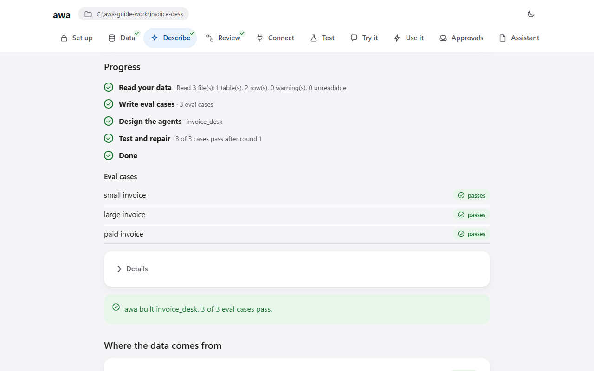
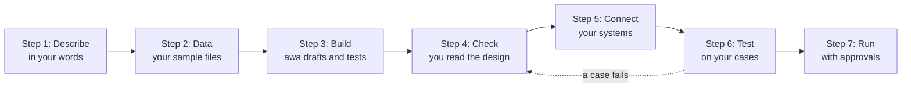
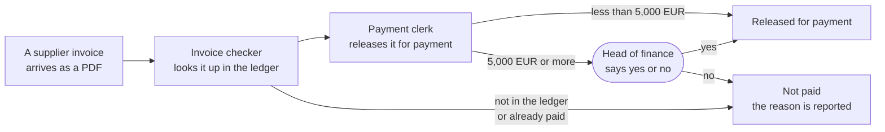
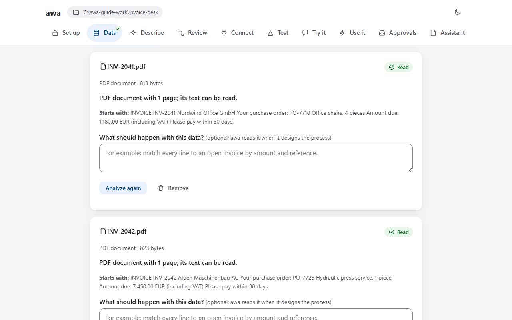
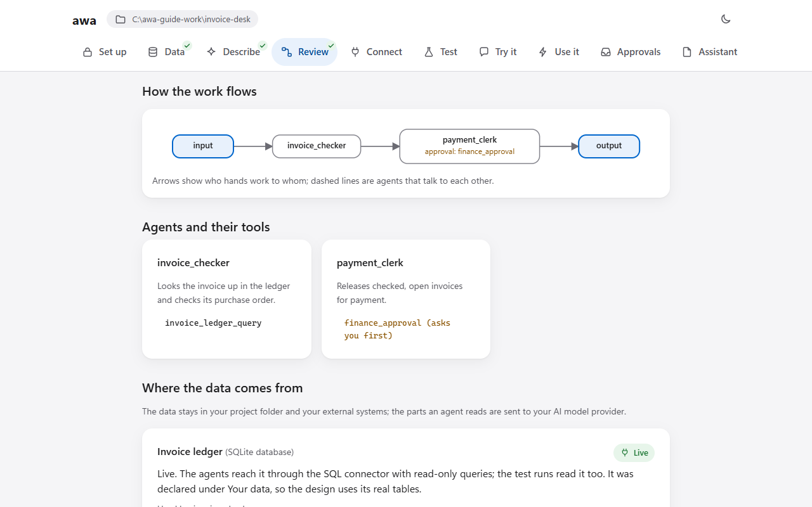
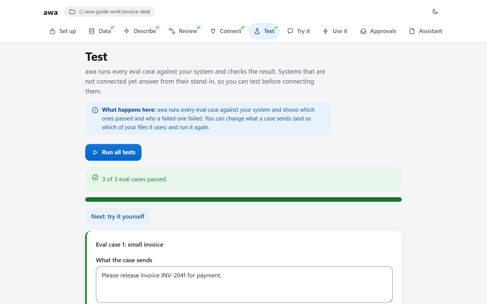
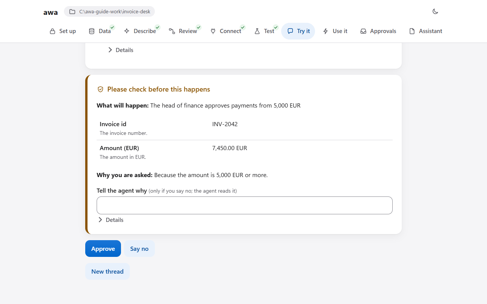
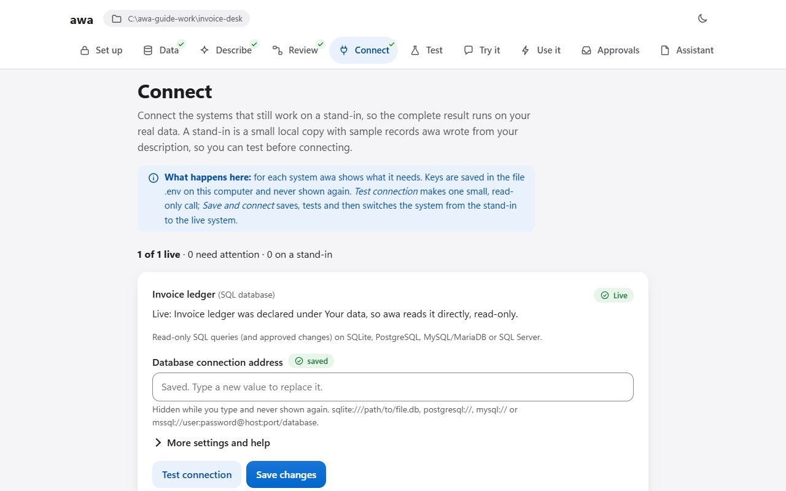
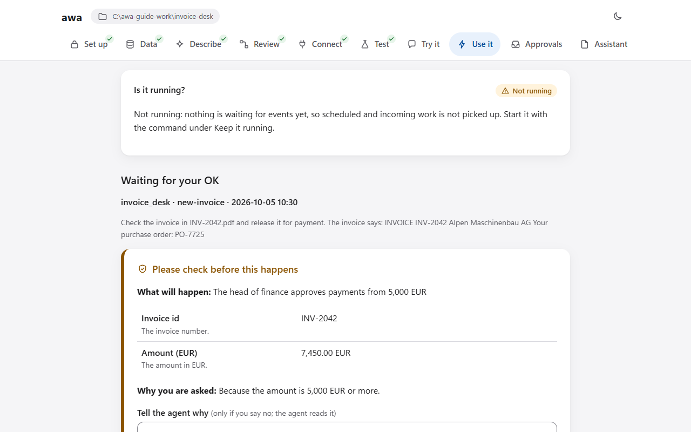
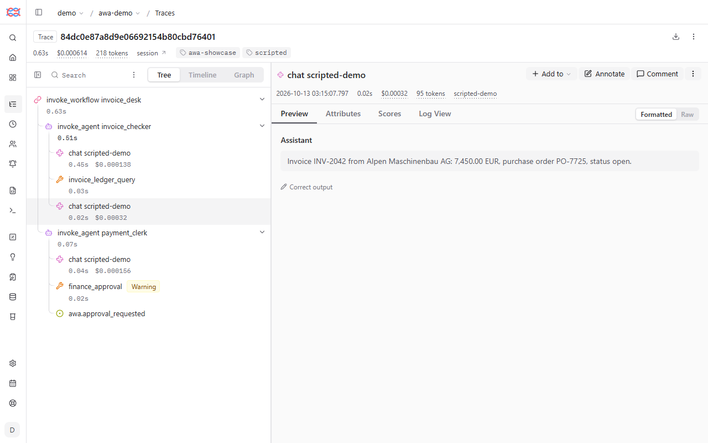

# awa

**awa helps you automate business processes with AI agents that run inside hard limits enforced by code and wait
for a person's OK before the steps you choose. You describe the process in your own words, awa drafts and tests it,
and you decide.**

   

*The web app after a build: awa read the sample files, wrote three test cases from the description, drafted the
agents and reports that 3 of 3 cases pass. You read the draft, change what does not fit and test it on your data.*

## Start here

1. **Install awa.** One command, or a double-click installer if you have no Python: [Install](#install).
2. **Open the web app.** Type `awa ui`. It opens in your browser and asks for the key of your AI provider.
3. **Follow the guided tour.** [The guided tour](docs/guide/tour.md) builds one complete process with sample files,
   screen by screen, in about 30 minutes.

**First just look?** **[The tour in pictures](TOUR.md)** shows the whole way in ten screenshots.

You prefer a terminal to the web app? Take [First automation](docs/start/first-automation.md) instead of the tour.

## How it works

You describe, awa drafts and tests, you check and decide. When the process runs, a person approves the steps that
matter.

An example, the invoice desk of the tour: two agents check each invoice, and from 5,000 EUR the head of finance
decides.

An **agent** is an AI model with one job, its tools and its rules. An **approval** is a person's yes or no before a
step runs. A **test case** is one example with what the process must do with it.

## What you can automate

Processes where something comes in, gets checked against rules and goes out, with a person for the decisions that
matter. Examples that ship with awa as samples:

- **Invoices:** check supplier invoices against orders and a ledger, ask before large payments.
- **Inbox:** sort incoming emails, create a task for the right team and draft a reply.
- **Expenses:** check expense reports and their receipts against the expense policy.
- **Support:** answer order questions, and ask before a refund above 50 EUR.

There are 13 use cases and nine recipes in all, each on sample data.

## What it looks like

**Your files:** awa reads the invoices you bring and shows what is in them.

**The design:** who does what, which step asks you first, before anything runs.

**The tests:** how many of the test cases pass.

**The approval:** the run waits until a person says yes or no.

**Connected systems:** each system is tested with one small read-only call.

**Running by itself:** a trigger starts runs, and the ones that wait for a person show up here.

More screens, step by step: [the tour in pictures](TOUR.md).

## What awa is, and what it is not

| awa is | awa is not |
| --- | --- |
| A local web app and a command line on your computer | A hosted service or a one-click automation |
| A helper that drafts agents and test cases from your words and files | A system that knows your process: you check the design and decide what is right |
| Default limits per run ([run limits](docs/reference/settings.md#run-limits-and-loop-protection)) and approvals for the steps you choose | A guarantee: AI models are not deterministic, so you test on your own cases first |

## Install

| You have | Do this |
| --- | --- |
| Python 3.11 or newer | `pip install "awa-agents[all] @ git+https://github.com/awa-projekt/multiagent_orchestration"` |
| Python 3.11 or newer and the awa folder | in the awa folder: `pip install ".[all]"` |
| Nothing installed (Windows) | double-click [`scripts/install-windows.cmd`](scripts/install-windows.cmd) |
| Nothing installed (macOS) | double-click [`scripts/install-macos.command`](scripts/install-macos.command) |
| Nothing installed (Linux) | `bash scripts/install-linux.sh` |

The installers set up their own Python, put an **awa** shortcut on your desktop and open the web app. Then run
`awa doctor`: it checks the installation and says what is missing. On Windows, use a short folder such as `C:\awa`.
Details and help: [Install](docs/start/install.md).

## See every run

Send the runs to a local [Langfuse](https://langfuse.com) and every step of one run is visible
in the browser. The pictures show one run of the invoice desk:

1. **The trace tree.** Both agents with every model and tool call, and the run's time, cost and tokens.
   

2. **A tool call.** The arguments the agent chose and what came back.
   

3. **The approval pause.** The exact values the person is asked about.
   

4. **A model call.** Each model call with its answer, time, tokens and cost.
   

How to switch it on: [See your runs in Langfuse](docs/guide/langfuse.md).

## Status

- **Beta (1.0.0b1), no production history yet.** It suits a pilot of one to three real processes under control,
  for example invoice checks, inbox triage or spreadsheets from scanned documents.
- **Real runs need a model key** (or a local Ollama) and cost tokens. There is no hosted service.
- What is still missing: [Roadmap](docs/about/roadmap.md).

## For developers

Python, the blueprint file, the API, the architecture and how to work on awa itself:
**[DEVELOPERS.md](DEVELOPERS.md)**. It also shows how to read all docs as a site with `python -m mkdocs serve`.

## License

MIT, see [LICENSE](LICENSE). Security: [SECURITY.md](SECURITY.md).

## About

awa (Agentic Work Automation) is programmed by cd-bits. It is developed within the research project *Agentic Work Automation* (AWA), led by the Fraunhofer Institute for Applied Information Technology FIT, Branch Business & Information Systems Engineering, Augsburg, together with the partners Ancud IT-Beratung GmbH, DATEV eG, Brauerei Gebr. Maisel GmbH & Co. KG and soffico GmbH.

awa is an early, unfinished software library that is still under construction and not yet an interim result of the research project. It provides first core functions for multi-agent systems (agents, teams, workflows, communication between agents, approvals, limits and evaluation) and is meant to become the base on which reference architectures and decision models may later be built. Hybrid multi-agent systems, in which a lead agent delegates work and its members consult each other directly inside limits enforced by code, are tested on it first. The recipes and use cases shipped with awa are small first test cases on sample data: they show that the library applies to many kinds of processes, and the library was extended along them with standard functions such as connections to Microsoft 365, files including scanned PDFs and Excel workbooks, e-mail and databases. Proof in practice follows once the library has been hardened: larger and more complex use cases from companies are then applied to it.

The research project is funded by the Bavarian Transformation and Research Foundation (Bayerische Transformations- und Forschungsstiftung).
