# The tour in pictures

This page shows in pictures how a process comes to life in the awa web app. The example is an **invoice desk**: it
checks supplier invoices against a ledger and asks the head of finance before it releases a payment of 5,000 EUR or
more.

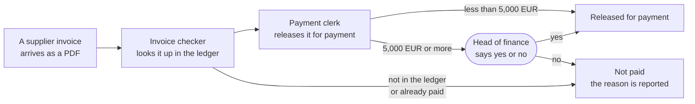

Two **agents** do the work: an agent is an AI model with one job, its tools and its rules. Between them and the
payment stands a person, the head of finance, who gives the **approval**.

You only look here. To do it yourself, step by step with the sample files, follow
**[the guided tour](docs/guide/tour.md)**. It takes about 30 minutes.

## 1. Save your key

Open the web app with `awa ui`. On **Set up** you enter the key of your AI provider once.

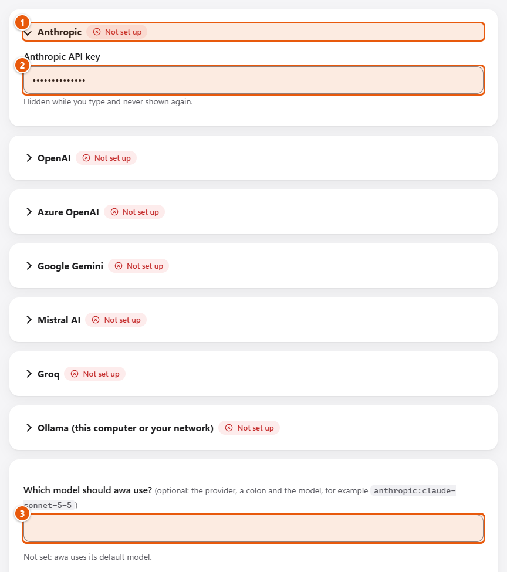

## 2. Bring your files

On **Data** you drop sample invoices and the list of purchase orders. awa reads each file and shows what is in it.

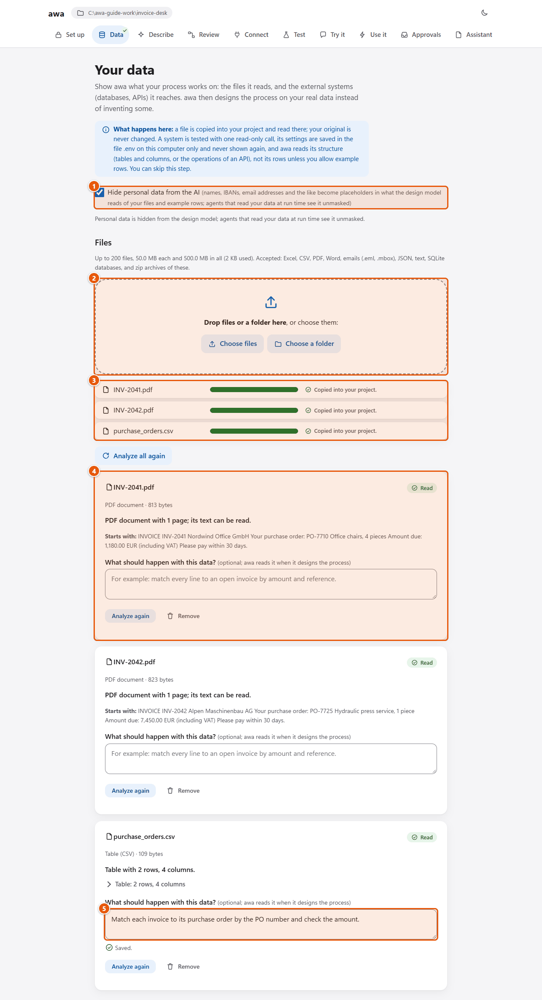

## 3. Connect the ledger

awa tests the connection to the invoice ledger with one small read-only call and shows the tables it found.

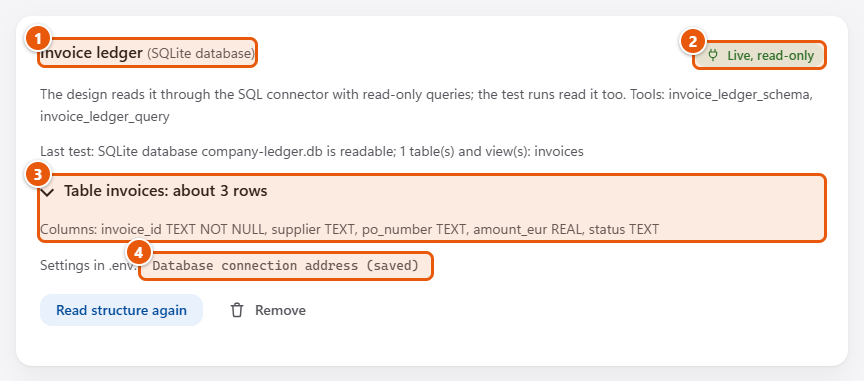

## 4. Describe the process

On **Describe** you write in your own words what happens: invoices arrive, each one is checked, from 5,000 EUR the
head of finance decides.

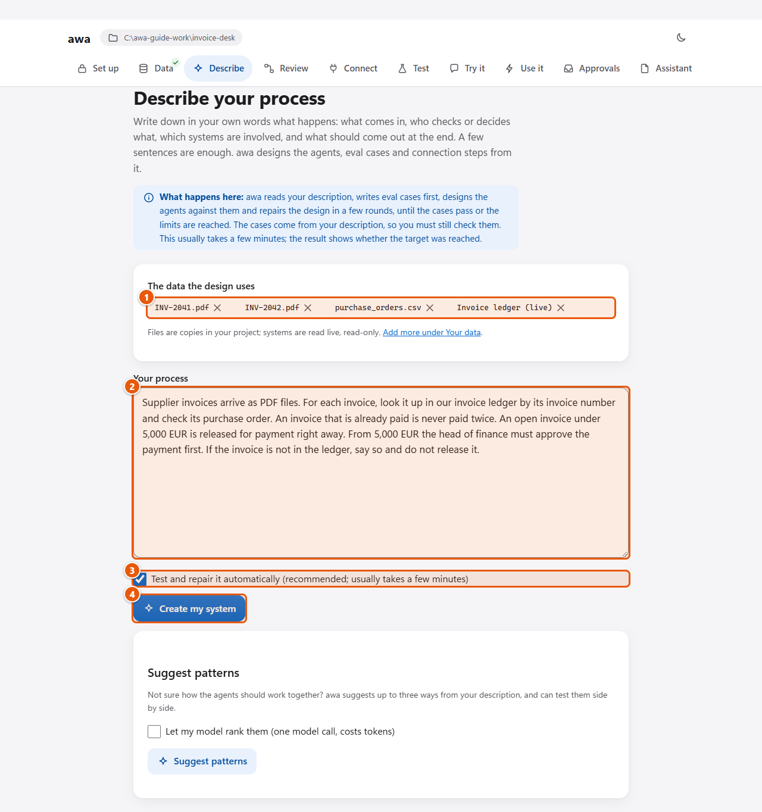

You press **Create my system**. awa writes test cases from your words, drafts the agents and tests them.

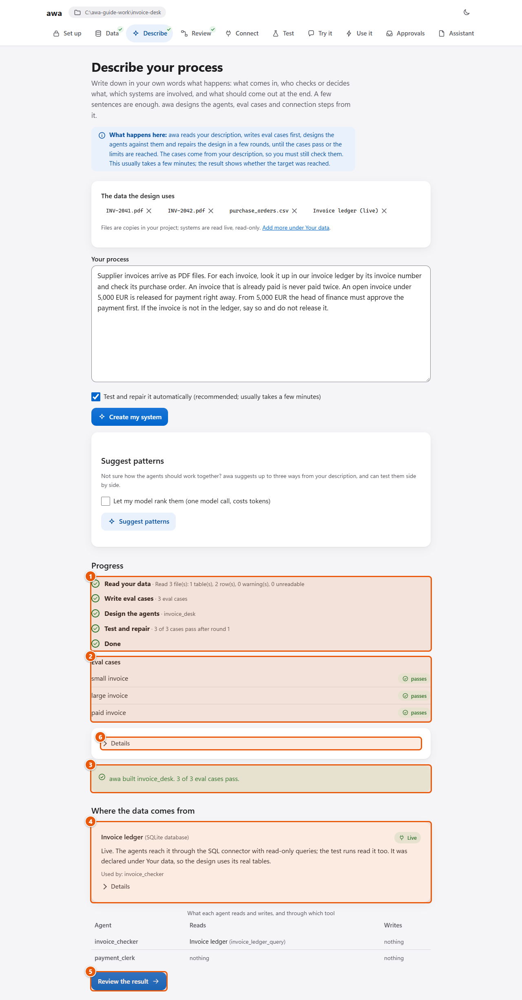

## 5. Review the design

On **Review** you see who does what, which tool asks you first, and where the data comes from. You change what does
not fit your process.

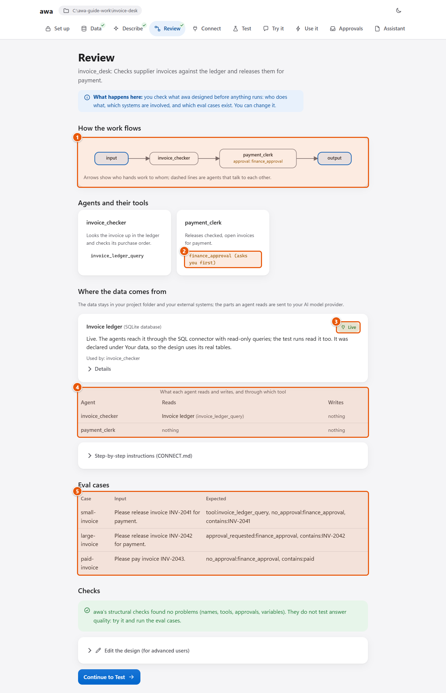

## 6. Run the tests

On **Test** awa runs every test case and shows how many pass.

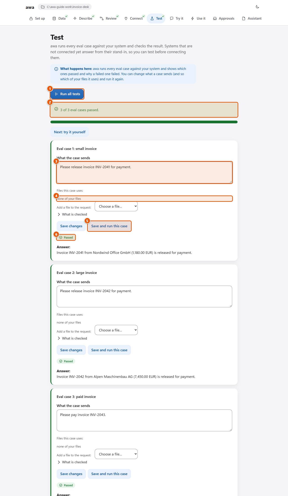

## 7. Try it, with an approval

On **Try it** you send an invoice of 7,450 EUR. The run stops and asks you before the payment.

You press **Approve**, and the run continues exactly where it stopped.

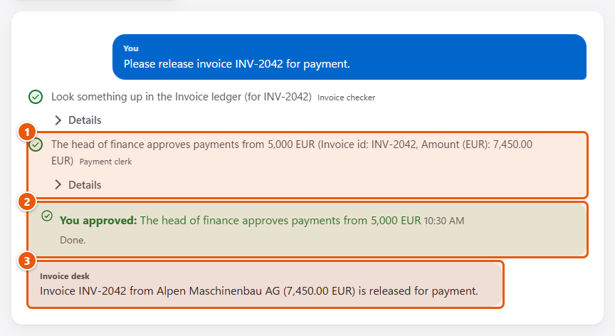

## 8. Let it run by itself

On **Use it** you add a trigger: every PDF that lands in the folder `inbox` starts a run.

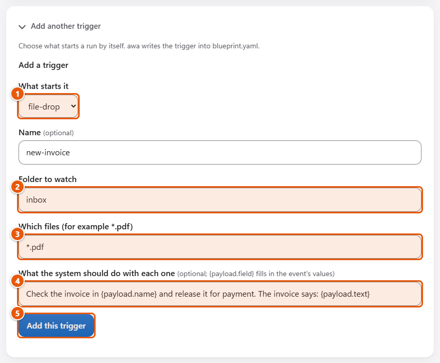

## 9. Answer approvals

Runs that wait for a person collect on **Approvals**, with the values you decide on.

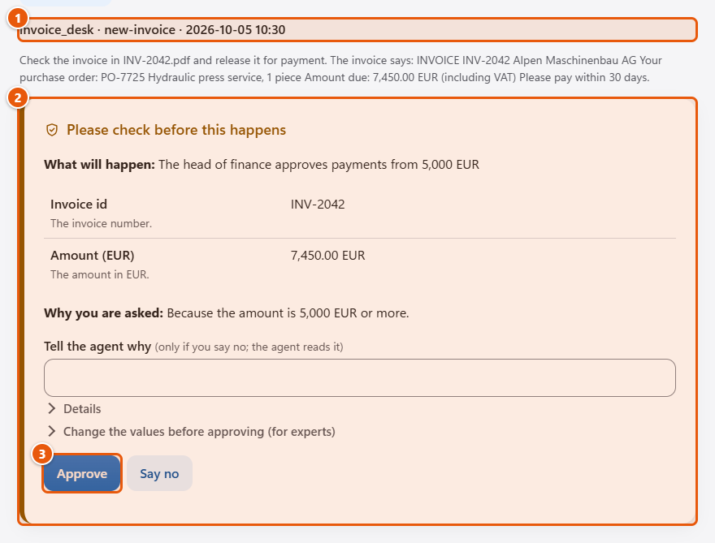

## 10. See what happened

Every run can be followed step by step, here in Langfuse: both agents, every call, the approval, time and cost.

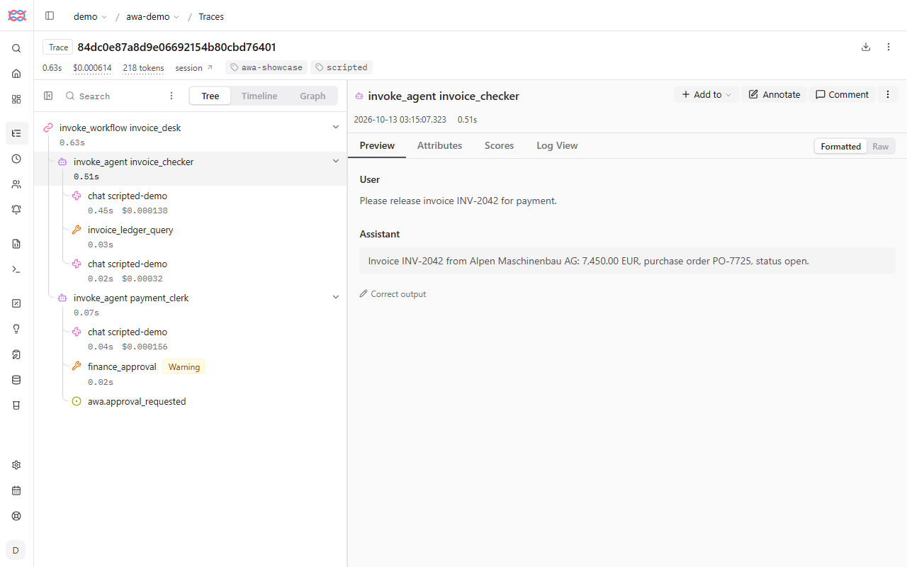

## What you have at the end

A folder with the whole process: the agents, the approval, the connection, the trigger and the test cases. It runs
on your computer. This is a pilot on sample files: before it handles real invoices, you need your own data, a
read-only login to your ledger, test cases from your own invoices that pass, and the agreement of the people
responsible.

**Next:** [the guided tour](docs/guide/tour.md) to do it yourself, or back to the [README](README.md).
