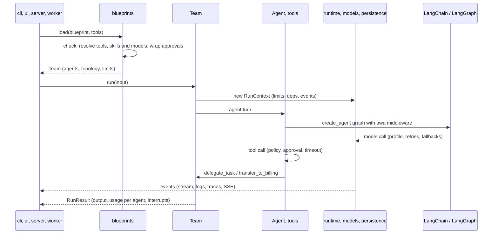

# Architecture

awa builds on LangChain and LangGraph. Agents, teams, workflows, tools, limits and approvals are
plain data and Python. They run through one small engine port, and its only adapter is LangGraph.

Read this page when you change awa itself. It shows the layers, where each concept lives, how a run
flows through the packages, the engine port, how to upgrade LangGraph, and the rules a change
follows. To add your own parts without changing awa, see [Extend](extend.md).

## The layers

awa has six layers. Each may import the layers below it, never the ones above:

| Layer | Responsibility | Packages, from the top |
| --- | --- | --- |
| Interfaces | Running and serving systems for people and machines | `cli`, `checks`, `testing`, `ui`, `project_setup`, `server`, `automation`, `people` |
| Compiler | A process described as data, and its quality | `exporter`, `ext`, `blueprints`, `quick`, `refine`, `evals` |
| Integrations | Company systems, files and ready-made tools | `connectors`, `data`, `toolkits`, `mcp` |
| Orchestration | Several agents working together | `team`, `workflows`, `tasks`, `messaging`, `directory` |
| Runtime | One agent and what it uses while it runs | `agents`, `guardrails`, `memory`, `skills`, `tools`, `persistence`, `observability`, `models`, `runtime`, `plugins` |
| Foundation | Settings, errors, the shared data contracts and the upstream seam | `config`, `core`, `contracts`, `_compat`, `_internal`, `errors`, `kernel` |

A package sits in the layer its imports put it in, which is not always the role its name
suggests. The Interfaces layer also holds the parts that build on the compiler: `automation`
(triggers and process runs) and `people` (the people directory). `ext` is the import surface for
extension authors; it sits next to the compiler because it re-exports helpers from the layers
below, not because it compiles anything.

Inside a layer the order counts too. The block below lists the packages from the top (may import
everything below) to the bottom (imports nothing above); packages joined by `|` are independent of
each other, packages joined by `:` may import each other. It is the order of `.importlinter`, and a
test keeps them equal:

<!-- layers:start -->
```text
cli : checks : __main__
testing
ui | project_setup
server
automation | people
exporter | ext
blueprints : quick
refine
evals
connectors | data
toolkits | mcp
team
workflows
tasks | messaging
directory
agents : guardrails
memory | skills
tools
persistence
observability
models
runtime
plugins
config : core
contracts
_compat : _internal
errors
kernel
```
<!-- layers:end -->

Imports inside a function count; imports under `if TYPE_CHECKING:` do not. A module whose name starts
with `_` is imported only from inside its package. No core module imports an outer part, a part that
builds on the core (`automation`, `people`, `server`, `ui`, the builder modules of `blueprints`, the
agent network, the connectors and checks for Microsoft 365); this boundary is about dependencies,
not stability ([preview parts](../about/stability.md#preview-parts)). `lint-imports` and
`tests/architecture/test_import_contracts.py` check the contracts; the imports that break a rule today
are listed under `ignore_imports` in `.importlinter`.

`awa` itself exports 37 everyday names, grouped by concept in `awa.__all__`, and loads each on
first use, so `import awa` loads neither LangChain nor LangGraph
(`tests/unit/test_import_cost.py`). Everything else is imported from its package
(`from awa.evals import evaluate`); a package exports its public names in `__init__.py` and keeps
its internals in modules whose names start with `_`. A name that is not on `awa` raises an
`AttributeError` that prints the import line to use.

## Where things live

| You think about | Package |
| --- | --- |
| One agent | `awa.agents`, with `awa.tools`, `awa.toolkits`, `awa.skills`, `awa.memory`, `awa.guardrails` |
| Several agents | `awa.team`, `awa.workflows`, `awa.messaging`, `awa.tasks`, `awa.directory` |
| Systems outside | `awa.connectors`, `awa.mcp` |
| Your files | `awa.data` |
| A process as data | `awa.blueprints`, `awa.quick`, `awa.evals` |
| Running and serving | `awa.automation`, `awa.server`, `awa.cli`, `awa.ui`, `awa.observability` |
| Testing | `awa.testing` |
| Plumbing | `awa.core`, `awa.contracts`, `awa.runtime`, `awa.models`, `awa.persistence`, `awa.errors` |
| Export to plain LangGraph code | `awa.exporter` ([Export](export.md)) |

| Package | Responsibility | Start from |
| --- | --- | --- |
| `awa.contracts` | The data every package shares: cards, messages, events, results, usage and limits, `AgentLike` | `RunEvent`, `RunResult`, `Usage`, `UsageLimits` |
| `awa.runtime` | The state of a running run tree: run context, cancellation and deadlines, event streaming, clock and ids | `RunContext`, `cancel`, `subscribe_globally` |
| `awa.models` | Chat model resolution, profiles, resilience, provider errors, the request switch | `resolve_model`, `ModelRegistry`, `ModelSettings` |
| `awa.persistence` | Checkpointers, stores, artifacts, the data store, erasure and retention | `open_checkpointer`, `open_store`, `erase_subject` |
| `awa.agents` | The `Agent` and the middleware that connects its graph to the run context | `Agent`, `AgentHooks` |
| `awa.tools` | The tool contract: approval, hardening, idempotency, risk, policies, toolboxes | `tool`, `Toolbox`, `harden_tool` |
| `awa.team` | `Team` and `AgentNetwork` with their limits | `Team`, `TeamLimits`, `AgentNetwork` |
| `awa.workflows` | `Sequential`, `Parallel`, `Loop`, `Map`, `Checked`, `ProcessWorkflow` | `Sequential`, `ProcessWorkflow` |
| `awa.blueprints` | The blueprint schema; checking, building and explaining it; designing a project from a description and files | `Blueprint`, `load`, `aload` |
| `awa.evals` | Datasets, scorers, the model judge, the runner, reports and baselines | `evaluate`, `Dataset`, `EvalReport` |
| `awa.server` | The HTTP API, its router, data endpoints, jobs and the MCP server | `create_app`, `create_router`, `ServedSystem` |
| `awa.automation` | Triggers, durable process runs and the worker | `Automation`, `Worker` |
| `awa.observability` | Subscribers, OpenTelemetry and Langfuse, run traces, the audit trail, redaction | `OpenTelemetrySubscriber`, `AuditLog` |

The [API reference](../reference/index.md) has every public name. Preview parts work and are tested
but carry no stability promise yet: a preview module declares `__stability__ = "preview"`, and the
public API snapshot keeps its names, backend protocols and commands apart from the stable ones.
[Stability](../about/stability.md) lists them.

### Where a change goes

| You add | It goes in |
| --- | --- |
| A built-in tool | a module of `src/awa/toolkits` and its entry in `src/awa/toolkits/_catalog.py` |
| A SaaS connector | a `ConnectorSpec` (data only) in `src/awa/connectors/_saas.py` |
| A built-in skill | a folder with `SKILL.md` in `src/awa/skills/builtin` |
| An event type | `src/awa/contracts/events.py` and the `RunEvent` union |
| An exception | `src/awa/errors.py`, below `AwaError` |
| A setting | `src/awa/core/settings.py` (an `AWA_*` variable) |
| A blueprint field | `src/awa/blueprints/_schema_agent.py`, `src/awa/blueprints/_schema_structure.py` or `src/awa/blueprints/_schema_policy.py`; checked in `src/awa/blueprints/_check.py`, built in `src/awa/blueprints/_build.py` |
| A scorer | `src/awa/evals/scorers.py`, with its short form in `src/awa/evals/specs.py` |
| A trigger | a class on `src/awa/automation/_trigger_base.py`, exported from `src/awa/automation/triggers.py` |
| A command | a `_<group>.py` module of `src/awa/cli` with `add_<command>`, listed in `awa.cli.COMMANDS` |
| An upstream API | the matching module of `src/awa/_internal/upstream` |

## How a run flows

`awa run support.yaml "Order 1001 arrived broken."` crosses every layer once:



1. A command, the web app, an HTTP request, a trigger or your own code receives the request.
2. `Blueprint.check` validates the schema, every reference, the topology and the risk of each
   agent's tools, without side effects; `build` resolves tools (your functions, `builtin:`,
   `connector:`, `mcp:`, import references), skills, models and approvals and constructs the agents
   and the team, workflow or network. Code that builds systems directly skips this step.
3. The run gets a `RunContext` (run id, limits, deadline, deps, event emitter). The team's graph runs
   the agent holding control for one turn at a time.
4. The agent runs its `create_agent` graph through awa's middleware. Models come from a profile with
   retries, fallbacks and a circuit breaker; tool calls go through policy, approval, timeout and
   output limits.
5. A delegation, consultation, handoff, agent used as a tool or workflow step starts a child run
   that shares the parent's usage, limits and event stream. A gated tool raises a LangGraph
   interrupt; the outermost checkpointed graph saves the state and the run returns with
   `result.interrupts`.
6. Events reach every subscriber of the run tree: `stream()`, hooks, logs, spans, Server-Sent
   Events, the evaluation trace.

### Inside an agent

`Agent` builds one `create_agent` graph on its first run and wraps model and tool calls in
middleware, outermost first:

| Middleware | Does |
| --- | --- |
| Control | Renders the system prompt (instructions, skills, memory note), enforces `max_steps`, repairs invalid structured output, keeps parallel approval pauses in tool-call order |
| Tool policy | Decides every tool call: run, ask a person, change the arguments, refuse |
| Yours | `middleware=[...]`; a team adds the middleware that delivers notes and handbacks before each model call |
| Compaction | Summarizes older turns over a token budget |
| Resilience | Retries, fallbacks and the circuit breaker |
| Run tracking | Blocks real requests when disabled, records usage per call, emits model and tool events, checks `UsageLimits` |

Input guardrails run before the graph and output guardrails on the final answer; `output_type`
becomes `create_agent`'s `response_format`.

### The run tree

Every run started inside another run gets a child `RunContext` that shares the parent's usage
accumulator, limits and event emitter. `UsageLimits` apply to the whole tree and
`result.usage.by_agent` breaks the total down; one stream sees every event of the tree, and
`root_run_id`, `run_id`, `parent_run_id` and `depth` rebuild it; `cancel(run_id)` or a deadline stops
the whole tree. A `Team` compiles to a LangGraph graph with one node that runs the agent holding
control; an `AgentNetwork` runs a coordinator loop over a task board; workflows compile to a graph
with one node per step. All of them are `AgentLike` (`name`, `card`, `run`), so any of them can be a
team member, a workflow step, a served system or an evaluation target.

## Rules for a change

Every module of `src/awa` has one role, written down in `tests/architecture/roles.toml`:

| Role | What it is | May import |
| --- | --- | --- |
| domain | Run semantics and logic: agents, teams, workflows, tools, memory, tasks | backend protocols, other domain code, `core`, `contracts`, the upstream seam |
| backend protocol | An interface the domain needs: a `Protocol`, or a one-method callable | `core`, `contracts` |
| backend | The only code that touches a driver (PostgreSQL, SQLite, SMTP, HTTP, a process) | backend protocols, `core`, its driver |
| root | Chooses and wires backends: command line, server, web app, blueprint builder, the `open_*` factories | everything except test support |
| testing | `awa.testing`: doubles and contract suites | public names of awa |
| seam | `awa._internal.upstream` and `awa._compat`: the only importers of LangChain, LangGraph and the MCP SDK besides `awa.kernel`, which imports no other awa module | upstream |

- Dependencies point inward: domain code imports backend protocols, never a backend or a root.
- Drivers (`psycopg`, `sqlite3`, `smtplib`, `urllib.request`, ...) are imported only in backend
  and root modules, optional ones inside the function, and their absence raises
  `OptionalDependencyError` with the extra to install (ruff rule `TID251`, `src/ruff.toml`).
- Every driven backend protocol has one contract suite, and every backend passes it
  ([Extend](extend.md#backend-protocols)). A protocol changes by addition only.
- Production code never knows that tests exist: no import of `awa.testing` or `pytest`, no test
  switch. Defaults are safe; a relaxation is an explicit argument. Time and ids are injected.
- A public name, a stored format or an exception class changes only on purpose:
  `tests/unit/test_public_api_snapshot.py` compares `tests/fixtures/public_api.json` ([Stability](../about/stability.md#what-a-version-number-promises)).

```console
python -m pytest tests/architecture
python -m pytest tests/contracts
python -m ruff check src
```

How the guards count their findings against a baseline is in `CONTRIBUTING.md`.

## The engine port

awa holds agents, prompts, tools, skills, limits, approvals and run records as plain data and
Python functions; the execution engine underneath only builds and runs graphs. Agents, teams
and workflows reach it through one port, `awa.runtime.engine.Engine`, never through LangGraph
directly:

| Operation | What it does |
| --- | --- |
| `build_agent(AgentSpec)` | Builds a tool-calling agent from its model, tools, middleware, output type and checkpointer |
| `run(handle, input, RunOptions)` | Runs new input, a `Resume` or the continuation of a stopped thread; returns the final state and the pending `Pause`s |
| `state(handle, thread_id)` | Reads a saved thread: its values, pending pauses and whether it stopped mid-run |
| `pause(value)`, `has_decision()` | Stops a node or tool until a decision arrives (approvals, `wait_for_event`, escalations); tells whether a resume brought one |
| `pauses(error)`, `control_flow`, `is_step_limit(error)` | Tell a pause or a handoff from a failure, and a used-up step budget from other errors |
| `in_thread()`, `detached()`, `outside_run()` | Whether a pause can be saved, and how background tasks and networks leave the enclosing run |

The port works per run, not per step, so it costs one context-variable lookup per run.
Limits, approvals, events and usage stay in awa: the engine receives a step bound, a
durability flag and the middleware list, and nothing else decides. `current_engine()` returns
the LangGraph engine (`awa.runtime._langgraph`) unless `use_engine(engine)` set another one for
the block. The engine tests (`tests/unit/test_runtime_engine.py`) run the same agents, tool
calls, pauses and resumes on the LangGraph engine and on a small engine without LangGraph. A
guard test rejects LangGraph's build, pause and step-limit primitives anywhere outside the
adapter, the seam, the exporter, the kernel and LangGraph-specific modules (`from_langgraph`,
checkpointer and store backends, their contract suites).

What stays LangChain-specific on purpose: messages, tools and chat models are the interchange
format for providers and MCP, the middleware classes are the hook mechanism the port passes
through, checkpointers and stores keep LangGraph's types, and teams and workflows still compile
their graphs with LangGraph's `StateGraph` before they run through the port. `awa export` is a
code generator, not an engine: it writes LangGraph source from the validated blueprint
([Export](export.md)).

## Upgrading LangGraph

A new LangChain or LangGraph release affects only the upstream seam and the engine adapter, and
both are tested continuously. The seam `awa._internal.upstream` imports LangChain and LangGraph,
one module per area, and the engine adapter `awa.runtime._langgraph` builds on it; `awa._compat`
holds the MCP SDK, and `awa.kernel`, which imports no other awa module, is the only other direct
importer. Ruff's banned-import rule (`src/ruff.toml`) refuses an upstream import in any other
module, except in the files the exporter copies into an exported project. The ranges in
`pyproject.toml` stay open within the major version (`langchain>=1.4.3,<2`,
`langgraph>=1.2.14,<2`), and their floors guarantee every name the seam uses.

1. Install the new release inside the range: `pip install -U langchain langgraph`.
2. Run `python -m pytest tests/upstream tests/unit/test_runtime_engine.py`. The upstream tests hold
   one test for every upstream behavior awa relies on and name the awa module behind each broken
   contract; the engine tests run agents, tool calls, pauses, resumes, step limits and run options
   through the adapter.
3. Fix the seam or the adapter, never their callers, and run the full suite.

A new major version is outside the range until an awa release widens it. Scheduled CI jobs run the
same tests against the lowest and the newest allowed releases
([Upstream versions](../about/stability.md#python-langchain-and-langgraph)). In your own code, import LangChain
and LangGraph from their public locations.

## Design principles

- **Models decide within limits; code enforces them.** Steps, tokens, cost, delegation depth,
  parallelism, handoffs and timeouts are counters in Python, never requests in a prompt.
- **Typed contracts at every boundary.** Structured output is validated; results, events, cards and
  messages are pydantic models; `AgentLike` lets every runnable stand in for every other.
- **Content from other agents is data.** Delegated results, notes, task text and tool output reach a
  model as labeled blocks, never as instructions.
- **One run tree.** Delegations, consultations, handoffs and nested systems share one usage total,
  one set of limits and one event stream.
- **Explicit topology.** Each agent gets exactly the delegation and messaging tools its declared
  edges allow.
- **Failures inside collaboration are results.** A failing member returns an error result to its
  caller; only limits, cancellation and approval pauses cross run boundaries.
- **Offline first.** Every system can be tested without a network, and real model requests can be
  blocked for the whole process.
- **Fast to import.** Names load on first use; `import awa` and `awa --help` load neither LangChain
  nor a feature package.
