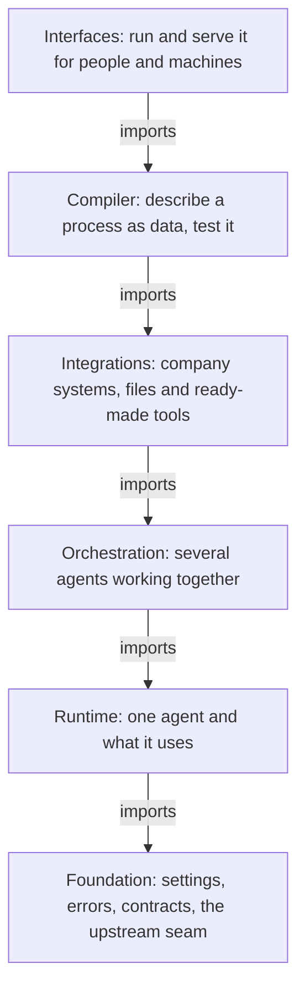

# Project map

This page is a map of the awa repository: where something lives, what it is for, and where its tests and docs
are. A test keeps it true: every package under `src/awa` is on this page, and every package on this page exists.

## The folders of the repository

| Folder | What it holds |
| --- | --- |
| `src/` | The library: the Python package `awa`, split into the packages below |
| `tests/` | Every test: `unit/` (offline, no key), `examples/` (the runnable examples and use cases), `proof/` (the core proof with scripted models), `architecture/` (the structure guards and the import contracts), `contracts/` (every backend against its backend protocol), `upstream/` (what awa relies on in LangChain and LangGraph), `integration/` (PostgreSQL and other real services, skipped without them), `property/`, `typing/` (`assert_type` checks of the public API types, run by `mypy tests/typing`), `docs/` (the checks of the documentation, run as their own CI job), `_helpers/` (shared test helpers) and `fixtures/` |
| `docs/` | These pages: `start/`, `guide/` (the walk-through with screenshots), `develop/`, `reference/`, `about/` |
| `examples/` | Small programs numbered `01_` to `11_`, plus `blueprints/`, `recipes/`, `usecases/`, `benchmarks/` and `evals/` |
| `deploy/` | Reference deployment files: the Dockerfile, a Docker Compose setup with PostgreSQL, a TLS edge and Langfuse, placeholder settings ([Production](production.md#reference-setup-with-docker-compose)) |
| `scripts/` | Tools for maintainers and the installers: screenshots, the architecture baseline, the generated schemas |

## The layers

A package may import only the layers below it, and inside a layer only the packages listed after it
(`.importlinter` holds the order; `lint-imports` and a test check every module). The interfaces sit on top,
the foundation at the bottom.

## The packages of `src/awa`

Tests are in `tests/unit/` unless the path says otherwise. Pages: [Architecture](architecture.md) explains the
layers, [API reference](../reference/index.md) has every name.

| Package | What it is for | Layer | Tests | Docs |
| --- | --- | --- | --- | --- |
| `awa._compat` | The one door to the MCP client and server SDKs | Foundation | `tests/unit/test_compat_*.py`, `tests/upstream/test_*.py` | [Compatibility](../about/stability.md#python-langchain-and-langgraph) |
| `awa.core` | Settings, logging, ids, redaction, shared plumbing | Foundation | `tests/unit/test_core_*.py` | [Runtime](../reference/api/core.md#awa.runtime), [Exceptions](../reference/exceptions.md) |
| `awa.contracts` | The data every package shares: cards, messages, events, results, limits | Foundation | `tests/unit/test_contracts_*.py` | [Contracts](../reference/api/core.md#awa.contracts) |
| `awa.runtime` | The state of a running system: context, stop button, clock and ids | Runtime | `tests/unit/test_runtime_*.py` | [Runtime](../reference/api/core.md#awa.runtime), [Backend protocols](extend.md#backend-protocols) |
| `awa.models` | Chat model choice, retries, fallbacks | Runtime | `tests/unit/test_models_*.py` | [Models](models.md) |
| `awa.persistence` | Saved state: checkpoints, artifacts, run records | Runtime | `tests/unit/test_persistence_*.py` | [Memory](memory.md), [Persistence](../reference/api/data.md#awa.persistence) |
| `awa.config` | Where settings come from: the one `.env` loader and the settings registry | Foundation | `tests/unit/test_config_loader.py`, `tests/unit/test_settings_registry.py` | [Configuration](configuration.md), [Settings reference](../reference/settings.md) |
| `awa.kernel` | The small rules everything builds on: conditions and redaction; imports no other awa module (preview) | Foundation | `tests/architecture/test_kernel_isolation.py`, `tests/unit/test_core_redaction.py` | [Observability](../reference/api/server.md#awa.observability) |
| `awa._internal` | Private plumbing shared by several packages: the upstream seam to LangChain and LangGraph (`upstream`), retry, serialization, HTTP client, sandbox, ids, logging | Foundation | `tests/unit/test_core_*.py` | [Architecture](architecture.md) |
| `awa.ext` | The import surface for extension authors: redactors, ids, logging and the sync-over-async runner (preview) | Compiler | `tests/unit/test_ext_door.py` | [Architecture](architecture.md) |
| `awa.errors` | Every error awa raises, importable from one place | Foundation | `tests/unit/test_core_exceptions.py` | [Exceptions](../reference/exceptions.md) |
| `awa.agents` | The `Agent`: instructions, tools, skills, memory, run, resume; `graph_agent` runs an existing LangGraph graph as an agent | Runtime | `tests/unit/test_agents_*.py` | [Agents](agents.md) |
| `awa.tools` | Making tools and making tool calls safe (approval, limits, risk); `importing` brings in LangChain tools | Runtime | `tests/unit/test_tools_*.py` | [Tools](tools.md) |
| `awa.toolkits` | The ready-made tools: files, data, SQL, documents, web, mail | Integrations | `tests/unit/test_toolkits_*.py` | [Toolkits](tools.md#builtin-toolkits) |
| `awa.data` | A profile of your files, made without a model; safe intake; the parser backend protocol (preview) | Integrations | `tests/unit/test_data_*.py` | [The data profile](data.md), [Write a parser](extend.md#write-a-parser) |
| `awa.skills` | Reusable know-how loaded from `SKILL.md` files; `importing` brings in skill folders and prompts | Runtime | `tests/unit/test_skills_*.py` | [Skills](skills.md) |
| `awa.memory` | Long-term memory and shortening of long conversations | Runtime | `tests/unit/test_memory_*.py` | [Memory](memory.md) |
| `awa.guardrails` | Deterministic checks of inputs and outputs | Runtime | `tests/unit/test_*guardrail*.py` | [Guardrails and limits](safety.md#limits) |
| `awa.team` | `Team` and `AgentNetwork` (preview): delegation, consulting, handoffs | Orchestration | `tests/unit/test_team_*.py` | [Teams](teams.md), [Agent network](teams.md#agent-networks) |
| `awa.workflows` | Steps in order, in parallel or in a loop | Orchestration | `tests/unit/test_workflows_*.py` | [Workflows](workflows.md) |
| `awa.messaging` | The message bus, who may talk to whom, the blackboard (preview) | Orchestration | `tests/unit/test_messaging_*.py` | [Collaboration](teams.md#shared-state-notes-blackboard-directory-and-task-board) |
| `awa.tasks` | The shared task board and per-agent planning (preview) | Orchestration | `tests/unit/test_tasks_*.py` | [Collaboration](teams.md#shared-state-notes-blackboard-directory-and-task-board) |
| `awa.directory` | Who does what, and whether they are available (preview) | Orchestration | `tests/unit/test_directory_*.py` | [Collaboration](teams.md#shared-state-notes-blackboard-directory-and-task-board) |
| `awa.connectors` | Links to external systems, and the engine behind them | Integrations | `tests/unit/test_connectors_*.py` | [Connectors](connectors.md), [Write a connector](connectors.md#write-a-connector) |
| `awa.mcp` | The tools of MCP servers as agent tools | Integrations | `tests/unit/test_*mcp*.py` | [MCP](mcp.md) |
| `awa.people` | Find colleagues in Entra ID or a local list, pin them to roles, `role:` recipients (preview) | Interfaces | `tests/unit/test_people_*.py`, `tests/contracts/test_people_directory.py` | [Microsoft 365](../guide/microsoft-365.md) |
| `awa.blueprints` | A process as data: schema, check, build, design, build on your files | Compiler | `tests/unit/test_blueprints_*.py` | [Blueprints](blueprints.md) |
| `awa.quick` | A running team from names and tasks in one call | Compiler | `tests/unit/test_blueprints_short_forms.py` | [Blueprints](blueprints.md) |
| `awa.refine` | Refinement hooks of a project's `refine.py`: chat model and middleware in, out | Compiler | `tests/unit/test_blueprints_refine.py` | [Test and improve](../guide/test.md) |
| `awa.exporter` | Eject a project with one agent into a standalone LangChain and LangGraph project | Compiler | `tests/export/`, `tests/unit/test_exporter_*.py` | [Export](export.md) |
| `awa.evals` | Eval cases, scorers, the judge, reports | Compiler | `tests/unit/test_evals_*.py` | [Testing](testing.md) |
| `awa.templates` | The files of `awa init` and `awa new` (data, no code) | Compiler | `tests/unit/test_cli_init.py` | [Command line](../reference/cli.md) |
| `awa.server` | Systems as an HTTP API, jobs and MCP; the data endpoints (preview) | Interfaces | `tests/unit/test_server_*.py` | [Serving](serving.md), [The data API](data.md#the-data-endpoints) |
| `awa.automation` | Triggers, durable process runs, the worker, approvals (preview) | Interfaces | `tests/unit/test_automation_*.py` | [Blueprints](blueprints.md), [Automation](../reference/api/server.md#awa.automation) |
| `awa.observability` | Event subscribers, traces, OpenTelemetry, the audit log | Runtime | `tests/unit/test_observability_*.py` | [Observability](observability.md) |
| `awa.testing` | Offline test doubles; contract suites (`awa.testing.contracts`, preview) | Interfaces | `tests/unit/test_testing_*.py`, `tests/contracts/test_*.py` | [Testing](testing.md), [Write a store backend](extend.md#write-a-store-backend) |
| `awa.checks` | `awa check`: small read-only checks of Microsoft 365 (preview) | Interfaces | `tests/unit/test_checks.py`, `tests/unit/test_connect_microsoft.py` | [Connect Microsoft 365](../guide/microsoft-365.md) |
| `awa.plugins` | One registry of plugins (project folder, installed packages, built-ins) and the part switches; `awa plugins` | Runtime | `tests/unit/plugins/` | [Plugins](extend.md#plugins) |
| `awa.ui` | The local web app behind `awa ui` (preview) | Interfaces | `tests/unit/test_ui_*.py` | [The web app](../guide/web-app.md) |
| `awa.project_setup` | `awa setup` and `awa.setup()`: the model key, database and tracing, and local services in Docker | Interfaces | `tests/unit/test_setup_*.py` | [Set up a project](../guide/setup.md) |
| `awa.cli` | The `awa` command | Interfaces | `tests/unit/test_cli_*.py` | [Command line](../reference/cli.md) |
| `awa.__main__` | `python -m awa` | Interfaces | `tests/unit/test_cli.py` | [Command line](../reference/cli.md) |

## Where to put a change

[Architecture](architecture.md#where-a-change-goes) lists the module for each kind of change, and
[Architecture rules](architecture.md#rules-for-a-change) the checks that every change passes.
