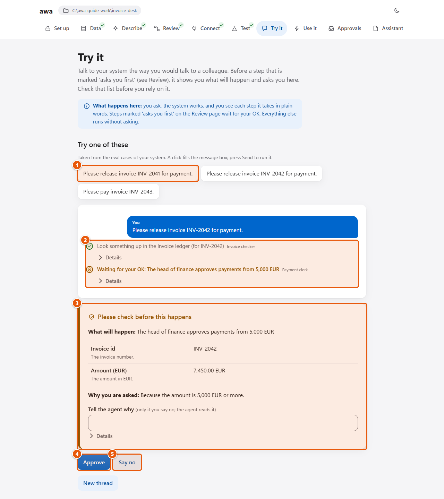
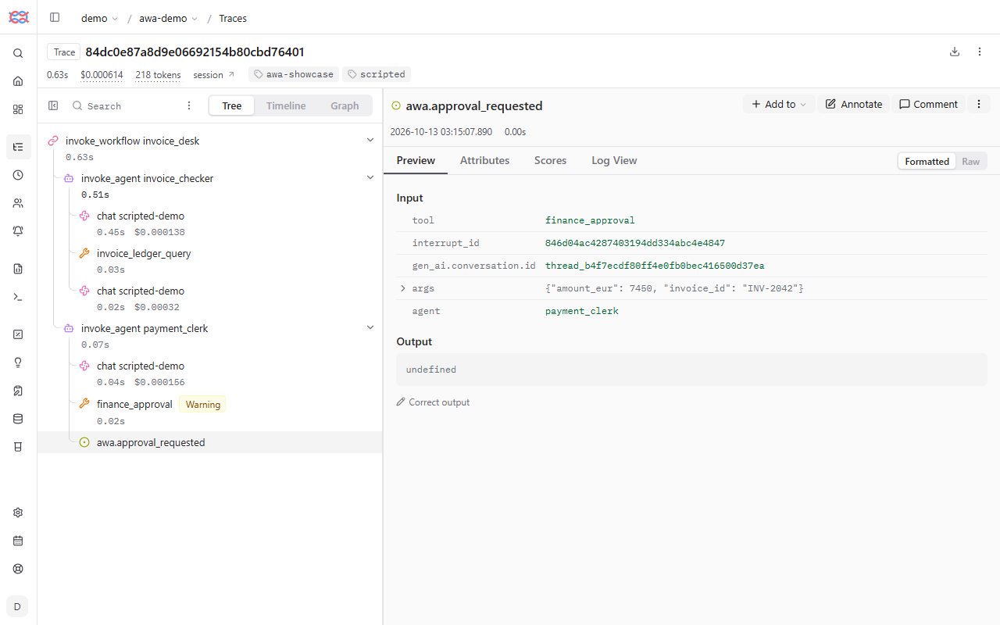
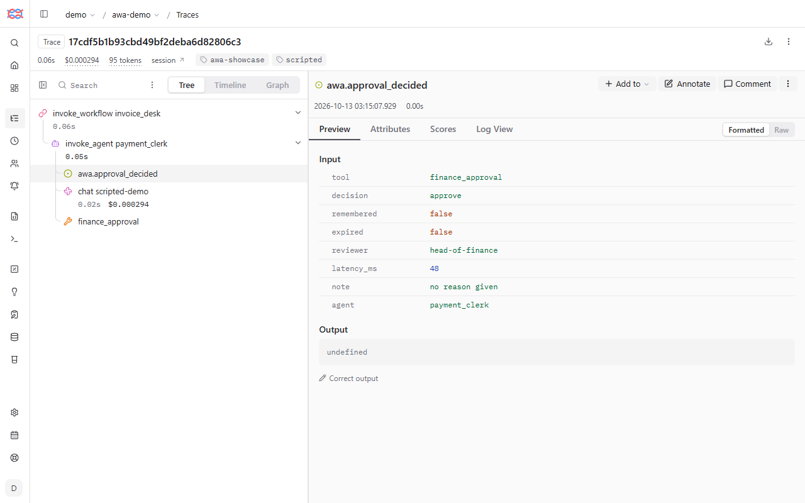

# Approvals

An [approval](../reference/glossary.md#approval) makes a tool call wait for a person's decision before it runs. Use
it for every step that changes data, sends something or cannot be undone. awa enforces it in code, so a model cannot
talk its way past a gated call.

To add one, list the tool under `approvals:` in `blueprint.yaml`, with a `when` condition if only some calls should
wait:

```yaml
approvals:
  - tool: connector:tickets.create_issue      # every call
  - tool: book_payment
    when: "amount >= 10000"                    # only from 10,000 on
  - tool: connector:mail.send_email
    when: "not endswith(to, '@example.com')"   # only mail leaving the company
```

The run stops before the call. The person sees which agent wants to do what, with which values. In the web app this
is the card **Please check before this happens** (step 8 of the [tour](tour.md)). It shows what will happen, the
values (amounts with their currency, dates written out) and why you are asked, for example *because the amount
is 5,000 EUR or more*:



--8<-- "docs/assets/screenshots/guide/a08-try-approval.legend.txt"

The person answers in one of three ways:

| Answer | Effect |
| --- | --- |
| **Approve** | The call runs. |
| **Say no**, with a note | The call does not run. The agent reads the note (**Tell the agent why**) and can explain or try another way. |
| **Approve with changes** | The call runs with the values you corrected, for example a lower amount. In the web app: **Change the values before approving (for experts)**, which takes a JSON object; in a terminal: `awa runs decide RUN_ID --approve --edit-args "@values.json"`. |

A double click cannot send the answer twice. A waiting run holds no resources. With the runs kept in the project
folder (`.awa`), the decision can come days later from any program on this computer, and the run continues where it
stopped. A decision from another computer needs the runs in PostgreSQL
([Keep it running](operate.md#when-many-people-depend-on-it)).

## What asks first without you doing anything

- Every connector operation that changes something: creating a ticket, sending an email, posting a message, changing
  a record. `requires_approval: false` on a connector switches this off, and `awa validate` then warns.
- Built-in tools that act outside: sending email, posting to a webhook, writing, moving or deleting files, changing a
  database.
- In a system from `awa build`: every step that changes data or sends something, and every decision your description
  leaves to a person.
- A function of your own in `tools.py` waits only when it is listed under `approvals:` or marked by its developer.
  `awa show` lists every tool that waits.

## The condition

`tool` is the name exactly as in the agents' `tools`. An approval on `connector:tickets` covers every operation of
that system. Without `when`, every call waits; with `when`, only the calls where the condition is true. A condition
uses the inputs of the tool (`awa show` and `awa connectors show NAME` list them):

| You write | Meaning |
| --- | --- |
| `amount >= 5000`, `==`, `!=`, `<`, `<=`, `>` | Compare numbers or text. |
| `and`, `or`, `not` | Combine conditions. |
| `country in ['DE', 'AT']`, `not in` | One of a list. |
| `amount * quantity > 1000` | Arithmetic with `+ - * /`. |
| `contains(recipient, '@partner.example')`, `startswith(...)`, `endswith(...)` | Text tests. |
| `lower(...)`, `upper(...)`, `len(...)`, `number(...)`, `empty(...)`, `abs(...)`, `round(...)`, `min(...)`, `max(...)` | Helpers. |

A condition that cannot be worked out, for example because a value is missing, **asks**. A condition that is false
does not ask, so test both sides of every limit.

### Change the amount, and let the tests catch it

Say your head of finance decides from 10,000 EUR, not 5,000. Copy `invoice-desk` of the tour to `desk-10k` and
change the condition:

<!-- guide:do cd . -->
<!-- guide:do copy invoice-desk desk-10k -->
<!-- guide:do cd desk-10k -->
<!-- guide:do replace desk-10k/blueprint.yaml "amount_eur >= 5000" "amount_eur >= 10000" -->
<!-- guide:contains blueprint.yaml -->
```yaml
approvals:
- tool: finance_approval
  when: amount_eur >= 10000
```

<!-- guide:run exit=1 -->
```console
$ awa eval blueprint.yaml evals/cases.yaml
Evaluation: invoice_desk
========================

System invoice_desk on dataset invoice_desk: 3 case(s) x 1 repetition(s).

- Pass rate: 66.7% (2/3 runs)
- Errors: 0
...
Cases
-----

  case           passed  scores                                                                                      ms  tokens
  small-invoice  1/1     tool:invoice_ledger_query 1.00, no_approval:finance_approval 1.00, contains:INV-2041 1.00  387    1121
  large-invoice  0/1     approval_requested:finance_approval 0.00 (failed), contains:INV-2042 1.00                  385    1121
  paid-invoice   1/1     no_approval:finance_approval 1.00, contains:paid 1.00                                      289     793

Failures
--------

- large-invoice (repetition 1): approval_requested:finance_approval: approval for finance_approval requested 0 time(s), wanted 1..n (requests: none) (decisions applied: none; 1 never asked for)
evaluation failed: pass rate 66.7% (minimum 100.0%)
```

The case of the 7,450 EUR invoice expects an approval that no longer comes. It fails, and `awa eval` ends with exit
code 1. Now you decide. If the new rule is right, change the case too (its invoice must be above 10,000 EUR). If it
was a mistake, change the rule back.

A misspelled name in a condition is an error before anything runs, with the names that exist:

<!-- guide:do replace desk-10k/blueprint.yaml "amount_eur >= 10000" "amout_eur >= 10000" -->
<!-- guide:run exit=1 -->
```console
$ awa validate blueprint.yaml
error: approvals[0].when: condition 'amout_eur >= 10000' reads amout_eur, which the arguments of 'finance_approval' do not have (arguments: amount_eur, invoice_id)
invoice_desk: 1 error(s), 0 warning(s)
```

<!-- guide:do replace desk-10k/blueprint.yaml "amout_eur >= 10000" "amount_eur >= 5000" -->

Tiers, blocked suppliers and other special cases are in
[Describe a process](describe.md#many-conditions-and-special-cases).

## Rules for kinds of tools: policies

`policies:` apply to every tool call of all agents, or of the agents you name:

<!-- guide:file blueprint.yaml append -->
```yaml
policies:
  - deny: [delete_file]
    reason: This desk never deletes files.
  - ask: [external_action]
```

<!-- guide:run -->
```console
$ awa validate blueprint.yaml
invoice_desk: valid
```

`deny` refuses a tool and tells the agent the reason. `ask` makes every tool of one kind wait for a person:

- `external_action`: sends, books or changes something.
- `private_data`: reads personal or confidential data.
- `untrusted_input`: reads text from outside, such as web pages and emails.

`agents: [payments]` limits a policy to those agents.

## Where people answer

| Where | How |
| --- | --- |
| The web app, **Try it** | The card **Please check before this happens** with **Approve** and **Say no**. |
| The web app, **Use it** and **Approvals** | Runs that a trigger started and that wait, with the same card. |
| `awa chat` | `approve? [y/N]`; anything but `y` says no and asks for a note. |
| `awa run` | `Approve? [y/N]` with the full request. Without a terminal the run ends paused with exit code 2. |
| `awa runs decide RUN --approve` or `--reject` | Automated runs (`awa worker`, `awa serve`) that wait with the status `waiting`. `--edit-args "@changed.json"` approves with changes. |
| A served system | Your application lists the pending approvals and sends the decision over HTTP; `--approver-role` limits who may decide ([Serving](../develop/serving.md)). |
| Eval cases | Each case lists the decisions a person would make ([Test and improve](test.md)). |

A run can wait for several approvals. They are answered one at a time, and the run goes on when all are answered.

## See an approval in Langfuse

With [Langfuse](langfuse.md), every pause and every decision is part of the run's trace. The pictures show the
invoice desk of the [tour](tour.md#step-10-answer-the-approval-and-finish-the-run) for invoice INV-2042, with a
scripted model. A tool call that waits for a person is marked as a warning, next to the approval request with the
tool and its arguments:



*The approval pause: the exact values the person is asked about.*

When the person decides, the run continues as a second trace of the same thread, with the decision and who
made it:



*The decision, who made it, and the release that followed.*

## Before real use

- [ ] Every action that cannot be undone asks for approval, and the right people answer.
- [ ] Thresholds are in approval conditions or rules, not in instructions.
- [ ] The eval cases cover both sides of every threshold.
- [ ] Waiting runs are kept in a durable store, so a decision can come later.
- [ ] Open approvals escalate when nobody answers (`sla: approval_within`, see
      [Keep it running](operate.md#retries-deadlines-and-notifications)).

## Common mistakes

| Mistake | What you see | Fix |
| --- | --- | --- |
| The threshold is only in the instructions | The model sometimes forgets it | Put it in `approvals:` with `when`. |
| The tool name in `approvals:` differs from the agent's `tools` | The approval never asks | Copy the name from `awa show`. |
| `error: approvals[0].when` | The condition names an input the tool does not have | Use a name from the list the message gives. |
| Only one side of a limit is tested | A rule change slips through | One case just below, one just above. |
| `awa run` ends with exit code 2 | Nobody could answer: there is no terminal | Run it in a terminal, or use the worker and `awa runs decide`. |
| A run stays `waiting` | It waits for a person | Look at **Approvals** or `awa runs list --status waiting`. |

<!-- guide:do cd . -->
<!-- guide:do cd invoice-desk -->

!!! example "In code"

    `awa.load` builds the project folder with its `tools.py`, as the commands do. A system with approvals needs a
    **checkpointer**, the place where a paused run is kept. `run` returns a paused result with the exact values that
    wait, and `resume` continues the same thread with the decision (`{"action": "reject", "note": "..."}` says no,
    `{"action": "edit", "args": {...}}` approves with changes). See [Safety: approvals](../develop/safety.md#approvals).
    Run it in the folder `invoice-desk` of the [tour](tour.md) with your provider's key; the output below comes from
    the guide's scripted model, so your answer is worded differently.

    <!-- guide:python -->
    ```python
    import asyncio

    import awa
    from awa.persistence import StateInMemorySaver


    async def main() -> None:
        desk = awa.load(".", checkpointer=StateInMemorySaver())
        paused = await desk.run("Please release invoice INV-2042 for payment.", thread_id="inv-2042")
        print(paused.is_interrupted, paused.interrupts[0]["value"]["tool"], paused.interrupts[0]["value"]["args"])
        done = await desk.resume("inv-2042", {"action": "approve"})
        print(done.output)


    asyncio.run(main())
    ```

    <!-- guide:expect -->
    ```text
    True finance_approval {'invoice_id': 'INV-2042', 'amount_eur': 7450.0}
    Invoice INV-2042 from Alpen Maschinenbau AG (7,450.00 EUR) is released for payment.
    ```
