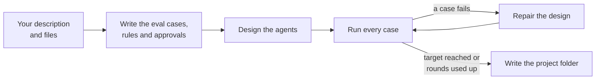

# Describe a process

Tell awa in a few sentences what your process does, and awa drafts the system for you. The draft is a
[**blueprint**](../reference/glossary.md#blueprint): the file `blueprint.yaml` with the agents, their tools, how they
work together and which steps wait for a person. You read it, adapt it and test it before you rely on it.

The shortest path is one command:

```console
awa build "Supplier invoices arrive by email as PDF files. Accounts payable checks each one against the purchase order in our ERP. The vendor must match and the amount may differ by at most 1 percent. Above 10,000 EUR the head of finance approves the payment. A mismatch goes on hold, and the supplier is told why." --out my-process
```

There are three ways to a blueprint. All three end in the same file: `awa validate` checks it, `awa show` explains
it and `awa eval` tests it.

| Way | You give | Use it when |
| --- | --- | --- |
| [In your own words](#in-your-own-words) | A few sentences | You know the process but not the agents. This is the recommended way. |
| [From a template](#from-a-template) | A template name | You want a small working project to change. |
| [By hand](#by-hand) | A YAML file | You know what you want, or you change a project awa made. |

<!-- guide:do cd . -->

!!! info "Preview"
    Letting awa write the blueprint (`awa build`, the page **Describe**) works and is tested, but its options may still change in a minor release ([Stability](../about/stability.md)).

## In your own words

Use the page **Describe** of the web app, or `awa build` in a terminal. The
[guided tour](tour.md#step-4-describe-the-process) builds the invoice desk this way; the step numbers in the legend
are those of the tour.


--8<-- "docs/assets/screenshots/guide/a04-describe-before.legend.txt"

The same in a terminal, with the folder of your files:

```console
awa build "Supplier invoices arrive as PDF files. ..." --out invoice-desk --data invoice-files
```

### What a good description says

| Say ... | Example |
| --- | --- |
| What starts the process and what arrives | "Supplier invoices arrive as PDF files." |
| Each step and who does it today | "Accounts payable checks the invoice against the purchase order." |
| Every rule with its numbers | "The amount may differ by at most 1 percent." |
| Every decision a person makes, and from when | "From 5,000 EUR the head of finance approves." |
| The systems involved, by what they are | "our ERP", "the shared mailbox", "Jira" |
| What happens when something is wrong | "A mismatch goes on hold and the supplier is told why." |
| What comes out at the end | "The invoice is booked, or on hold with a reason." |

Describe the business, not how the AI should think. "Handle our invoices with AI" gives a system that guesses. The
description at the top of this page gives one that can be tested.

### What awa does with it



1. **Tests first.** From your words awa writes the eval cases, the rules with their numbers, and the decisions that
   a person makes, each with its condition (for example `amount_eur >= 5000`). Where your text is silent, awa makes
   a choice and lists it under **Assumptions** in `README.md`. When your text says what starts the process ("every
   Monday", "when a file lands in a folder"), awa adds that trigger.
2. **Design against the tests.** awa designs the agents, their tools and how they work together. It checks the
   design and has it repaired before it goes on.
3. **Evaluate and repair.** Every case runs. A case that fails twice goes back with what happened, and awa changes
   the design while the tests stay fixed. This repeats until all cases pass, the rounds are used up (three by
   default) or the usage limit is reached.
4. **Write the project folder**, with `CONNECT.md` for every system that still works on a stand-in.

**Rules become code, not instructions.** "The amount may differ by at most 1 percent" becomes a small function in
`tools.py`, checked against a worked example. "From 5,000 EUR the head of finance approves" becomes an approval step
with a condition. Neither is left to the model's judgment.

The options of `awa build` you need most:

| Option | Meaning |
| --- | --- |
| `--out DIR` | The project folder. Without it awa uses the name of the system. |
| `--data PATH`, `--note FILE=TEXT` | Your files and what must happen with them ([Your files](files.md#build-on-your-files)). |
| `--rounds N` | How often awa may test and repair the design (default 3). |
| `--target R` | The pass rate to stop at (default 1.0, every case). Below it the command ends with exit code 1. |
| `--force` | Replace an existing project folder. |

The others, such as `--guidance` for an extra design requirement or a cap on the model calls of the whole build,
are in the [command reference](../reference/cli.md#awa-build).

**When the result misses something:**

1. Read `README.md`: are the acceptance criteria and the assumptions right?
2. Read `evals/cases.yaml`: are the exceptions covered?
3. Run `awa show blueprint.yaml`: who does what, and which steps wait for a person?
4. Add what is missing to the description and build again with `--force`.

## From a template

A template is a small project that works at once. There are five:

- `minimal`: one agent with a lookup tool and an action that asks first.
- `team`: a lead with a researcher and a writer.
- `workflow`: fixed steps.
- `network`: teammates on a shared task board.
- `support`: a support desk with a refund approval.

<!-- guide:run -->
```console
$ awa init support-desk --template support
created support-desk (template support):
  blueprint.yaml
  tools.py
  tests/conftest.py
  tests/test_blueprint.py
  evals/cases.yaml
  .env.example
  .gitignore
  README.md
  pyproject.toml

next:
  cd support-desk
  pip install pytest         if it is missing
  pytest                     offline tests, no key
  awa setup                  set your provider's key in .env (or: awa ui, then Set up)
  awa chat blueprint.yaml    tools.py next to the blueprint is loaded by itself
$ cd support-desk
$ awa validate blueprint.yaml
support-desk: valid
$ awa show blueprint.yaml
support-desk 0.1.0
Answers customer requests about orders, deliveries and refunds.
entrypoint: team

agent             model    tools                         skills               description
triage            default  -                             delegation-briefs    Receives every customer request, gets the facts and write...
order_specialist  default  lookup_order, track_shipment  -                    Looks up orders and shipments and reports their status.
refunds           default  lookup_order, issue_refund    safe-tool-execution  Handles refund requests end to end and talks to the custo...

team support-desk: orchestrator triage
  delegates: triage -> order_specialist, refunds
  handoffs: triage -> refunds
  handoffs: refunds -> triage
  shared: messaging

approvals: issue_refund
```

You can check a template without a key. It comes with offline tests (`pytest`) and eval cases for `awa eval`. Then
change the agents' instructions, rename the tools and add your own eval cases.

## By hand

<!-- guide:do cd . -->

### Let awa write the file

`awa new process` writes a blueprint from the agents and their tasks. Without options it asks one question at a
time. With options it runs without questions:

<!-- guide:run -->
```console
$ awa new process refund-desk --agent triage="Answers order questions and passes refund requests on" --agent refunds="Checks a refund request and asks for approval before paying" --structure team --lead triage --no-input -o refund-desk.yaml
wrote refund-desk.yaml

auto-matching for refund_desk
  triage
    + skill orchestration-planning (role: orchestrator)
    + skill refund-and-credit-requests (matched: order, refund, requests)
  refunds
    + skill refund-and-credit-requests (matched: refunds, request, asks, approval)
    + skill approval-requests (matched: request, approval)

next:
  awa show refund-desk.yaml
  awa run refund-desk.yaml "<a task for the team>"
  awa add trigger refund-desk.yaml   # start it by itself: schedule, web request, ...
$ awa validate refund-desk.yaml
refund_desk: valid (tool names not checked; no tools.py beside it)
```

The lines with `+` are **skills** that awa added by itself. A skill is a written method that an agent follows. With
`auto: true` in a blueprint, awa matches skills and ready-made tools to each agent by the words of its task. It never
calls a model for this, so the same blueprint always gives the same result. A tool that sends, writes or deletes is
never added this way: awa only suggests it, and `awa validate` warns about it.

### Write it yourself

A blueprint is a YAML file: `name: value` lines, with two spaces of indentation for what belongs together. In this
example, one agent reads a table of orders and writes reminder emails, and a person approves every email:

<!-- guide:file reminder-desk/blueprint.yaml -->
```yaml
name: reminder-desk
description: Finds overdue orders and writes a reminder for each one.
defaults:
  model: default

toolkits:
  files: {root: ./data}
  email: {sender: accounting@example.com, allowed_recipients: ["@example.com"]}

agents:
  - name: reminder_writer
    description: Finds overdue orders and writes the reminders.
    instructions: Read orders.csv with read_csv. For each overdue order, send a short reminder with send_email.
    tools: [builtin:read_csv, builtin:send_email]

approvals:
  - tool: builtin:send_email
```

| Key | What it says |
| --- | --- |
| `name`, `description` | What the system is called and what it does. Names use letters, digits, `_` and `-`. |
| `defaults` | Settings every agent shares, such as the model profile (`default`, `fast` or `strong`). |
| `toolkits` | Settings of ready-made tools. Here the file tools only see the folder `data`, and mail may only go to `@example.com`. |
| `agents` | Each agent with its job (`description`), its `instructions` and the `tools` it may use. |
| `approvals` | The tools that wait for a person before they run ([Approvals](approvals.md)). |

`awa validate` checks the file without a key and without a model. `awa show` explains it:

<!-- guide:run -->
```console
$ awa validate reminder-desk/blueprint.yaml
reminder-desk: valid (tool names not checked; no tools.py beside it)
$ awa show reminder-desk/blueprint.yaml
reminder-desk 1.0.0
Finds overdue orders and writes a reminder for each one.
entrypoint: reminder_writer

agent            model    tools                 skills  description
reminder_writer  default  read_csv, send_email  -       Finds overdue orders and writes the reminders.

approvals: send_email
```

An entry of `tools` is one of these:

- `builtin:<tool>`: a tool that ships with awa.
- `connector:<system>` or `connector:<system>.<operation>`: a system you connected ([Connect systems](connect.md)).
- `mcp:<server>`: the tools of an MCP server.
- The plain name of a function in `tools.py` next to the blueprint.

How agents work together (`team`, `workflow`, `network`) is the subject of [Agents and teams](agents-and-teams.md).
Every key of the format is in [Blueprints](../develop/blueprints.md).

## Many conditions and special cases

A real process has tiers, exceptions and blocked suppliers. Keep every special case as **one row in a table, one rule
that decides it, and one test that checks it**:

| # | If ... | then ... | Decided by | Test |
| --- | --- | --- | --- | --- |
| 1 | the invoice is below 5,000 EUR and open | release it | the rule | `small-invoice` |
| 2 | the amount is 5,000 EUR up to 20,000 EUR | ask the head of finance | the head of finance | `finance-tier` |
| 3 | the amount is 20,000 EUR or more | ask the management board | the board | `board-tier` |
| 4 | the invoice is already paid | never pay it again | the rule | `paid-invoice` |
| 5 | the supplier is on the blocked list | do not pay; say why | the rule | `blocked-supplier` |

Check the table before you build it:

- Gaps and overlaps: who decides exactly 20,000?
- A rule or a person for every row.
- What happens when a value is missing.

Then each kind of row goes to one place:

| The row is | It lives in |
| --- | --- |
| A number that decides whether a person must approve | An approval condition (`when`) |
| A calculation or lookup that must always give the same answer | A small rule in `tools.py` |
| A fixed order of steps | A workflow ([Agents and teams](agents-and-teams.md)) |
| Judgment that cannot be written as a rule | The agent's instructions, and an eval case |

### Write the rules

Work on a copy of the desk from the tour: copy the folder `invoice-desk` to `desk-rules`. Replace its `tools.py`
with two **rules** and two **approval steps**:

<!-- guide:do copy invoice-desk desk-rules -->
<!-- guide:do cd desk-rules -->
<!-- guide:file tools.py -->
```python
"""The rules and approval steps of the invoice desk, with three tiers and a blocked-supplier list."""

from __future__ import annotations

import json

from awa import tool

BLOCKED_SUPPLIERS = {"Blocked Supplies Ltd"}


@tool
def payment_route(amount_eur: float) -> str:
    """Who must approve a payment: release (under 5,000 EUR), finance (from 5,000 EUR up to 20,000 EUR) or board (from 20,000 EUR).

    Args:
        amount_eur: The amount in EUR.
    """

    if amount_eur >= 20000:
        return "board"
    if amount_eur >= 5000:
        return "finance"
    return "release"


@tool
def supplier_status(supplier: str) -> str:
    """Whether a supplier may be paid: ok or blocked.

    Args:
        supplier: The name of the supplier as on the invoice.
    """

    return "blocked" if supplier in BLOCKED_SUPPLIERS else "ok"


@tool
def finance_approval(invoice_id: str, amount_eur: float) -> str:
    """The head of finance approves payments from 5,000 EUR up to 20,000 EUR.

    Args:
        invoice_id: The invoice number.
        amount_eur: The amount in EUR.
    """

    return json.dumps({"approved": True, "invoice_id": invoice_id, "amount_eur": amount_eur})


@tool
def board_approval(invoice_id: str, amount_eur: float) -> str:
    """The management board approves payments from 20,000 EUR.

    Args:
        invoice_id: The invoice number.
        amount_eur: The amount in EUR.
    """

    return json.dumps({"approved": True, "invoice_id": invoice_id, "amount_eur": amount_eur})


__all__ = ["board_approval", "finance_approval", "payment_route", "supplier_status"]
```

A **rule** gives the same answer for the same input. The agent decides when to call it, so an eval case checks the
call (`tool:payment_route`).

An **approval step** is a tool that a person must approve. Each tier is its own tool with its own condition, with no
gap and no overlap:

<!-- guide:file blueprint.yaml -->
```yaml
format_version: awa/v1
name: invoice_desk
description: Checks supplier invoices against the ledger and releases them for payment.
agents:
- name: invoice_checker
  description: Looks the invoice up in the ledger and checks its purchase order.
  instructions: Look the invoice up in the invoices table with invoice_ledger_query. Report the supplier, the purchase order, the amount in EUR and the status.
  tools:
  - connector:invoice_ledger.query
- name: payment_clerk
  description: Releases checked, open invoices for payment.
  instructions: |
    1. Call supplier_status with the supplier. A blocked supplier is never paid: say so and stop.
    2. Call payment_route with the amount. For release, confirm the release. For finance call finance_approval, for board call board_approval, then confirm the release.
    3. Never release an invoice that is already paid.
  tools:
  - supplier_status
  - payment_route
  - finance_approval
  - board_approval
entrypoint: workflow
workflow:
  sequential:
  - invoice_checker
  - payment_clerk
approvals:
- tool: finance_approval
  when: amount_eur >= 5000 and amount_eur < 20000
- tool: board_approval
  when: amount_eur >= 20000
connectors:
  invoice_ledger:
    use: sql
    env:
      DATABASE_URL: INVOICE_LEDGER_DATABASE_URL
    read_only: true
```

`awa tools call` runs one tool of `tools.py` without a model and without a key. It is the cheapest test of a rule.
The arguments come from small files, `big.json`:

<!-- guide:file big.json -->
```json
{"amount_eur": 25000}
```

and `small.json`:

<!-- guide:file small.json -->
```json
{"amount_eur": 4999.99}
```

<!-- guide:run -->
```console
$ awa validate blueprint.yaml
invoice_desk: valid
$ awa show blueprint.yaml
invoice_desk 1.0.0
Checks supplier invoices against the ledger and releases them for payment.
entrypoint: workflow

agent            model    tools                                                             skills  description
invoice_checker  default  invoice_ledger_query                                              -       Looks the invoice up in the ledger and checks its purchas...
payment_clerk    default  supplier_status, payment_route, finance_approval, board_approval  -       Releases checked, open invoices for payment.

workflow: invoice_checker -> payment_clerk

approvals: finance_approval (when amount_eur >= 5000 and amount_eur < 20000), board_approval (when amount_eur >= 20000)
$ awa tools call tools.py payment_route --args "@big.json"
board
$ awa tools call tools.py payment_route --args "@small.json"
release
```

Files work the same in every terminal; Windows PowerShell 5.1 removes the double quotes inside an argument such as
`'{"amount_eur": 25000}'`.

### Test the boundaries

Try each condition with the values around each limit. This script uses the same condition object that awa uses:

<!-- guide:python -->
```python
from awa.tools import ApprovalCondition

finance = ApprovalCondition("amount_eur >= 5000 and amount_eur < 20000")
board = ApprovalCondition("amount_eur >= 20000")
for amount in (4999.99, 5000, 19999.99, 20000):
    print(f"{amount:>9}  finance asks: {finance({'amount_eur': amount})!s:5}  board asks: {board({'amount_eur': amount})}")
```

<!-- guide:expect -->
```text
  4999.99  finance asks: False  board asks: False
     5000  finance asks: True   board asks: False
 19999.99  finance asks: True   board asks: False
    20000  finance asks: False  board asks: True
```

From 5,000 up, exactly one of the two asks, never both. When a condition cannot be worked out, it **asks** rather than
guesses. That happens when the value is missing, or when it can be read two ways (`5.000` is five thousand or five):

<!-- guide:python -->
```python
from awa.tools import ApprovalCondition

finance = ApprovalCondition("amount_eur >= 5000 and amount_eur < 20000")
print("missing amount asks:", finance({}))
print("'5.000' asks:", finance({"amount_eur": "5.000"}))
print("'5,000' asks:", finance({"amount_eur": "5,000"}))
```

<!-- guide:expect -->
```text
missing amount asks: True
'5.000' asks: True
'5,000' asks: True
```

A tool with a required number refuses a call without it, before anything happens:

<!-- guide:run exit=1 -->
```console
$ awa tools call tools.py payment_route
error: missing arguments: amount_eur. The tool takes payment_route(amount_eur: number)
```

### What conditions cannot do

- **They see only the tool's own values.** A rule must compute a month's total or the person who asked, and pass it
  to the approval step as an input.
- **One approval per tool.** Tiers need one tool each, as above.
- **Nothing forces a rule to run before an action.** awa enforces the approval on the tool that acts, not the order
  that the instructions ask for. Put the safety there.
- **Branches without the model exist only in a `process:`, and only forward**
  ([below](#a-process-with-checked-steps)). In a `workflow:` the agent picks the branch by its instructions, so test
  every branch with one case per row.

### A rule table

You can also write the worksheet as a table and let awa find the boundaries:

- The first row that holds decides.
- `else` decides when no row holds.
- A missing or unclear value goes to `when_unclear`: a person decides, unless you say `reject`.

<!-- guide:python -->
```python
from awa.workflows import SpecialCases, boundary_cases

cases = SpecialCases.model_validate({
    "cases": [
        {"if": [{"field": "amount_eur", "op": ">=", "value": 5000}], "then": "ask", "by": "finance"},
        {"if": [{"field": "amount_eur", "op": "<", "value": 5000},
                {"field": "supplier", "op": "one of", "value": ["Acme Tools"]}],
         "then": "approve"},
    ],
    "else": "ask",
})
for line in cases.describe():
    print(line)
for case in boundary_cases(cases):
    if case.row == 2:
        print(f"{case.probe:<36} {case.expected.describe()}")
```

<!-- guide:expect -->
```text
If amount is 5,000 EUR or more: a person decides (finance)
If amount is less than 5,000 EUR and supplier is one of "Acme Tools": approved without asking a person
Otherwise: a person decides
When a value is missing or unclear: a person decides
amount_eur just below 5,000 EUR      row 2: approved without asking a person
amount_eur exactly 5,000 EUR         row 1: a person decides (finance)
amount_eur just above 5,000 EUR      row 1: a person decides (finance)
supplier not in the list             else: a person decides
supplier "Acme Tools" in other case  else: a person decides
amount_eur missing                   unclear at row 1 (amount_eur has no value): a person decides
amount_eur two-way number 5.000      unclear at row 1 (the number '5.000' in amount_eur can be read two ways (decimal or thousands)): a person decides
supplier missing                     unclear at row 2 (supplier has no value): a person decides
supplier two-way number 5.000        else: a person decides
```

Text must match exactly, including capital letters: "Acme Tools" in other case goes to `else`. In a blueprint, the
same table goes under `special_cases:`. `awa show cases blueprint.yaml` prints the rows and every boundary with its
outcome ([Blueprints: special cases](../develop/blueprints.md#special-cases)).

### A process with checked steps

A `process:` in a blueprint is a line of checked steps. A rule table named after a step decides on that step's
result in every run, and a step can be tried again when it fails.

The **dry run** walks such a process without a model. Stand-in agents answer with the values you give, and the dry
run prints the path a run would take:

<!-- guide:python -->
```python
import asyncio

from awa.blueprints import Blueprint, dry_run
from awa.persistence import StateInMemorySaver

blueprint = Blueprint.from_yaml_text("""
name: invoice-route
agents:
  - name: reader
    description: Reads one invoice.
    output_schema:
      type: object
      properties: {supplier: {type: string}, amount_eur: {type: number}}
      required: [supplier, amount_eur]
  - name: archivist
    description: Files the invoice.
process:
  - name: extract
    agent: reader
    retry: {max_attempts: 3, initial: 10s}
    after_last_try: ask
    checks:
      - {kind: rule, fail_when: "amount_eur <= 0", message: No amount found.}
  - name: archive
    agent: archivist
special_cases:
  extract:
    cases:
      - {if: "supplier in ['Blocked Supplies Ltd']", then: reject, message: Blocked supplier.}
      - {if: [{field: amount_eur, op: ">=", value: 5000}], then: ask, by: finance}
      - {if: [{field: amount_eur, op: "<", value: 5000}], then: approve}
    else: ask
""")
for values, fail in (
    ({"supplier": "Acme Tools", "amount_eur": 1200}, {"extract": 2}),
    ({"supplier": "Acme Tools", "amount_eur": 6200}, {}),
    ({"supplier": "Blocked Supplies Ltd", "amount_eur": 300}, {}),
):
    path = asyncio.run(dry_run(blueprint, values, checkpointer=StateInMemorySaver(), fail=fail))
    print(f"{values['amount_eur']} from {values['supplier']}: {path.outcome}")
    for line in path.lines:
        print(f"  {line.step}: {line.text}")
```

<!-- guide:expect -->
```text
1200 from Acme Tools: completed
  extract: Try 1 of 3 failed: ModelProviderError: simulated failure of try 1 (dry run). A real run waits 10 s, then tries again.
  extract: Try 2 of 3 failed: ModelProviderError: simulated failure of try 2 (dry run). A real run waits 20 s, then tries again.
  extract: passed its checks (try 3). Special case row 3 (If amount is less than 5,000 EUR: approved without asking a person).
  archive: passed its checks.
6200 from Acme Tools: completed
  extract: PAUSE: a person is asked: Special case: row 2: a person decides (finance). The dry run answers approve.
  extract: passed its checks (try 1). Special case row 2 (If amount is 5,000 EUR or more: a person decides (finance)).
  archive: passed its checks.
300 from Blocked Supplies Ltd: rejected
  extract: REJECTED by special case row 1 (If supplier is one of "Blocked Supplies Ltd": rejected. Blocked supplier.).
```

- The first invoice fails twice and passes on the third try. (`fail` makes the stand-in raise an error, as a
  provider outage would.)
- The second pauses for finance.
- The third is rejected, and the archive step never starts.

On the command line: `awa show dry-run blueprint.yaml --input values.json --fail extract=2`, with the values in a
JSON file. The dry run proves the routing only. It reads no documents, calls no tools and shows nothing a model would
answer.

## Common mistakes

| Mistake | What you see | Fix |
| --- | --- | --- |
| The description is one vague sentence | Many assumptions in `README.md` | Add what arrives, the rules with numbers and who decides. |
| A rule is left to the model | An eval case fails now and then | Give it a number; awa turns it into a rule or an approval. |
| The description is not in quotes in the terminal | `unrecognized arguments` | Put the whole text in double quotes, or use the page **Describe**. |
| One space or a tab as indentation in YAML | A parse error with a line number | Use two spaces per level, no tabs. |
| A tool name is misspelled | `awa validate` says the tool is unknown | Copy the name from `awa show`. |
| Two conditions overlap or leave a gap | Two approvals ask, or none | Use `>=` on one side and `<` on the other; test the boundary values. |

<!-- guide:do cd . -->

!!! example "In code"

    A blueprint is a Python object too. `Blueprint.from_yaml_file` reads and checks the file;
    `awa.blueprints.build_project` is `awa build` from Python ([Blueprints](../develop/blueprints.md)).

    <!-- guide:python -->
    ```python
    from awa.blueprints import Blueprint

    blueprint = Blueprint.from_yaml_file("reminder-desk/blueprint.yaml")
    print(blueprint.name, [agent.name for agent in blueprint.agents])
    print([approval.tool for approval in blueprint.approvals])
    ```

    <!-- guide:expect -->
    ```text
    reminder-desk ['reminder_writer']
    ['builtin:send_email']
    ```
