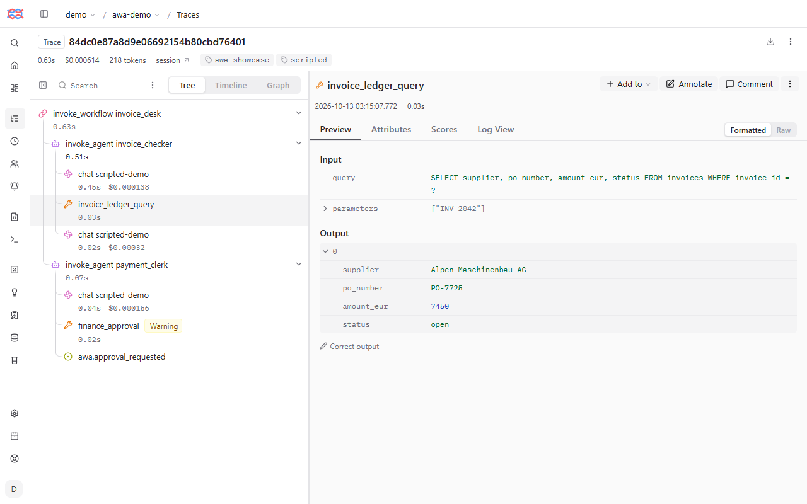

# Keep it running

This page is for a process that runs on its own. [Limits](../reference/glossary.md#usage-limit) stop a run that
goes wrong, `automation:` retries and escalates, and [traces](../reference/glossary.md#trace) show what a run did.
awa keeps every run as a record you can list, retry, cancel and read step by step. The shortest path: set `limits:`
and `automation:` as below, and use `awa runs list` and `awa runs trace` when something looks wrong.

```yaml
limits:
  max_requests: 30
  max_cost: 0.50
  max_duration: 5m
automation:
  retry: {max_attempts: 4, initial: 1m, max_delay: 1h}
  sla: {complete_within: 2d, approval_within: 4h, remind_every: 1h}
```

Everything is kept in the folder `.awa` of the project folder. It survives an orderly restart of the worker, the
server and the computer. It is not a backup: if `.awa` is lost, waiting runs are lost.

| File | What it holds |
| --- | --- |
| `.awa/awa.db` | Every run: input, status, history, tokens, cost. `awa store sweep` deletes old finished runs. |
| `.awa/checkpoints.db` | The saved state of runs that wait for an approval or an answer. |
| `.awa/traces/` | The trace of every attempt of every run. |

The files hold the inputs and answers of your runs. On Linux and macOS only your user can read them. On Windows awa
gives the database files an access list for your user only (when `icacls` can run). The traces folder keeps the
permissions of the project folder, so keep that folder private and out of version control.

!!! info "Preview"
    Process runs, `awa runs` and `awa store` work and are tested, but their options may still change in a minor release ([Stability](../about/stability.md)).

## The runs

| Status | Meaning |
| --- | --- |
| `queued` | Waiting for a worker. |
| `running` | A worker is working on it. |
| `waiting` | Paused for an approval or an answer from outside. |
| `succeeded` | Done. |
| `failed` | Stopped by an error a retry would not fix, for example a limit. |
| `dead_lettered` | Failed on every retry; `awa runs dlq` lists these. |
| `cancelled` | Stopped by a person. |
| `rejected` | A special case or a person turned the item down. Not retried. |

To try it:

1. Copy `invoice-desk` of the tour to `desk-ops` and delete its folders `.awa` and `inbox`.
2. Set a very small limit in `blueprint.yaml`: `max_requests: 2`.
3. Drop an invoice into `inbox` and run the worker. The run reaches the limit and fails:

<!-- guide:do cd . -->
<!-- guide:do copy invoice-desk desk-ops -->
<!-- guide:do delete desk-ops/.awa -->
<!-- guide:do delete desk-ops/inbox -->
<!-- guide:do cd desk-ops -->
<!-- guide:do replace desk-ops/blueprint.yaml "max_requests: 30" "max_requests: 2" -->
<!-- guide:do copy awa:docs/guide/files/INV-2041.pdf desk-ops/inbox/INV-2041.pdf -->
<!-- guide:run exit=1,0 -->
```console
$ awa worker blueprint.yaml --once
runs are kept in C:\awa-guide-work\desk-ops\.awa\awa.db and paused runs in C:\awa-guide-work\desk-ops\.awa\checkpoints.db (this machine); use --dsn (or $AWA_POSTGRES_DSN) to share them with workers elsewhere
proc_3b9c0d7a41e2 invoice_desk failed attempts=1 tokens=603 error=UsageLimitExceededError: Usage limit exceeded: requests=3 > max_requests=2
$ awa runs list --status failed
RUN                AUTOMATION    STATUS  ATTEMPTS  TOKENS  COST  CREATED (UTC)        TRIGGER
proc_3b9c0d7a41e2  invoice_desk  failed  1         603     -     2026-10-05 21:40:02  new-invoice
$ awa runs dlq
no runs in .awa/awa.db
```

The run is `failed`, not `dead_lettered`: a limit is not a temporary problem, and a retry would only spend more.

| Command | Does |
| --- | --- |
| `awa runs list [--status S] [--automation NAME] [--json]` | Runs, newest first, with tokens and cost. |
| `awa runs show RUN` | One run with its full history, as JSON. |
| `awa runs trace RUN` | What the run did, step by step ([below](#read-a-trace)). |
| `awa runs retry RUN [--restart]` | Queue a failed run again: from where it stopped, or from its input with `--restart`. |
| `awa runs cancel RUN [--reason TEXT]` | Cancel a run that is not finished. |
| `awa runs decide RUN --approve` or `--reject` | Answer a waiting approval ([Approvals](approvals.md)). |
| `awa runs dlq` | Runs that failed every retry. |
| `awa runs export-cases RUN --out FILE` | Eval cases from runs ([Test and improve](test.md#cases-from-real-runs)). |
| `awa runs migrate BLUEPRINT [--dry-run]` | Move waiting runs to the current version of the blueprint ([below](#change-a-process-while-runs-are-waiting)). |

Run them in the project folder, or give the same `--store` or `--dsn` as the worker. Put the run back in the queue,
then cancel it, say because the invoice was a duplicate:

<!-- guide:run -->
```console
$ awa runs retry RUN_ID
proc_3b9c0d7a41e2 invoice_desk queued attempts=0 tokens=603
$ awa runs cancel RUN_ID --reason "duplicate invoice"
proc_3b9c0d7a41e2 invoice_desk cancelled attempts=0 tokens=603 error=RunCancelledError: duplicate invoice
$ awa runs list
RUN                AUTOMATION    STATUS     ATTEMPTS  TOKENS  COST  CREATED (UTC)        TRIGGER
proc_3b9c0d7a41e2  invoice_desk  cancelled  0         603     -     2026-10-05 21:40:02  new-invoice
```

A retried run gets only what is left of its budget, so a run that stopped at a limit stops again. Raise the limit
and drop the file again instead. A run whose saved state is gone fails with `checkpoint lost`;
`awa runs retry RUN --restart` starts it again from its input.

## Retries, deadlines and notifications

The section `automation:` of the blueprint says how awa handles runs:

<!-- guide:file blueprint.yaml append -->
```yaml
automation:
  concurrency: 2
  retry: {max_attempts: 4, initial: 1m, max_delay: 1h}
  sla: {complete_within: 2d, approval_within: 4h, remind_every: 1h}
  notify:
    - {webhook: "https://hooks.example.com/ap-team", secret_env: AP_HOOK_SECRET}
```

| Setting | Meaning |
| --- | --- |
| `concurrency` | How many runs of this process run at the same time, across all workers. |
| `retry` | A run that fails for a temporary reason (the provider is busy, a system does not answer) is tried again with growing pauses: at most `max_attempts` tries, the first pause `initial`, never longer than `max_delay`. Other errors fail the run at once. |
| `sla` | Deadlines. `complete_within` warns at 80 percent of the time and reports a breach; `approval_within` escalates an approval that is still open; `remind_every` repeats a reminder. |
| `notify` | Where warnings, breaches, reminders and failed runs go: a signed web request to a chat channel, an incident tool or your own service. |
| `run_timeout` | The longest one attempt may take (default 30 minutes). |

Durations are written `30s`, `15m`, `4h`, `2d`. `awa validate` checks the section:

<!-- guide:run -->
```console
$ awa validate blueprint.yaml
invoice_desk: valid
```

## Change a process while runs are waiting

Everything in the blueprint is part of its **version**, `limits:` and `prices:` included. A waiting run stays on the
version it started with, so a rule or a budget never changes under a half-done run. Before you restart the worker
with a new blueprint, see what would happen to the waiting runs:

<!-- guide:run -->
```console
$ awa runs migrate blueprint.yaml --dry-run
current version: sha256:5cb76a5dc6486586
every unfinished run is on the current version
```

Without `--dry-run` the command moves the waiting runs it lists.

## Limits and costs

A limit is the one safety net that does not depend on the model behaving. Set limits from the process, not from the
model: if one invoice never needs more than five model calls, a sixth is a loop.

| Limit under `limits:` | What it stops |
| --- | --- |
| `max_requests` | The run after this many model calls. Exact: the call that would be one too many is not made. |
| `max_total_tokens` | The run when the tokens of all model calls add up to more than this. |
| `max_tool_calls` | The run after this many tool calls. |
| `max_cost` | The run when its cost, counted with your `prices:`, is above this amount. |
| `max_duration` | The run when it has worked longer than this (`30s`, `5m`, `2h`). |

Everything the run starts counts: a team and its members, the steps of a workflow, delegations. The running call
finishes first, so a limit other than `max_requests` can be overshot by one reply. The options `--max-requests`,
`--max-total-tokens`, `--max-tool-calls`, `--max-cost` and `--max-duration` of `awa run`, `chat`, `serve`, `worker`
and `trigger run` can only **tighten** the blueprint's limits. Finer limits exist per agent (`max_steps`, default 25
model calls per run) and per team ([Agents and teams](agents-and-teams.md#team-an-orchestrator-and-members)).

Copy `invoice-desk` to `desk-limits`. The desk needs four model calls for this invoice; allow two:

<!-- guide:do cd . -->
<!-- guide:do copy invoice-desk desk-limits -->
<!-- guide:do cd desk-limits -->
<!-- guide:run exit=1 -->
```console
$ awa run blueprint.yaml "Please release invoice INV-2041 for payment." --max-requests 2
error: Usage limit exceeded: requests=3 > max_requests=2
```

The third call was not made, so nothing was paid for it. Where you see a stopped run:

| Where | What you see |
| --- | --- |
| `awa run` | `error: Usage limit exceeded: ...` and exit code 1. |
| `awa chat` | The error for that message; the next message starts a fresh budget. |
| `awa eval` | The case ends with the status `error`; the other cases go on. |
| A served system | `429`, or `504` when `max_duration` ran out. |
| An automatic run | `failed` with the code `awa.usage_limit_exceeded`; not retried. |
| The web app | The conversation or the test shows the error with a hint to change `limits:` on **Review**. |

### Count the cost

awa ships no prices, because providers change them. Put what you pay per million tokens under `prices:`. The key is
the model name as in `provider:model`, with or without the provider part; a longer name that starts with it matches
too. The scripted model of this page calls itself `unknown`, and the numbers are only an example:

<!-- guide:file blueprint.yaml append -->
```yaml
prices:
  unknown: {input_per_mtok: 2.0, output_per_mtok: 8.0}
```

<!-- guide:run -->
```console
$ awa validate blueprint.yaml
invoice_desk: valid
$ awa run blueprint.yaml "Please release invoice INV-2041 for payment."
Invoice INV-2041 from Nordwind Office GmbH (1,180.00 EUR) is released for payment.

[invoice_desk] 4 model call(s), 1121 tokens (1062 in, 59 out), cost 0.0026, 127 ms
```

Now `max_cost` works, and `max_duration` stops a slow run:

<!-- guide:run exit=1 -->
```console
$ awa run blueprint.yaml "Please release invoice INV-2041 for payment." --max-cost 0.0001
error: Usage limit exceeded: cost=0.0004 > max_cost=0.0001
$ awa run blueprint.yaml "Please release invoice INV-2041 for payment." --max-duration 1ms
error: Run 'run_74048440f339485d8f3c10f6d4f2c663' of 'invoice_desk' exceeded max_duration=0.001s and was stopped after 0.04s
```

The same prices in a file price an evaluation (`awa eval ... --prices prices.yaml`) and show what all runs and one run
cost:

<!-- guide:file prices.yaml -->
```yaml
unknown:
  input_per_mtok: 2.0
  output_per_mtok: 8.0
```

<!-- guide:run -->
```console
$ awa eval blueprint.yaml evals/cases.yaml --prices prices.yaml
Evaluation: invoice_desk
========================
...
  cost  0.0070 (0.0023 per run)
...
```

`awa validate` reports an error when a model written as `provider:model` has no price, and a warning when a blueprint
has triggers but no `limits:`. `awa build` sets `max_requests: 200` for processes that a trigger starts; lower it to
what you need. Token and cost limits count what the provider reports, so set `max_requests` as well.

## Read a trace

When a run gives a wrong answer, fails or costs too much, its **trace** shows what it did: who asked whom, which tool
got which values, where a person approved, and what each step used. `awa serve` and `awa worker` keep a trace of
every attempt in `.awa/traces/`, without prompts, answers or tool results. Open the failed run from above:

<!-- guide:do cd . -->
<!-- guide:do cd desk-ops -->
<!-- guide:run -->
```console
$ awa runs trace RUN_ID
Trace of run proc_3b9c0d7a41e2, attempt 1
  automation invoice_desk, trigger new-invoice, thread_id proc_3b9c0d7a41e2
  file .awa/traces/proc_3b9c0d7a41e2.a1.jsonl (level summary)
Result: failed (UsageLimitExceededError: Usage limit exceeded: requests=3 > max_requests=2)
Totals: 2 model calls, 603 tokens (572 in, 31 out), time 201 ms
        agents 3, tool calls 1 (0 only hand work to other agents), delegations 0, consultations 0, handoffs 0, approvals 0 asked / 0 answered

What went wrong:
  - payment_clerk: limit max_requests reached (3 > 2)
  - payment_clerk: UsageLimitExceededError: Usage limit exceeded: requests=3 > max_requests=2

workflow invoice_desk  [no model calls, 201 ms]
  agent invoice_checker  [2 model calls, 603 tokens, 120 ms]
    tool invoice_ledger_query {"query": "SELECT supplier, po_number, amount_eur, status FROM invoices WHERE invoice_id = ?", "parameters": ["INV-2041"]} -> ok (19 ms)
  agent payment_clerk  [no model calls, 6 ms]
    ! LIMIT limit max_requests reached (3 > 2)
    ! ERROR UsageLimitExceededError: Usage limit exceeded: requests=3 > max_requests=2
  ! ERROR UsageLimitExceededError: Usage limit exceeded: requests=3 > max_requests=2

Note: level summary keeps no message texts (prompts, replies, tool results). Record with level full to see them.
Note: no prices, so no cost. Add `prices:` to the blueprint or pass --prices FILE.
```

Read **What went wrong** first. The indentation shows who asked whom, the brackets what each agent used, `->` how a
call ended. `!` lines mark a limit, an error or a refused call where it happened. `awa run` writes a trace when you
ask, and `--trace-level full` adds what was asked, answered and returned:

<!-- guide:do cd invoice-desk -->
<!-- guide:run -->
```console
$ awa run blueprint.yaml "Please release invoice INV-2041 for payment." --trace trace-1.jsonl --trace-level full
trace written to trace-1.jsonl; read it with: awa runs trace trace-1.jsonl
Invoice INV-2041 from Nordwind Office GmbH (1,180.00 EUR) is released for payment.

[invoice_desk] 4 model call(s), 1121 tokens (1062 in, 59 out), 134 ms
$ awa runs trace trace-1.jsonl
Trace of run run_8c1f2a47e90b4d6f8a3b5c71d2e9f046
  file trace-1.jsonl (level full)
Result: finished
Totals: 4 model calls, 1,121 tokens (1,062 in, 59 out), time 134 ms
        agents 3, tool calls 2 (0 only hand work to other agents), delegations 0, consultations 0, handoffs 0, approvals 0 asked / 0 answered

workflow invoice_desk  [no model calls, 134 ms]
  input: Please release invoice INV-2041 for payment.
  agent invoice_checker  [2 model calls, 506 tokens, 76 ms]
    input: Please release invoice INV-2041 for payment.
    tool invoice_ledger_query {"query": "SELECT supplier, po_number, amount_eur, status FROM invoices WHERE invoice_id = ?", "parameters": ["INV-2041"]} -> ok (9 ms)
...
    said: Invoice INV-2041 from Nordwind Office GmbH: 1,180.00 EUR, purchase order PO-7710, status open.
  agent payment_clerk  [2 model calls, 615 tokens, 41 ms]
    input: Invoice INV-2041 from Nordwind Office GmbH: 1,180.00 EUR, purchase order PO-7710, status open.
    tool finance_approval {"invoice_id": "INV-2041", "amount_eur": 1180.0} -> ok (2 ms)
      result: {"approved": true, "invoice_id": "INV-2041", "amount_eur": 1180.0}
    said: Invoice INV-2041 from Nordwind Office GmbH (1,180.00 EUR) is released for payment.
  output: Invoice INV-2041 from Nordwind Office GmbH (1,180.00 EUR) is released for payment.

Note: no prices, so no cost. Add `prices:` to the blueprint or pass --prices FILE.
```

**A full trace contains the personal data of the run**: use it to find a problem, then delete the file.
`AWA_TRACE_LEVEL` (`off`, `summary`, `full`) sets the level for the worker and the server. Every error message starts
with `error:` and ends with what to do; `awa --verbose` before a command prints the technical details.

The same runs in the browser, with every tool call's input and output, are in [Langfuse](langfuse.md):



*A tool call with the arguments the agent chose and what came back.*

| You see | Look at | Usually |
| --- | --- | --- |
| `credentials ABSENT` or an authentication error | `awa doctor` | The key is not set in the folder you work in. |
| A run waits and nothing happens | `awa runs list --status waiting` | An approval waits for a person. |
| Nothing starts | `awa trigger list`, is the worker running? | The worker is not running, or the folder or schedule is not what you think. |
| A run costs too much or takes long | `awa runs trace RUN` | One agent loops, or one step is slow. |
| A wrong answer | `awa run ... --trace FILE --trace-level full`, then `awa runs trace FILE` | A tool returned something unexpected, or an instruction is unclear. |

## When many people depend on it

On one computer everything is in `.awa`. When several computers share the work, or there are many runs, keep the runs
in PostgreSQL:

1. Set `AWA_POSTGRES_DSN` in `.env`, or pass `--dsn` to `awa worker`, `awa serve` and `awa runs`.
2. Test the connection with `awa doctor --check-postgres`.

Then `awa serve` only receives web requests, and workers on as many computers as you like run everything else. Ask
your IT team for this list:

- [ ] The worker runs as a service that starts with the computer and restarts when it stops.
- [ ] The runs are in a database with backups, or `.awa` is on a disk that is backed up.
- [ ] The keys are in a protected `.env`, not in the blueprint.
- [ ] `limits:` are set, and `notify:` points to a channel somebody reads.
- [ ] Someone answers the approvals, and `sla: approval_within` escalates the ones nobody answers.
- [ ] The [production checklist](../develop/production.md) is read.

To back up, copy the project folder with `.awa`. To start clean, stop the worker and the web app and delete `.awa`:
waiting runs are lost, the blueprint, the tests, the data and `.env` stay.

## Common mistakes

| Mistake | What you see | Fix |
| --- | --- | --- |
| `awa runs` in the wrong folder | `No process run ... in .awa\awa.db` | Go to the project folder, or pass `--store`. |
| The worker is not running | Runs stay `queued` | Start it: `awa worker blueprint.yaml`. |
| A retry of a run that hit a limit | It fails again | Raise the limit, drop the file again. |
| No limits on an automatic process | `awa validate` warns | Add `limits:`. |
| `max_cost` without `prices:` | An error that prices are missing | Add `prices:` for every model the system uses. |
| `No trace for ...` | Wrong folder, or tracing was off | Run in the project folder, or pass `--traces DIR`. |

!!! example "In code"

    `awa.automation` is what `awa worker` and `awa serve` run, for any awa system in Python
    ([Serving: jobs on your own queue](../develop/serving.md#jobs-on-your-own-queue)). Here a second event with the same business key starts no second run:

    <!-- guide:python -->
    ```python
    import asyncio

    from awa import Agent
    from awa.automation import Automation, RetryPolicy
    from awa.testing import FakeChatModel

    clerk = Agent("clerk", instructions="Book supplier invoices.", model=FakeChatModel(["Booked RE-17."]))
    invoices = Automation(clerk, input="Book invoice {payload.invoice_no}.", dedup="{payload.invoice_no}",
                          retry=RetryPolicy(max_attempts=3, initial="1m"))


    async def main() -> None:
        first = await invoices.submit({"invoice_no": "RE-17"})
        again = await invoices.submit({"invoice_no": "RE-17"})
        await invoices.run_pending()
        run = await invoices.store.get(first.run.id)
        print(run.status, run.output, first.run.id == again.run.id)


    asyncio.run(main())
    ```

    <!-- guide:expect -->
    ```text
    succeeded Booked RE-17. True
    ```
