# Guided tour

This tour takes one process from a few sentences to a system that runs by itself. You build an **invoice desk**:
it checks supplier invoices against a ledger and asks the head of finance before it releases a payment of 5,000 EUR
or more. awa drafts and tests the system; at each step you check what it made and decide what happens next.

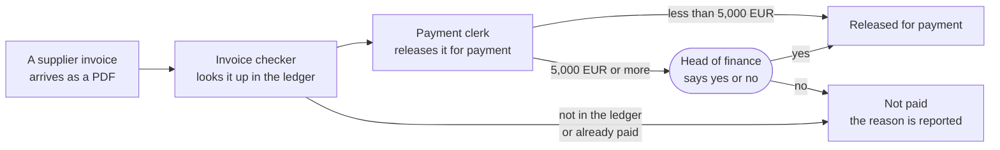

Two [**agents**](../reference/glossary.md#agent) do the work. An agent is an AI model with one job, its tools and
its rules. Between the agents and the payment stands a person: the
[**approval**](../reference/glossary.md#approval) of the head of finance.

**Before you start**, you need:

- awa installed ([Install](../start/install.md)) and the key of an AI provider.
- About 30 minutes with the sample files. Your own process takes longer: you prepare your data, connect your
  systems, and adapt awa's draft until it passes your own cases.
- The sample files. They are in the awa folder under `docs/guide/files/` (a wheel does not contain them; the links
  download them): two invoices, [INV-2041.pdf](files/INV-2041.pdf) (1,180.00 EUR) and
  [INV-2042.pdf](files/INV-2042.pdf) (7,450.00 EUR), the list [purchase_orders.csv](files/purchase_orders.csv) and
  the ledger [company-ledger.db](files/company-ledger.db).

Each step names its goal and shows what to do, in the web app or in a terminal. Both write the same project folder,
so pick one. Each step ends with the result you should have.

The pictures and the terminal output come from a test that runs every step with a scripted model, so they are the
same every time. With your own model the screens look the same, but the answers are worded differently and the
numbers of model calls and tokens differ. The work folder in the pictures is `C:\awa-guide-work`; yours can be any
folder.

## Step 1: Check the installation

**Goal:** know that awa is installed and what it still needs. Open a terminal, make a work folder and run
`awa doctor` in it:

```console
mkdir awa-guide-work
cd awa-guide-work
```

<!-- guide:run shot=a01-doctor exit=78 -->
```console
$ awa doctor
awa doctor
...
Result: usable...
doctor checks this machine and the settings only; `--check-models` calls the models, `awa check` Microsoft 365.
```

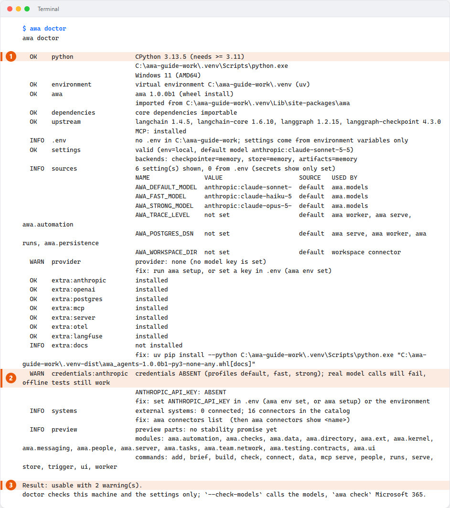

--8<-- "docs/assets/screenshots/guide/a01-doctor.legend.txt"

**What you see:** one line per check. `OK` passed. `WARN` is something you need later. `FAIL` blocks awa, and the
line under it says how to fix it.

**Result:** awa is usable. The warning about the missing key is expected; you save the key in step 2. Until then
`awa doctor` ends with exit code 78 ("a required part is missing"). Fix a `FAIL` line first:
[Troubleshooting](troubleshooting.md#what-awa-doctor-tells-you).

## Step 2: Open the web app and save your key

**Goal:** let awa call an AI model. awa calls the model through your provider, and the provider's **key** proves
that the request comes from you.

=== "Web app"

    1. Start the web app for a new project folder. The folder `invoice-desk` is created:

        ```console
        awa ui --project invoice-desk
        ```

        awa prints a link and opens your browser. Keep the terminal open; closing it stops the web app.

    2. On the page **Set up**, open the card of your provider under **AI model** and paste the key.
    3. Press **Save and continue**.

    

    --8<-- "docs/assets/screenshots/guide/a02-setup.legend.txt"

=== "Terminal"

    1. Create the file `invoice-desk/.env` with one line, the name of your provider's key setting and your key:

        <!-- guide:file invoice-desk/.env -->
        ```text
        ANTHROPIC_API_KEY=your-key-here
        ```

    2. Go into the project folder and run the health check again:

        <!-- guide:run -->
        ```console
        $ cd invoice-desk
        $ awa doctor
        awa doctor
        ...
          OK    .env                   found C:\awa-guide-work\invoice-desk\.env
        ...
          OK    credentials:anthropic  credentials present (profiles default, fast, strong)
                                       ANTHROPIC_API_KEY: PRESENT
        ...
        Result: usable...
        doctor checks this machine and the settings only; `--check-models` calls the models, `awa check` Microsoft 365.
        ```

**What you see:** the provider card says **Ready**, and `awa doctor` says `PRESENT`. awa never shows a saved key
again.

**Result:** the key is saved in `invoice-desk/.env`, on this computer only. Never share `.env`; the project download
of the web app leaves it out. From now on, run every terminal command in the folder `invoice-desk`.

## Step 3: Bring your files and your ledger

**Goal:** let awa design the process on your data instead of inventing some.

1. Make a folder `invoice-files` in `awa-guide-work` and put the three sample files in it.
2. Put the ledger `company-ledger.db` directly in `awa-guide-work`. The ledger is a system that awa reads where it
   is; awa does not copy it.

<!-- guide:do copy awa:docs/guide/files/INV-2041.pdf invoice-files/INV-2041.pdf -->
<!-- guide:do copy awa:docs/guide/files/INV-2042.pdf invoice-files/INV-2042.pdf -->
<!-- guide:do copy awa:docs/guide/files/purchase_orders.csv invoice-files/purchase_orders.csv -->
<!-- guide:do copy awa:docs/guide/files/company-ledger.db company-ledger.db -->

Then show awa the files and the ledger:

=== "Web app"

    1. Open the page **Data** and drop the three files onto the box under **Files**. awa copies them into the
       project and reads them; your originals are never changed.
    2. Under the card of `purchase_orders.csv`, write in **What should happen with this data?**:
       `Match each invoice to its purchase order by the PO number and check the amount.`

    

    --8<-- "docs/assets/screenshots/guide/a03-data.legend.txt"

    3. Under **External systems**, open **Add an external system**. Choose **SQL database**, name it
       `Invoice ledger`, choose **SQLite file** and enter the full path of `company-ledger.db`. Press **Test
       connection**: awa makes one small, read-only call.

    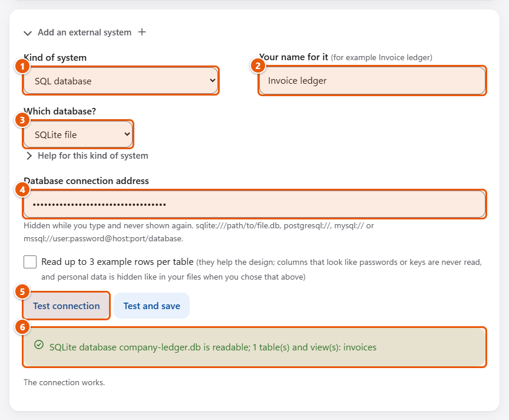

    --8<-- "docs/assets/screenshots/guide/a03-systems-test.legend.txt"

    4. Press **Test and save**. awa saves the path in `.env` and reads the structure of the ledger: its table and
       columns, no rows.

    

    --8<-- "docs/assets/screenshots/guide/a03-systems.legend.txt"

=== "Terminal"

    `awa data inspect` shows what awa finds in the files and changes nothing:

    <!-- guide:run shot=a03-inspect -->
    ```console
    $ awa data inspect ../invoice-files
    3 files, 1 table, 2 rows, 0 warnings, 0 errors

    file                 kind  content                status  flags
    INV-2041.pdf         pdf   1 page (born digital)  ok      -
    INV-2042.pdf         pdf   1 page (born digital)  ok      -
    purchase_orders.csv  csv   2 rows                 ok      -
    ...
    purchase_orders.csv  (csv, 109 bytes, ok)
      encoding utf-8, delimiter ',', line ends lf
      table: 2 rows, header row 1
        po                     text       unique  e.g. PO-7710, PO-7725
        vendor                 text       unique  e.g. Nordwind Office GmbH, Alpen Maschinenbau AG
        amount                 decimal    decimal '.'  unique  1180.0 to 7450.0  e.g. 1180.00, 7450.00
        status                 enum       e.g. open
    ```

    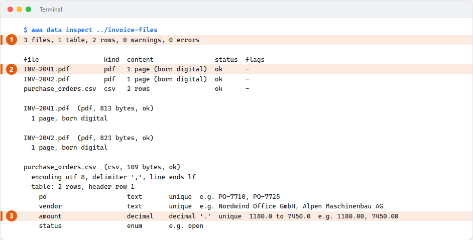

    --8<-- "docs/assets/screenshots/guide/a03-inspect.legend.txt"

    `awa data add-system` asks for the path of the ledger with hidden input, tests it and reads its structure:

    <!-- guide:run shot=a03-add-system input="../company-ledger.db" -->
    ```console
    $ awa data add-system . --type sql --name "Invoice ledger"
      INVOICE_LEDGER_DATABASE_URL, hidden:
    Test passed: SQLite database company-ledger.db is readable; 1 table(s) and view(s): invoices
    Saved INVOICE_LEDGER_DATABASE_URL in .env (never shown again)
    Declared Invoice ledger (SQLite database) as `invoice_ledger` in data/SYSTEMS.json
    Invoice ledger (SQLite database), id invoice_ledger: live, read-only
      table invoices, about 3 rows: invoice_id TEXT NOT NULL, supplier TEXT, po_number TEXT, amount_eur REAL, status TEXT
      tools: invoice_ledger_schema, invoice_ledger_query
    Next: awa build "<your process>" --out .  (the design reads it live, read-only)
    ```

    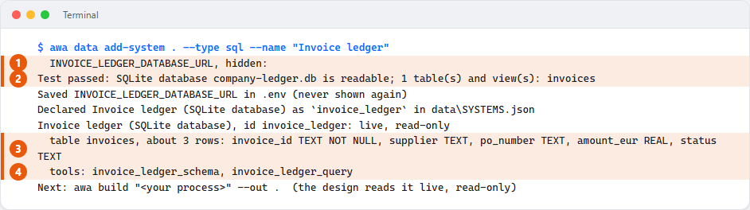

    --8<-- "docs/assets/screenshots/guide/a03-add-system.legend.txt"

**What you see:** one card per file with what awa found in it, and the ledger marked **Live, read-only**.

**Result:** the files are copied into `invoice-desk/data/files`. The ledger is declared in `data/SYSTEMS.json`, and
its address is in `.env`. For your own process, bring files that look like real cases, including the unusual ones:
awa writes its eval cases from them. [Your files](files.md) lists every file type awa reads;
[Connect systems](connect.md) covers databases and web services.

## Step 4: Describe the process

**Goal:** a first draft of the system, with eval cases. You write down in your own words what happens. awa writes
[eval cases](../reference/glossary.md#eval-case) from it, drafts the agents and tests the draft on sample data.
This is the description of the invoice desk:

> Supplier invoices arrive as PDF files. For each invoice, look it up in our invoice ledger by its invoice number
> and check its purchase order. An invoice that is already paid is never paid twice. An open invoice under 5,000
> EUR is released for payment right away. From 5,000 EUR the head of finance must approve the payment first. If
> the invoice is not in the ledger, say so and do not release it.

=== "Web app"

    1. Open the page **Describe**. Under **The data the design uses** it lists your files and your ledger.
    2. Paste the description into the large box. Leave **Test and repair it automatically** on.

    

    --8<-- "docs/assets/screenshots/guide/a04-describe-before.legend.txt"

    3. Press **Create my system**. The build usually takes a few minutes, depending on your model. Five steps are
       ticked as they finish.

    

    --8<-- "docs/assets/screenshots/guide/a04-describe-after.legend.txt"

=== "Terminal"

    `--out .` writes the project into the current folder, where awa finds the ledger of step 3. `--data` and
    `--note` hand over the files and the note. `--no-input` skips the question of what should start the system;
    step 9 answers it.

    <!-- guide:run shot=a04-build -->
    ```console
    $ awa build "Supplier invoices arrive as PDF files. For each invoice, look it up in our invoice ledger by its invoice number and check its purchase order. An invoice that is already paid is never paid twice. An open invoice under 5,000 EUR is released for payment right away. From 5,000 EUR the head of finance must approve the payment first. If the invoice is not in the ledger, say so and do not release it." --out . --no-input --data ../invoice-files --note "purchase_orders.csv=Match each invoice to its purchase order by the PO number and check the amount."
    [systems] Invoice ledger (SQLite database): live, read-only (declared in data/SYSTEMS.json)
    [profile] Reading your files
    [profile] INV-2041.pdf: pdf (ok)
    [profile] INV-2042.pdf: pdf (ok)
    [profile] purchase_orders.csv: csv (ok)
    [profile] Read 3 file(s): 1 table(s), 2 row(s), 0 warning(s), 0 unreadable
    [design] Writing the acceptance tests, then the design
    [design] The acceptance tests are written: 3 case(s)
    [design] The blueprint 'invoice_desk' is designed
    [evaluate] Round 1: running the cases
    [evaluate] Case small-invoice: passed
    [evaluate] Case large-invoice: passed
    [evaluate] Case paid-invoice: passed
    [evaluate] Round 1: 3 of 3 cases pass
    [write] Writing the project to .
    [write] The project is written
    [done] Target reached
    invoice_desk: 3 of 3 eval cases pass (100%) on the local workspace after 1 round(s); target reached.
    Project folder: .
    Where the data comes from:
      - Invoice ledger (SQLite database): live. The agents reach it through the SQL connector with read-only queries; the test runs read it too. It was declared under Your data, so the design uses its real tables.
        details: blueprint.yaml connectors: invoice_ledger: use sql; read-only; settings INVOICE_LEDGER_DATABASE_URL; tools invoice_ledger_query
    Refinement: none (the traces show nothing to refine).
    Model usage: 13 call(s) (design 2, evaluation 11, judges 0, repair 0), 8601 tokens.
    Next: read README.md and CONNECT.md in the project folder.
    ```

    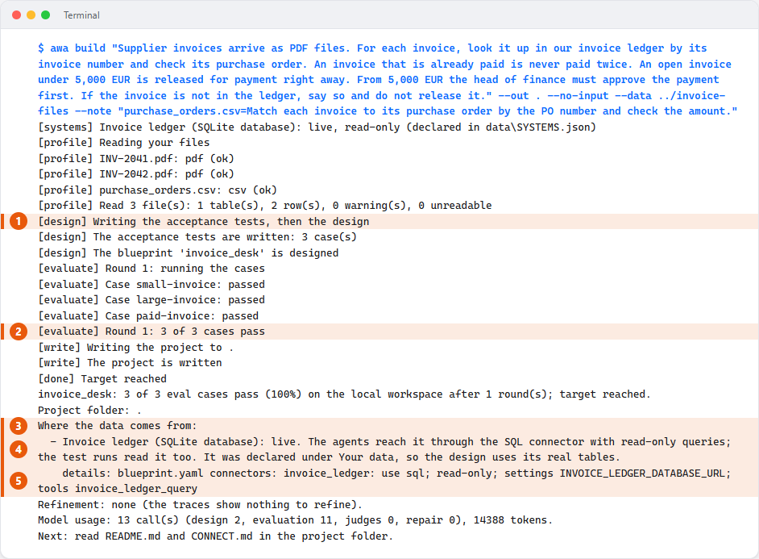

    --8<-- "docs/assets/screenshots/guide/a04-build.legend.txt"

**What you see:** awa reads your data and writes eval cases from your words. Then it designs the agents, runs every
case and repairs a failing design, in up to three rounds. The **data map** says where each source of data comes
from: here the ledger is live and read-only.

**Result:** the folder `invoice-desk` holds the system, all in plain text:

- `blueprint.yaml`: the agents, the approval and the ledger.
- `evals/cases.yaml`: the eval cases.
- `tools.py`: the approval step as a small function.
- `README.md`: the assumptions awa made.

"3 of 3 cases pass" means that the draft fits the cases awa wrote from your words. It does not prove that the
process is right; you check that in steps 5 and 7. With a real model the draft can differ from run to run.
[Describe a process](describe.md) shows how to write a description that works.

## Step 5: Review the design

**Goal:** know who does what before anything runs. Read what the system will do, and change what does not match
how the work is really done.

=== "Web app"

    Open the page **Review**. It shows how the work flows, each agent with its tools (*asks you first* marks a tool
    that waits for a person), where the data comes from, and the eval cases.

    

    --8<-- "docs/assets/screenshots/guide/a05-review.legend.txt"

=== "Terminal"

    <!-- guide:run shot=a05-show -->
    ```console
    $ awa validate blueprint.yaml
    invoice_desk: valid
    $ awa show blueprint.yaml
    invoice_desk 1.0.0
    Checks supplier invoices against the ledger and releases them for payment.
    entrypoint: workflow

    agent            model    tools                 skills  description
    invoice_checker  default  invoice_ledger_query  -       Looks the invoice up in the ledger and checks its purchas...
    payment_clerk    default  finance_approval      -       Releases checked, open invoices for payment.

    workflow: invoice_checker -> payment_clerk

    approvals: finance_approval (when amount_eur >= 5000)
    ```

    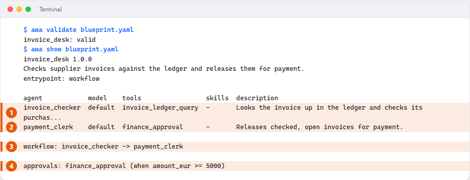

    --8<-- "docs/assets/screenshots/guide/a05-show.legend.txt"

**What you see:** the invoice checker reads the ledger with `invoice_ledger_query` and cannot change it. The payment
clerk calls `finance_approval`, and from 5,000 EUR that call waits for a person. In `blueprint.yaml` both rules are
code, not sentences the model could forget:

<!-- guide:contains blueprint.yaml -->
```yaml
connectors:
  invoice_ledger:
    use: sql
    env:
      DATABASE_URL: INVOICE_LEDGER_DATABASE_URL
    read_only: true
```

```yaml
approvals:
- tool: finance_approval
  when: amount_eur >= 5000
```

**Result:** you know who does what, what each agent reads, and which step waits for a person. To change the
condition, see [Approvals](approvals.md); after a change, `awa validate blueprint.yaml` checks the file again.

## Step 6: Check the connections

**Goal:** make sure no important system still works on sample records. Every external system of a process is either
**live** (reached for real) or a [**stand-in**](../reference/glossary.md#stand-in): sample records awa wrote from
your description, so the tests have something to work on.

=== "Web app"

    Open the page **Connect**. The ledger is marked **Live**, because you added it in step 3.

    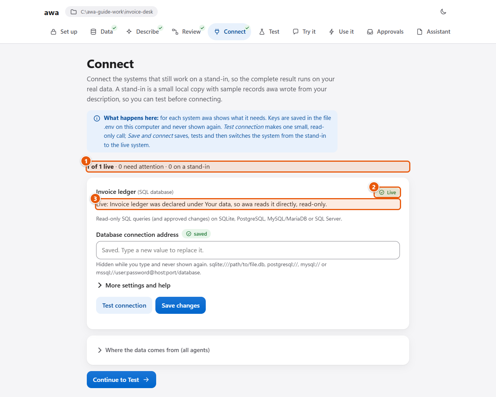

    --8<-- "docs/assets/screenshots/guide/a06-connect.legend.txt"

=== "Terminal"

    `awa connect` walks through every system that still works on a stand-in:

    <!-- guide:run shot=a06-nothing -->
    ```console
    $ awa connect .
    There is nothing to connect.
    ```

    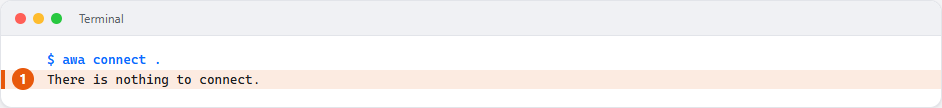

    --8<-- "docs/assets/screenshots/guide/a06-nothing.legend.txt"

**Result:** the agents read your real ledger. A system that you skip in step 3 gets a stand-in. You connect it here
later, without building again ([Connect systems](connect.md)). For a real system, ask your IT team for a read-only
login first.

## Step 7: Run the tests

**Goal:** know, with numbers, whether the system does what the process needs. awa wrote three eval cases; this is
the second one:

<!-- guide:contains evals/cases.yaml -->
```yaml
- id: large-invoice
  input: Please release invoice INV-2042 for payment.
  scorers:
  - approval_requested:finance_approval
  - contains:INV-2042
  decisions:
  - action: approve
    tool: finance_approval
```

The case passes only when the head of finance was asked and the answer names the invoice. The test plays the head
of finance and approves.

=== "Web app"

    Open the page **Test** and press **Run all tests**.

    

    --8<-- "docs/assets/screenshots/guide/a07-test.legend.txt"

=== "Terminal"

    <!-- guide:run shot=a07-eval -->
    ```console
    $ awa eval blueprint.yaml evals/cases.yaml
    Evaluation: invoice_desk
    ========================

    System invoice_desk on dataset invoice_desk: 3 case(s) x 1 repetition(s).

    - Pass rate: 100.0% (3/3 runs)
    - Errors: 0
    - Usage: 11 model call(s), 3035 tokens (2874 in, 161 out), 5 tool call(s)
    ...
    Cases
    -----

      case           passed  scores                                                                                      ms  tokens
      small-invoice  1/1     tool:invoice_ledger_query 1.00, no_approval:finance_approval 1.00, contains:INV-2041 1.00  387    1121
      large-invoice  1/1     approval_requested:finance_approval 1.00, contains:INV-2042 1.00                           385    1121
      paid-invoice   1/1     no_approval:finance_approval 1.00, contains:paid 1.00                                      289     793
    ```

    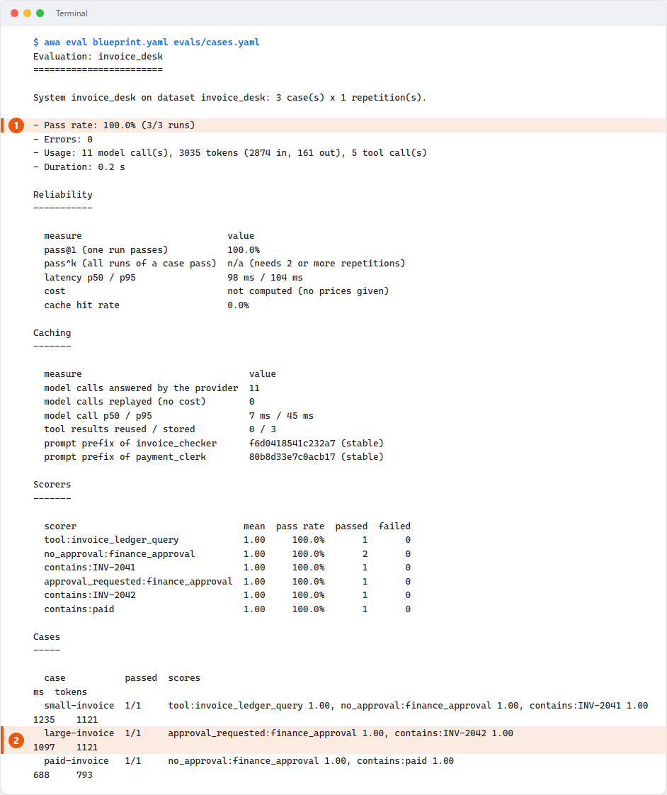

    --8<-- "docs/assets/screenshots/guide/a07-eval.legend.txt"

**What you see:** each case with **Passed**, **Failed** or **Could not run**, and its answer. For a failed case you
see the check that failed and why. `awa eval` ends with exit code 1 when a case fails, so a script can stop on it.

**Result:** all three cases pass. Run the tests after every change. Three cases are a start, not an acceptance:

- Add cases from your own data, including the ones that must be refused.
- Repeat them with `--repetitions 3` to see [pass^k](../reference/glossary.md#pass-k).

[Test and improve](test.md) shows how to add cases and compare before and after a change.

## Step 8: Try it with an approval

**Goal:** see the approval work. You talk to the system yourself and watch it stop before a large payment.

=== "Web app"

    1. Open the page **Try it**, type `Please release invoice INV-2042 for payment.` and press **Send**.
    2. The system shows each step in plain words. Then it stops with the card **Please check before this happens**:
       the invoice, the amount and why you are asked.

    

    --8<-- "docs/assets/screenshots/guide/a08-try-approval.legend.txt"

    3. Press **Approve**. The system continues and releases the invoice.

    

    --8<-- "docs/assets/screenshots/guide/a08-try-answer.legend.txt"

=== "Terminal"

    `awa chat` asks `approve? [y/N]` when a step needs your OK. Type `y` to approve; anything else says no.

    <!-- guide:run shot=a08-chat input="Please release invoice INV-2041 for payment.|Please release invoice INV-2042 for payment.|y|Please release invoice INV-2043 for payment.|/exit" -->
    ```console
    $ awa chat blueprint.yaml
    chatting with 'invoice_desk'; note: it keeps no conversation state, so each message runs on its own (single turn). /help for commands
    you> Please release invoice INV-2041 for payment.
      invoice_checker -> invoice_ledger_query({"query": "SELECT supplier, po_number, amount_eur, status FROM invoices WHERE invoice_id = ?", "p...)
    invoice_checker: Invoice INV-2041 from Nordwind Office GmbH: 1,180.00 EUR, purchase order PO-7710, status open.
      payment_clerk -> finance_approval({"invoice_id": "INV-2041", "amount_eur": 1180.0})
    payment_clerk: Invoice INV-2041 from Nordwind Office GmbH (1,180.00 EUR) is released for payment.
    you> Please release invoice INV-2042 for payment.
      invoice_checker -> invoice_ledger_query({"query": "SELECT supplier, po_number, amount_eur, status FROM invoices WHERE invoice_id = ?", "p...)
    invoice_checker: Invoice INV-2042 from Alpen Maschinenbau AG: 7,450.00 EUR, purchase order PO-7725, status open.
      payment_clerk -> finance_approval({"invoice_id": "INV-2042", "amount_eur": 7450.0})
    approval needed: finance_approval({"invoice_id": "INV-2042", "amount_eur": 7450.0})
    approve? [y/N] y
    invoice_desk: Invoice INV-2042 from Alpen Maschinenbau AG (7,450.00 EUR) is released for payment.
    you> Please release invoice INV-2043 for payment.
      invoice_checker -> invoice_ledger_query({"query": "SELECT supplier, po_number, amount_eur, status FROM invoices WHERE invoice_id = ?", "p...)
    invoice_checker: Invoice INV-2043 from Nordwind Papier KG: 342.50 EUR, purchase order PO-7731, status paid.
    payment_clerk: Invoice INV-2043 is already paid; nothing to release.
    you> /exit
    ```

    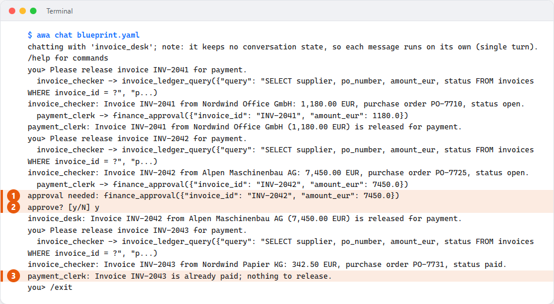

    --8<-- "docs/assets/screenshots/guide/a08-chat.legend.txt"

**What you see:** INV-2041 (1,180.00 EUR) is released at once. INV-2042 (7,450.00 EUR) waits for you. INV-2043 is
already paid and is not paid again. When you say no, your note goes to the agent and nothing is paid:

<!-- guide:run input="Please release invoice INV-2042 for payment.|n|Wait for the delivery note.|/exit" -->
```console
$ awa chat blueprint.yaml
chatting with 'invoice_desk'; note: it keeps no conversation state, so each message runs on its own (single turn). /help for commands
you> Please release invoice INV-2042 for payment.
  invoice_checker -> invoice_ledger_query({"query": "SELECT supplier, po_number, amount_eur, status FROM invoices WHERE invoice_id = ?", "p...)
invoice_checker: Invoice INV-2042 from Alpen Maschinenbau AG: 7,450.00 EUR, purchase order PO-7725, status open.
  payment_clerk -> finance_approval({"invoice_id": "INV-2042", "amount_eur": 7450.0})
approval needed: finance_approval({"invoice_id": "INV-2042", "amount_eur": 7450.0})
approve? [y/N] n
note for the agent (optional): Wait for the delivery note.
invoice_desk: Invoice INV-2042 stays on hold: Tool call to 'finance_approval' was rejected by a human reviewer and was not executed. Reason: Wait for the delivery note. Do not retry this call unless the user asks for it.
you> /exit
```

**Result:** awa enforces the approval on every call of `finance_approval`, whatever the model says. It checks the
amount that the agent passes in; that is why the tests of step 7 check it.

## Step 9: Let a trigger start it

**Goal:** a run starts when an invoice arrives, without anyone typing a request. A
[**trigger**](../reference/glossary.md#trigger) starts a run when something happens. Here it is a PDF that lands in
the folder `inbox`.

=== "Web app"

    1. Open the page **Use it**, then **Add another trigger**. Choose `file-drop`, the folder `inbox`, the files
       `*.pdf` and the name `new-invoice`.
    2. Under **What the system should do with each one**, write
       `Check the invoice in {payload.name} and release it for payment. The invoice says: {payload.text}`
       (awa fills in the name and the text of each file) and press **Add this trigger**.

    

    --8<-- "docs/assets/screenshots/guide/a09-trigger-form.legend.txt"

    3. To try it without a real file, open **Run it now with a sample** on the trigger's card. Fill in a name and a
       text and press **Run it now with this sample**. The run stops at the approval; you answer it in step 10.

    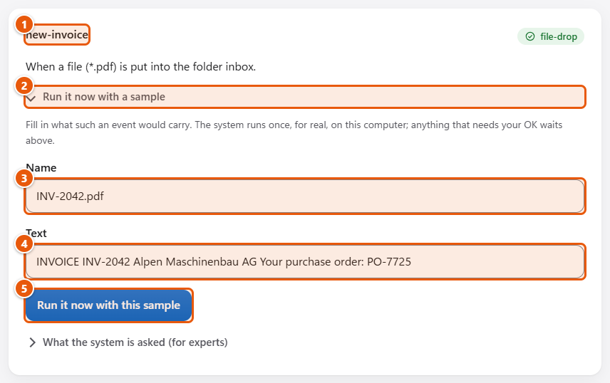

    --8<-- "docs/assets/screenshots/guide/a09-trigger-sample.legend.txt"

=== "Terminal"

    <!-- guide:run shot=a09-trigger -->
    ```console
    $ awa add trigger blueprint.yaml --kind file-drop --directory inbox --pattern "*.pdf" --name new-invoice --input "Check the invoice in {payload.name} and release it for payment. The invoice says: {payload.text}"
    added trigger 'new-invoice' to blueprint.yaml:
      - name: new-invoice
        file_drop:
          directory: inbox
          pattern: '*.pdf'
        input: 'Check the invoice in {payload.name} and release it for payment. The invoice says: {payload.text}'
    note: the blueprint has no `limits:`; add e.g. `limits: {max_requests: 100, max_total_tokens: 200000}` so a triggered run cannot use as much as it likes

    Start it:
      awa worker blueprint.yaml
      (It runs until you stop it with Ctrl+C. Runs that need an approval wait; answer them with `awa runs decide` or on the Approvals page of `awa ui`.)

    new-invoice: drop files (*.pdf) into:
      inbox
      (Handled files move to processed/, refused ones to failed/.)

    Try new-invoice without waiting for a real event:
      awa trigger run blueprint.yaml new-invoice --payload "@new-invoice.json" --dry-run
      (First save a sample event as new-invoice.json in this folder, for example {"name": "...", "text": "..."}. Shows the task the system would get; leave out --dry-run to run it once.)
    ```

    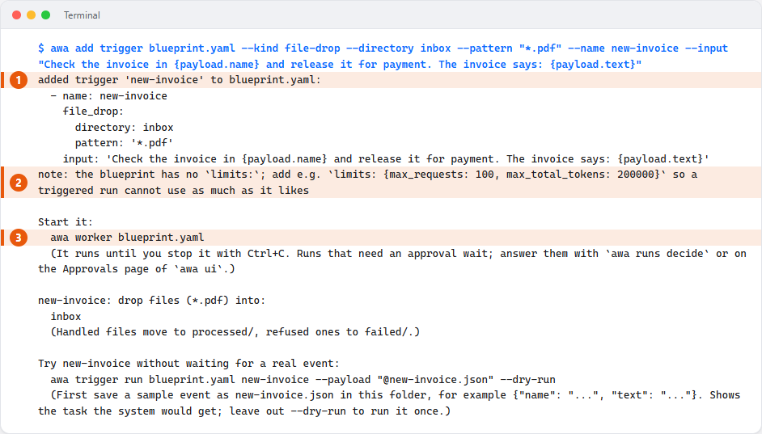

    --8<-- "docs/assets/screenshots/guide/a09-trigger.legend.txt"

**Give every run a budget.** Nobody watches a run that a trigger starts at night. A
[limit](../reference/glossary.md#usage-limit) stops it when it uses too much. Add these lines at the end of
`blueprint.yaml`: at most 30 model calls and 5 minutes per run.

<!-- guide:file blueprint.yaml append -->
```yaml
limits:
  max_requests: 30
  max_duration: 5m
```

<!-- guide:run -->
```console
$ awa validate blueprint.yaml
invoice_desk: valid
```

**See what a file would become** before a real one arrives. Save a sample event as `new-invoice.json`:

<!-- guide:file new-invoice.json -->
```json
{"name": "INV-2042.pdf", "text": "INVOICE INV-2042"}
```

<!-- guide:run -->
```console
$ awa trigger list blueprint.yaml
NAME         KIND       DETAILS
new-invoice  file_drop  directory=C:\awa-guide-work\invoice-desk\inbox, pattern=*.pdf
$ awa trigger run blueprint.yaml new-invoice --payload "@new-invoice.json" --dry-run
input:     Check the invoice in INV-2042.pdf and release it for payment. The invoice says: INVOICE INV-2042
thread_id: (one per run)
dedup_key: (none)
```

**Drop a real invoice.**

1. Create the folder `inbox` in `invoice-desk` and copy `INV-2042.pdf` into it.
2. Start the **worker**, the program that watches the triggers and executes the runs. `--once` handles what is
   there and stops:

<!-- guide:do copy awa:docs/guide/files/INV-2042.pdf invoice-desk/inbox/INV-2042.pdf -->
<!-- guide:run shot=a09-worker exit=2 -->
```console
$ awa worker blueprint.yaml --once
runs are kept in C:\awa-guide-work\invoice-desk\.awa\awa.db and paused runs in C:\awa-guide-work\invoice-desk\.awa\checkpoints.db (this machine); use --dsn (or $AWA_POSTGRES_DSN) to share them with workers elsewhere
proc_8f3a1c9d2b47 invoice_desk waiting attempts=1 tokens=901 waiting_for=approval:4f2508ee9bcba627937489ca3f4390bd
```

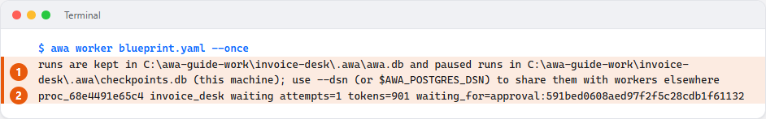

--8<-- "docs/assets/screenshots/guide/a09-worker.legend.txt"

**What you see:** the worker read the PDF and started a **run** with its own id (`proc_...`). The payment clerk
reached the approval for 7,450 EUR, so the run is `waiting`. The PDF moved to `inbox/processed/`.

**Result:** the worker starts a run for every PDF in `inbox`, with a budget per run. [Run automatically](run.md)
shows schedules, mailboxes and web requests.

## Step 10: Answer the approval and finish the run

**Goal:** decide the waiting payment and let the run finish. awa keeps the waiting run in the folder `.awa`, so you
can answer later, and the worker can stop in between. List the waiting runs:

<!-- guide:run -->
```console
$ awa runs list --status waiting
RUN                AUTOMATION    STATUS   ATTEMPTS  TOKENS  COST  CREATED (UTC)        TRIGGER
proc_8f3a1c9d2b47  invoice_desk  waiting  1         901     -     2026-10-05 16:32:55  new-invoice
```

=== "Web app"

    1. Open the page **Use it**. Under **Waiting for your OK** you see the run and the same card as in step 8.
       Press **Approve**.

    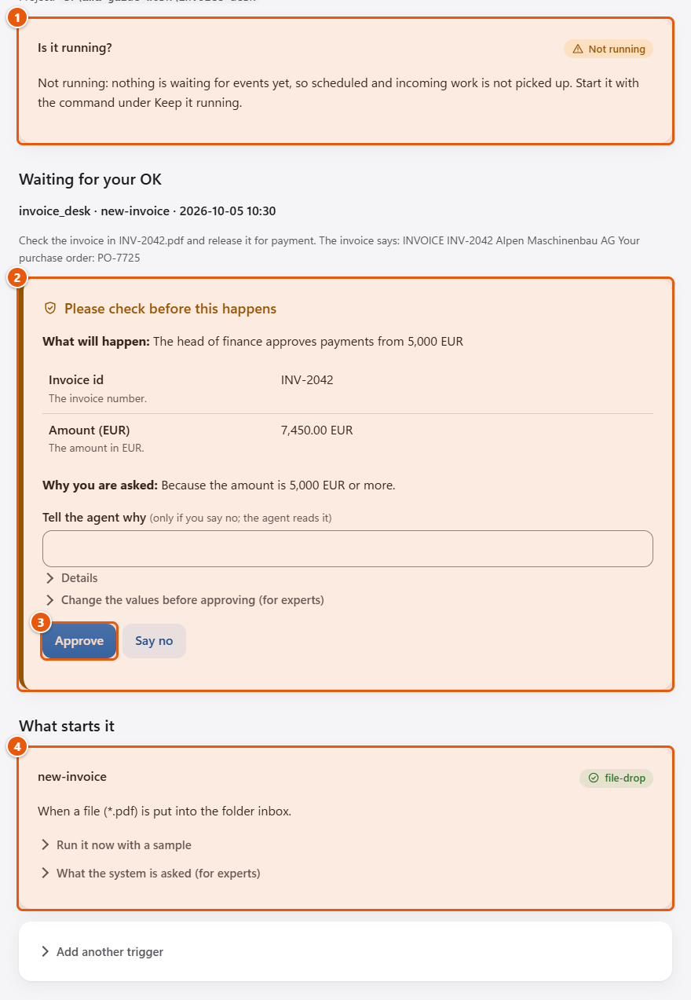

    --8<-- "docs/assets/screenshots/guide/a10-use-it-waiting.legend.txt"

    2. No worker is running, so the page offers **Continue it now**. Press it: the run finishes on your computer.
       Under **Keep it running** you find the command that starts the worker for good.

    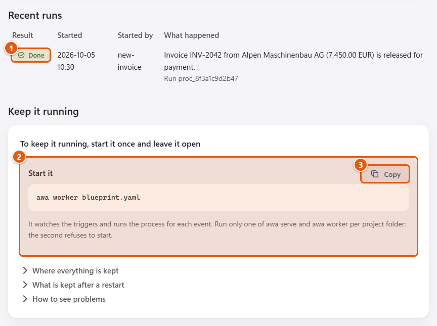

    --8<-- "docs/assets/screenshots/guide/a10-use-it-done.legend.txt"

    When many runs wait, use the page **Approvals**. It lists every waiting run of the project with the same card.

    

    --8<-- "docs/assets/screenshots/guide/a10-approvals.legend.txt"

=== "Terminal"

    Use the id from the list. `--actor` records who decided; `--reject --note "..."` says no.

    <!-- guide:run -->
    ```console
    $ awa runs decide RUN_ID --approve --actor "Head of finance"
    proc_8f3a1c9d2b47 invoice_desk queued attempts=1 tokens=901
    ```

    A new worker finds the run, reads the decision and continues where the run stopped:

    <!-- guide:run -->
    ```console
    $ awa worker blueprint.yaml --once
    runs are kept in C:\awa-guide-work\invoice-desk\.awa\awa.db and paused runs in C:\awa-guide-work\invoice-desk\.awa\checkpoints.db (this machine); use --dsn (or $AWA_POSTGRES_DSN) to share them with workers elsewhere
    proc_8f3a1c9d2b47 invoice_desk succeeded attempts=1 tokens=1223
    $ awa runs list
    RUN                AUTOMATION    STATUS     ATTEMPTS  TOKENS  COST  CREATED (UTC)        TRIGGER
    proc_8f3a1c9d2b47  invoice_desk  succeeded  1         1223    -     2026-10-05 16:32:55  new-invoice
    ```

Every run leaves a **trace**, the record of what it did:

<!-- guide:run shot=a10-trace -->
```console
$ awa runs trace RUN_ID
Trace of run proc_8f3a1c9d2b47, attempt 1
  automation invoice_desk, trigger new-invoice, thread_id proc_8f3a1c9d2b47
  file .awa/traces/proc_8f3a1c9d2b47.a1.jsonl (level summary)
Result: finished
Totals: 4 model calls, 1,223 tokens (1,164 in, 59 out), time 251 ms
        agents 3, tool calls 2 (0 only hand work to other agents), delegations 0, consultations 0, handoffs 0, approvals 1 asked / 1 answered

workflow invoice_desk  [no model calls, 251 ms]
  agent invoice_checker  [2 model calls, 608 tokens, 112 ms]
    tool invoice_ledger_query {"query": "SELECT supplier, po_number, amount_eur, status FROM invoices WHERE invoice_id = ?", "parameters": ["INV-2042"]} -> ok (17 ms)
  agent payment_clerk  [2 model calls, 615 tokens, 101 ms]
    tool finance_approval {"invoice_id": "INV-2042", "amount_eur": 7450.0} -> ok (after the approval)
    approval for finance_approval: approved by Head of finance after 251 ms (no reason given)

Note: level summary keeps no message texts (prompts, replies, tool results). Record with level full to see them.
Note: no prices, so no cost. Add `prices:` to the blueprint or pass --prices FILE.
```

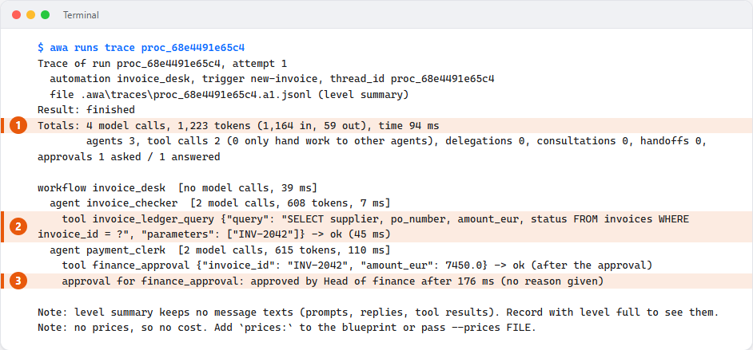

--8<-- "docs/assets/screenshots/guide/a10-trace.legend.txt"

**What you see:** the run is `succeeded`. The trace shows who did what: the checker read the ledger, the clerk's
call waited for the approval, and the head of finance approved it.

**Result:** the run finished after a restart, and nothing was asked twice. To keep the desk running, leave
`awa worker blueprint.yaml` open in a terminal. Ctrl+C stops it and gives running work up to 30 seconds to finish.
[Keep it running](operate.md) covers retries, deadlines and running it for a team.

## Step 11: See the run in Langfuse

**Goal:** follow every step of a run in the browser. Langfuse is an open-source tracing tool that runs on your own
computer. With [Langfuse set up](langfuse.md), every run of the steps above appears there, with each agent, model
call, tool call and approval. The picture shows a run of the invoice desk for INV-2042, made with a scripted model,
that paused at the approval:


*One run as a tree: both agents with every model and tool call, and the run's time, cost and tokens.*

**What you see:** the tree of the run on the left, and for each step its time, tokens and cost. The call of
`finance_approval` that waited for the head of finance is marked as a warning;
[Approvals](approvals.md#see-an-approval-in-langfuse) shows the pause and the decision.

**Result:** you can follow any run in the browser, filter runs by blueprint or run id, and show a colleague what an
agent did.

## What you built

| In the folder `invoice-desk` | What it holds | Step |
| --- | --- | --- |
| `blueprint.yaml` | The agents, the approval, the ledger, the trigger and the limits. | 4, 9 |
| `evals/cases.yaml` | The eval cases. | 4, 7 |
| `tools.py` | The approval step as a small function. | 4 |
| `data/` | The copies of your files (`data/files`), the declared ledger (`data/SYSTEMS.json`), the results (`data/output`). | 3, 4 |
| `.env` | Your key and the address of the ledger. Never share it. | 2, 3 |
| `inbox/` | The invoices that arrive, and `inbox/processed/` for the handled ones. | 9 |
| `.awa/` | The runs, the waiting approvals and the traces. | 9, 10 |

[The project folder](../develop/project-folder.md) explains every file, and how to work on the same folder from
Python.

This is a pilot on sample files and a sample ledger. Before it handles real invoices, you need your own data, a
read-only login to your ledger, eval cases from your own invoices that pass, and the agreement of the people
responsible.

## What next

| You want to | Read |
| --- | --- |
| Describe your own process, or write the blueprint by hand | [Describe a process](describe.md) |
| Work on your own files: CSV, Excel, PDF, Word, email | [Your files](files.md) |
| Connect a database, a web service, a CRM or a mailbox | [Connect systems](connect.md) |
| Work with Microsoft 365 mail, files and Teams channels | [Microsoft 365](microsoft-365.md) |
| Let several agents work as a team | [Agents and teams](agents-and-teams.md) |
| Decide who approves what, and from which amount | [Approvals](approvals.md) |
| Add eval cases and compare before and after a change | [Test and improve](test.md) |
| Start by schedule, email or web request | [Run automatically](run.md) |
| Cap the cost of a run, find why a run failed, run it for a team | [Keep it running](operate.md) |
| See every run in the browser | [Langfuse](langfuse.md) |
| Every page of the web app | [The web app](web-app.md) |
| Start from a finished example | [Examples](examples.md) |
| A message you do not understand | [Troubleshooting](troubleshooting.md) |
