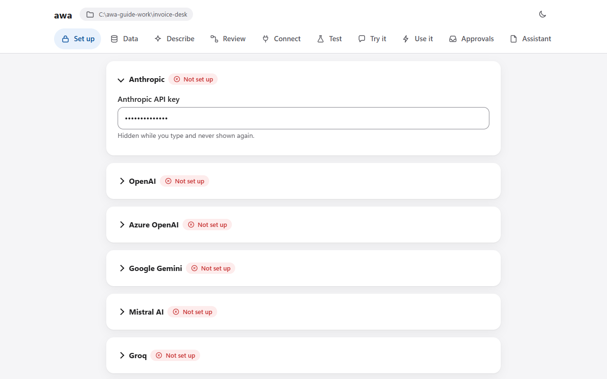
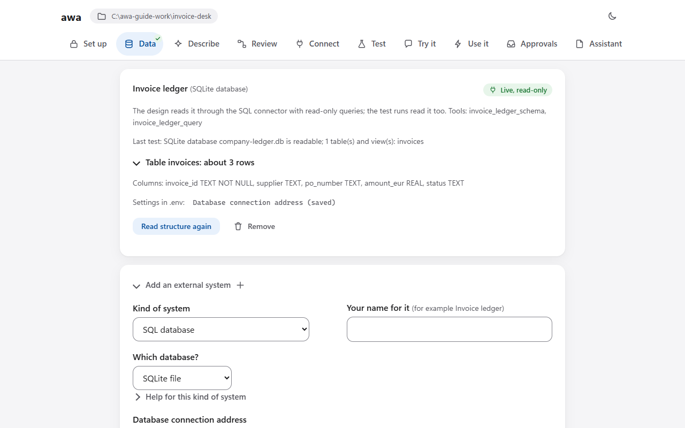
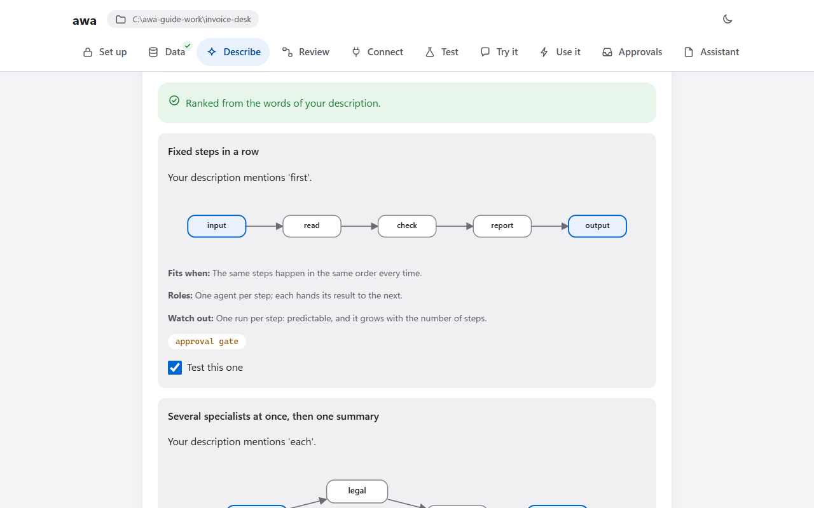
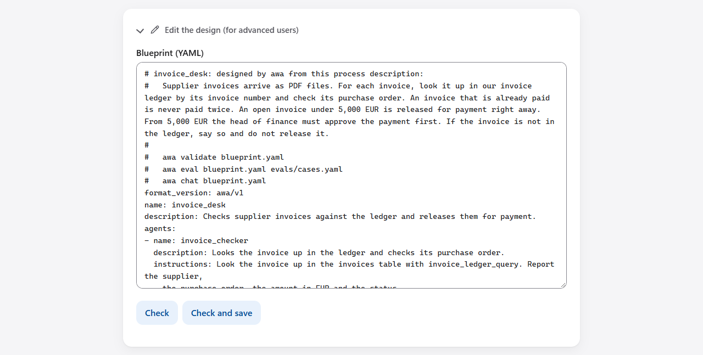
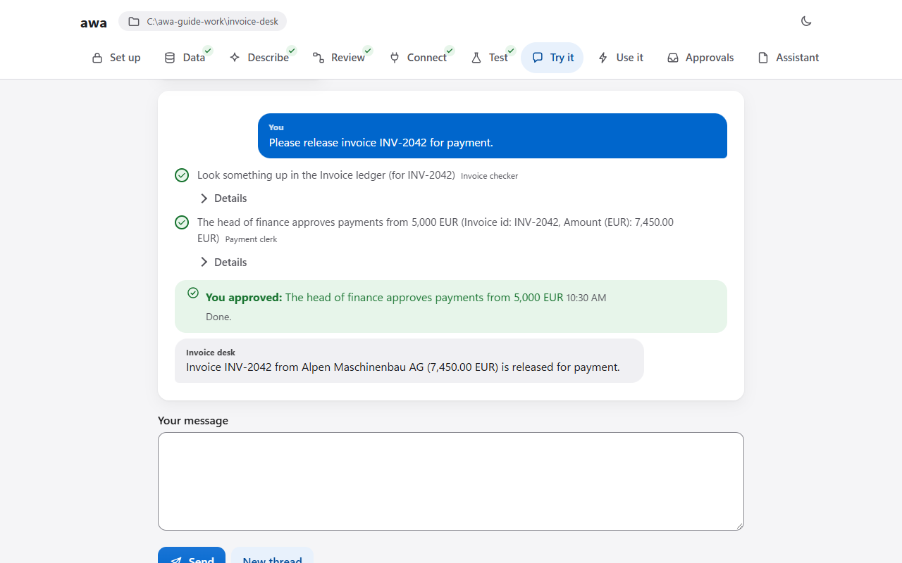
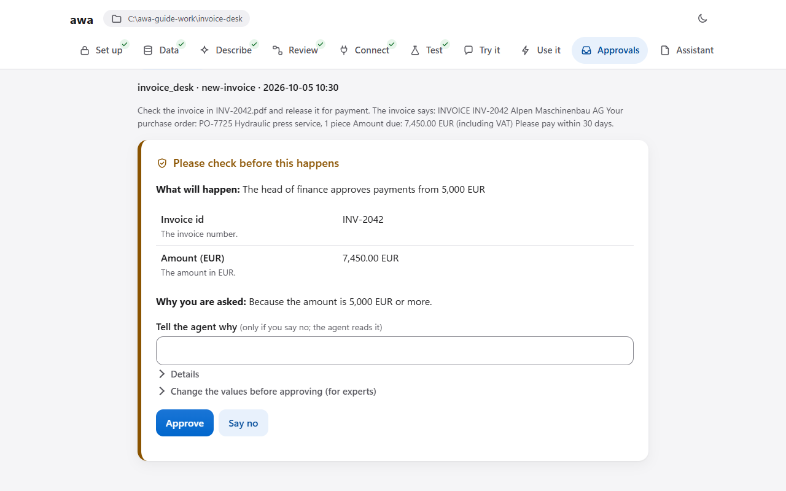
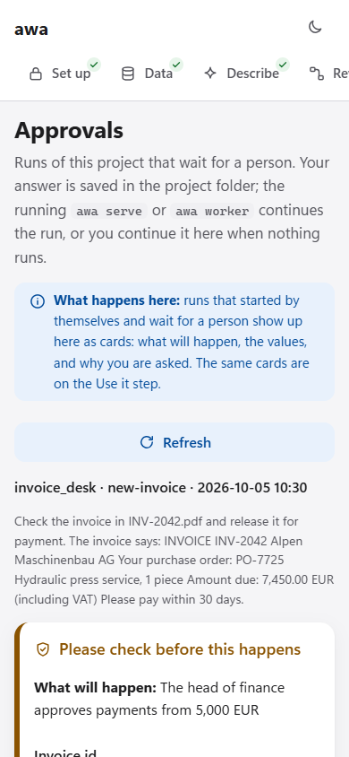

# The web app

The web app takes you through a process in the browser, one page per step: from your description and your files to a
system that you check, test, connect and start. awa does the work that can be automated and checked; on each page you
decide what is right for your process. Use it when you prefer buttons and forms to a terminal.

Start it for a project folder:

```console
awa ui --project invoice-desk
```

awa prints a link and opens it in your browser. Keep the terminal open: closing it stops the web app.

The app works on one [project folder](../develop/project-folder.md), the same folder that the commands and
`awa.load` read, so you can switch between the web app and the terminal at any time. The [guided tour](tour.md)
walks through every page with one example; this page describes each page on its own.

The options you may need:

| Option of `awa ui` | Effect |
| --- | --- |
| `--project DIR` | The project folder, created when missing (default: the current folder). |
| `--port N` | The port (default 8765; a free one when it is taken). |
| `--no-browser` | Only print the link. |
| `--example ID` | Open a shipped example as a new project first ([Examples](examples.md)). |

The others are in the [command reference](../reference/cli.md#awa-ui); for `--allow-remote`, read
[Is it safe?](#is-it-safe) first.

## The pages

The pages are listed at the top of the window. Go through them in order the first time; later, jump to any page.
Every page starts with a box **What happens here** that sums up its section below.

| Page | What you do there | What you get |
| --- | --- | --- |
| [Set up](#set-up) | Tell awa which AI model to use. | The key in `.env`, never shown again. |
| [Data](#data) | Bring the files your process works on, and the systems it reads. Optional. | Copies of your files, read and described; systems tested and declared. |
| [Describe](#describe) | Write the process in your own words and let awa build it. | A draft: `blueprint.yaml`, eval cases, the result of the test rounds. |
| [Review](#review) | Check what awa designed. | You know who does what and what waits for a person. |
| [Connect](#connect) | Enter the addresses and keys of your systems and test them. | Systems switched from stand-ins to live. |
| [Test](#test) | Run the eval cases. | Which cases pass, and why a case fails. |
| [Try it](#try-it) | Talk to the system and answer its approvals. | Answers, and the approval card before a gated step. |
| [Use it](#use-it) | Add triggers, try them on a sample, see the runs. | The command that keeps the system running. |
| [Approvals](#approvals) | Answer runs that wait for your OK. | Waiting runs continue or stop. |
| [Assistant](#hand-the-project-to-a-coding-assistant) | Write a brief for a coding assistant. | `BRIEF.md` with the process, the files and ready prompts. |

The pictures come from the invoice desk of the [guided tour](tour.md); a step number in a legend is a step of the
tour. Each section ends with a collapsed picture of the whole window.

!!! info "Preview"
    The web app works and is tested, but its pages and options may still change in a minor release ([Stability](../about/stability.md)).

## Set up

**Purpose:** tell awa which AI model to use and how to reach your external systems.

- **You enter:** under **AI model**, open the card of your provider and fill in its fields: a **key** (hidden while
  you type), an **address** for a provider that needs one (it must start with `https://`), and optionally the model
  as `provider:model` under *Which model should awa use?*. Under **External systems**, the settings of a connector
  of the catalog.
- **In the background:** **Save and continue** checks the form of each value and writes the values into `.env` in
  the project folder, readable only by you. The key is not tried here. The first real run calls the model, or
  `awa doctor --check-models` in a terminal.
- **Result:** the provider card says **Ready**. A saved value shows only as *Saved*; awa never shows it again.
- **If something goes wrong:**
    - *No key for the AI model is set up yet* (on another page): enter the key here.
    - *Your AI provider did not accept the key*: check the key and, for Azure OpenAI, the endpoint.
    - *The AI service does not know this model*: check the model name (for Azure, the deployment name).


--8<-- "docs/assets/screenshots/guide/a02-setup.legend.txt"

In a terminal: `awa setup` asks for the provider and the key with hidden input and writes `.env`
([Set up a project](setup.md)).

??? note "The whole window"
    

## Data

**Purpose:** show awa what your process works on, so it designs on your real data instead of inventing some. This
page is optional: with **Skip: describe your process without files or systems**, awa writes small sample records
([stand-ins](../reference/glossary.md#stand-in)) from your description.

- **You enter:**
    - Under **Files**, drop documents or a whole folder (Excel, CSV, PDF, Word, email, JSON, text, SQLite, or a zip
      of them), or press **Choose files** or **Choose a folder**.
    - Under each file, a note in your own words in **What should happen with this data?**.
    - Under **External systems**, **Add an external system**: the kind, your name for it and its fields.
- **In the background:** each file is copied into `data/files` (your originals are never changed) and read without
  a model: its kind, columns, number and date formats, and what to watch. For a system, **Test connection** makes
  one small read-only call and saves nothing. **Test and save** saves its settings in `.env`, declares it in
  `data/SYSTEMS.json` and reads its structure (tables and columns, or the operations of an API). It reads no rows,
  unless you allow up to 3 example rows per table.
- **Result:** one card per file in plain words, such as *Looks like a scan*, and each system marked **Live,
  read-only**. The design and the test runs read the system live.
- **If something goes wrong:**
    - *Could not be read*: open the file yourself and bring a good copy.
    - *Looks like a scan*: the pages are pictures; see [Your files](files.md).
    - A file whose ending does not match its content is refused: export it again.
    - The limits are 200 files, 50 MB per file and 500 MB in all.
    - *The connection test failed*: check the address and the key, or ask for a read-only login.


--8<-- "docs/assets/screenshots/guide/a03-data.legend.txt"


--8<-- "docs/assets/screenshots/guide/a03-systems-test.legend.txt"

More on this page:

- **Hide personal data from the AI** (at the top) replaces names, IBANs and email addresses with placeholders in
  what the design model reads. Agents that read your data while they run see it unmasked
  ([What the mask covers](files.md#what-the-mask-covers)).
- **Remove** deletes a copy (press twice to confirm). **Analyze all again** reads every file again.
- **Start from an example** opens a shipped example in a new project folder next to the current one, with its files,
  its description and its eval cases.

In a terminal: `awa data inspect` and `awa data add-system` ([Your files](files.md), [Connect systems](connect.md)).

??? note "The whole window"
    

    

## Describe

**Purpose:** turn your description into a first draft of the system, with eval cases that show whether the draft
fits.

- **You enter:** under **Your process**, what happens: what comes in, who checks or decides what, the rules with
  their numbers, and what comes out ([What a good description says](describe.md#what-a-good-description-says)).
  Leave **Test and repair it automatically** on.
- **In the background:** **Create my system** reads your data and writes eval cases from your words. Then it designs
  the agents against them, runs the cases on sample data, and repairs a failing design in up to three rounds. Five
  steps are ticked as they finish; if you reload the page, it picks up where it was. With a real model this usually
  takes a few minutes and costs tokens.
- **Result:** the project folder holds `blueprint.yaml`, `evals/cases.yaml`, `tools.py` and a `README.md` with the
  assumptions awa made. The page says what was built, how many cases pass, and where the data comes from (the data
  map).
- **If something goes wrong:**
    - *Describe your process in a few sentences first*: the box is empty.
    - *This folder already has a system*: creating a new one replaces it.
    - The target is not reached: read the failing cases, add the missing detail to the description and build again.


--8<-- "docs/assets/screenshots/guide/a04-describe-before.legend.txt"


--8<-- "docs/assets/screenshots/guide/a04-describe-after.legend.txt"

The cases come from your description, so "3 of 3 pass" says that the draft fits them. Whether they are the right
cases, you check on [Review](#review) and [Test](#test).

**Suggest patterns** proposes up to three ways for the agents to work together, from the words of your description,
without a model call. **Let my model rank them** adds one model call that orders them. **Test the proposals** drafts
a system per pattern, runs the same eval cases through each, and shows the results side by side, with a cap on model
calls. Nothing is saved until you press **Use this pattern**.



*Suggest patterns proposes ways for the agents to work together, from your words.*

In a terminal: `awa build "<process>" --data <folder>` ([Describe a process](describe.md)).

??? note "The whole window"
    

## Review

**Purpose:** check what awa designed before anything runs, and change it where it does not match how the work is
really done.

- **You read:** how the work flows (a diagram), each agent with its tools (*asks you first* marks a tool that waits
  for a person), **where the data comes from** (each source *Live*, *Your file (copy)*, *Stand-in* or *Results
  folder*, and what each agent reads and writes), and the eval cases.
- **You change:** **Edit the design (for advanced users)** shows the blueprint as text. **Check** lists the problems;
  **Check and save** saves only a design without errors.
- **Result:** you know who does what, what each agent reads and which step waits for a person.
- **If something goes wrong:**
    - *Not saved: fix the problems marked Must fix first*: each problem names the line; see
      [Troubleshooting](troubleshooting.md#building-and-blueprints).
    - An approval you expected is missing: add it under `approvals:` ([Approvals](approvals.md)).


--8<-- "docs/assets/screenshots/guide/a05-review.legend.txt"

In a terminal, with the approval rule as it stands in `blueprint.yaml`:

```console
awa validate blueprint.yaml
awa show blueprint.yaml
```

```yaml
approvals:
  - tool: finance_approval
    when: amount_eur >= 5000
```

??? note "The whole window and the editor"
    

    

## Connect

**Purpose:** switch every system that still works on a stand-in to the live system, so the result runs on your real
data.

- **You enter:** each system has a card: *Live*, *Needs attention* (a setting is missing or not tested) or
  *Stand-in*. Press **Connect the live system**, then fill in its fields.
- **In the background:** **Test connection** makes one small read-only call. **Save and connect** saves the values
  in `.env`, tests again and switches the system from its stand-in to the real one. **Go back to the stand-in**
  switches it back.
- **Result:** every system the agents use is *Live*, or you know which one is not.
- **If something goes wrong:**
    - *The connection test failed*: the message names the cause. Check the address and the key, and the VPN for a
      system in your company network.
    - *These tools of the stand-in have no counterpart in the live system and were removed*: the live system offers
      fewer operations; check the agents on Review.

    More: [Connect systems](connect.md).


--8<-- "docs/assets/screenshots/guide/a06-connect.legend.txt"

In a terminal: `awa connect .` asks for every missing setting with hidden input.

??? note "The whole window"
    

## Test

**Purpose:** know, with numbers, whether the system does what the process needs.

- **You enter:** nothing; press **Run all tests** to run every case. To change a case, edit what it sends and press
  **Save and run this case**.
- **In the background:** every eval case runs against the system. Systems that are not connected yet answer from
  their stand-in. Each check of a case is scored, and its approvals are answered as the case says.
- **Result:** *Passed*, *Failed* or *Could not run* per case, and its answer. For a failed case you see the check
  that failed and why.
- **If something goes wrong:**
    - *No eval cases yet*: create the system on Describe with testing switched on.
    - **Could not run**: the message names the key, the limit or the connection.
    - A case passes on sample data and fails on real data: change its expected values ([Test and improve](test.md)).


--8<-- "docs/assets/screenshots/guide/a07-test.legend.txt"

In a terminal, repeated three times to see [pass^k](../reference/glossary.md#pass-k):

```console
awa eval blueprint.yaml evals/cases.yaml --repetitions 3
```

??? note "The whole window"
    

## Try it

**Purpose:** work with the system yourself, step by step, and see the approvals before you rely on them.

- **You enter:** a message, or one of **Try one of these** (requests from your eval cases); then **Send**. **Stop**
  ends the run at once. **New thread** starts a new conversation.
- **In the background:** the system runs with the blueprint's limits. Before a step marked *asks you first*, it stops
  and saves its state.
- **Result:** each step appears as a plain sentence. Before a gated step, the card **Please check before this
  happens** shows what will happen, the values and why you are asked:
    - **Approve** lets it go ahead.
    - **Say no** stops it.
    - **Tell the agent why** is a note that the agent reads.
- **If something goes wrong:**
    - *No AI model is set up yet, so the system cannot answer*: enter the key on Set up.
    - *The AI service is busy right now*: wait a minute and try again.
    - *That was too much text for the model at once*: use a shorter message or smaller files.


--8<-- "docs/assets/screenshots/guide/a08-try-approval.legend.txt"


--8<-- "docs/assets/screenshots/guide/a08-try-answer.legend.txt"

In a terminal: `awa chat blueprint.yaml` asks `approve? [y/N]` before a gated step.

??? note "The whole window"
    

    

## Use it

**Purpose:** put the system to work. See what starts it, try a trigger once on a sample, follow the runs, and get the
one command that keeps it running after you close the window.

- **You enter:** **Add another trigger**. Under **What starts it**, choose the kind (`schedule`, `webhook`,
  `file-drop`, `mail` or `queue`) and its settings, then fill in **What the system should do with each one** and
  press **Add this trigger**. **Run it now with a sample** takes the values that one event would carry.
- **In the background:** the trigger is written into `blueprint.yaml`. A sample run runs once, for real, on this
  computer. A step that needs your OK waits under **Waiting for your OK**.
- **Result:** the page shows:
    - **Is it running?**: whether an `awa worker` or `awa serve` waits for events;
    - **Waiting for your OK**;
    - **What starts it**: each trigger as a sentence;
    - **Recent runs**;
    - **Keep it running**: the command, with a **Copy** button.
- **If something goes wrong:**
    - *Not running*: no worker waits for events, so nothing starts on its own. Start the command under **Keep it
      running** and leave it open.
    - A run stays waiting: answer it here or on Approvals.
    - *Run only one of awa serve and awa worker per project folder*: the second one refuses to start.


--8<-- "docs/assets/screenshots/guide/a09-trigger-form.legend.txt"


--8<-- "docs/assets/screenshots/guide/a09-trigger-sample.legend.txt"


--8<-- "docs/assets/screenshots/guide/a10-use-it-done.legend.txt"

The trigger that the form writes, and the command that runs it:

```yaml
triggers:
  - name: new-invoice
    file_drop:
      directory: inbox
      pattern: '*.pdf'
    input: 'Check the invoice in {payload.name} and release it for payment. The invoice says: {payload.text}'
```

```console
awa worker blueprint.yaml
```

**Download the project (.zip)** gives your IT team the folder without `.env`, the `.awa` folder or key files. **More
ways to use it (for your IT team)** lists the commands to serve the system as a web API, over MCP or in a terminal.

??? note "The whole window"
    

## Approvals

**Purpose:** answer every run of the project that waits for a person, in one place.

- **You enter:** **Approve** or **Say no** on each card, with a note if you like. **Change the values before approving
  (for experts)** takes new values as a JSON object.
- **In the background:** your answer is saved in the project folder. A running `awa worker` or `awa serve` continues
  the run. When nothing is running, **Continue it now** continues it here.
- **Result:** the run goes on with your decision, or it stops and the agent reads your note.
- **If something goes wrong:**
    - *Nothing waits for you*: no run is paused.
    - *Nothing is running that would continue it*: press **Continue it now**, or start `awa worker` (see
      [Use it](#use-it)).


--8<-- "docs/assets/screenshots/guide/a10-approvals.legend.txt"

In a terminal: `awa runs list --status waiting`, then `awa runs decide RUN_ID --approve`
([Approvals](approvals.md)).

??? note "The whole window, and on a phone"
    

    

## Hand the project to a coding assistant

**Purpose:** let a coding assistant extend the project where the draft needs code, such as a tool for your own
system.

The page **Assistant** writes a brief from the project folder. The brief holds:

- the process and the pattern of the agents;
- a map of the files;
- the names of the settings (never their values);
- ready prompts: implement a tool, connect a system, add an MCP server, write more cases;
- templates, and the commands that check the result.

**Copy the brief**, **Download** it or **Save as BRIEF.md**. In a terminal:

```console
awa brief --out BRIEF.md
```

Write a new brief after you change the project. Review what the assistant changed, above all `approvals:` and
`limits:`. Run `awa validate .` and `awa eval . evals/cases.yaml` after every change.

## Is it safe?

- It listens on this computer only. Anything else needs `--allow-remote`, and even then only people with the link
  get in.
- The link carries an access code. The page keeps it in its browser tab and sends it with every request. It is never
  stored in a cookie, so other servers on this computer never see it.
- Every request without the code is refused. Requests from other sites and other host names are refused too. A new
  tab needs the link again.
- With `--allow-remote` the code travels unencrypted over the network: use it only on a network you trust.
- The page loads nothing from the internet and works offline.
- Saved settings go only to `.env` (readable only by you). They are never sent back to the browser and are left out
  of the download.
- Dropped files are checked by their content, kept under safe names and cut off at the size limits. What the AI
  reads of a file is marked as data, not instructions. This lowers the risk of injected instructions, but the
  approvals stay the real barrier.
- Open only projects you trust: a project can contain code (`tools.py`) that runs when awa opens it.

<!-- guide:do cd . -->

!!! example "In code"

    `awa.ui.create_ui_app` returns the same application as a FastAPI app, for example to test it or to serve it with
    your own options; its access code is `app.state.token`:

    <!-- guide:python -->
    ```python
    from fastapi.testclient import TestClient

    from awa.ui import create_ui_app

    app = create_ui_app("invoice-desk")
    with TestClient(app, base_url="http://127.0.0.1:8765") as browser:
        signed_in = {"Authorization": "Bearer " + app.state.token}
        print(browser.get("/api/state").status_code, browser.get("/api/state", headers=signed_in).status_code)
    ```

    <!-- guide:expect -->
    ```text
    401 200
    ```
