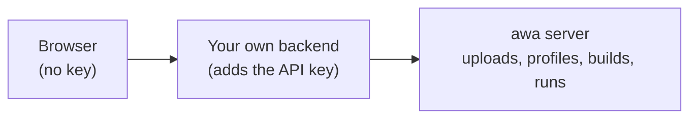

# Your own web frontend

Use this page when you build your own web page or app on top of awa. Over plain HTTP, without a client library, your
app uploads files, shows what awa found, builds a process from the files and one sentence, runs it and answers its
approvals. This page is for developers.

The shortest path:

1. [Start the server](#1-start-the-server) with one API key.
2. [Upload files](#2-upload-files) and keep the `upload_id`.
3. [Build a process](#4-build-a-process) from the upload and a sentence, and wait for `completed`.
4. [Run what was built](#6-run-what-was-built) and answer its approvals.

```console
curl -s -X POST localhost:8000/v1/uploads -H "Authorization: Bearer $AWA_API_KEY" -F "files=@INV-2041.pdf"
```

You need the server parts of awa (the `[all]` extra and the double-click installer have them). The examples use the
folder `invoice-files` of the [tour](tour.md#step-3-bring-your-files-and-your-ledger). Their output comes from the
page's own test, which runs every step with a scripted model.

!!! info "Preview"
    The HTTP endpoints this page uses work and are tested, but they may still change in a minor release ([Stability](../about/stability.md)).

## How the pieces fit



Keep the awa API key on your backend, never in the page: whoever opens a page can read it. Your backend forwards the
calls and adds the header `Authorization: Bearer YOUR_KEY`. The browser examples use `fetch`; a browser
`EventSource` cannot send that header.

## 1. Start the server

Create the folder `web-demo` with the file `server.py`. The server takes **one API key** from the environment. The
key belongs to a *principal*: a name, a tenant (each customer's data is kept apart) and roles. `DataOptions(root=...)`
is the folder for uploads and builds, one subfolder per tenant:

<!-- guide:do cd . -->
<!-- guide:file web-demo/server.py -->
```python
import os

from awa.server import ApiKeyAuthenticator, DataOptions, Principal, create_app

auth = ApiKeyAuthenticator(
    {os.environ["AWA_API_KEY"]: Principal("web-app", tenant="acme", roles={"builder"})}
)
app = create_app(
    [],  # no process to serve yet: this server only takes files and builds
    authenticator=auth,
    data=DataOptions(root="awa-data", roles={"builder"}),
)
```

<!-- guide:do cd web-demo -->

`create_app([])` serves no ready-made process: this server takes files and builds. Without `root`, awa keeps everything in memory and says so in its log. That is fine for a try-out, but everything is
gone when the server stops.

=== "Start it"

    ```console
    $ export AWA_API_KEY=pick-a-long-random-secret
    $ uvicorn server:app --port 8000
    ```

    On Windows PowerShell use `$env:AWA_API_KEY = "pick-a-long-random-secret"`. Check that it runs:

    ```console
    $ curl -s localhost:8000/v1/health
    {"status":"ok"}
    ```

=== "Run it here"

    The next scripts need no server. This helper runs the same `app` inside the Python process on its own thread, so a
    build runs only while the script that started it is alive. It offers `get` and `post` like a web client and keeps
    the ids between scripts in a file. Save it next to `server.py`:

    <!-- guide:python save=client.py -->
    ```python
    import asyncio
    import json
    import os
    import threading
    import time
    from pathlib import Path

    import httpx

    KEY = os.environ.setdefault("AWA_API_KEY", "pick-a-long-random-secret")
    from server import app  # noqa: E402

    loop = asyncio.new_event_loop()  # the app and its builds live on this loop
    threading.Thread(target=loop.run_forever, daemon=True).start()
    client = httpx.AsyncClient(
        transport=httpx.ASGITransport(app=app),
        base_url="http://localhost:8000",
        headers={"Authorization": "Bearer " + KEY},
    )
    STATE = Path("state.json")


    def request(method, path, **kwargs):
        return asyncio.run_coroutine_threadsafe(client.request(method, path, **kwargs), loop).result(60)


    def get(path, **kwargs):
        return request("GET", path, **kwargs)


    def post(path, **kwargs):
        return request("POST", path, **kwargs)


    def remember(**ids):
        state = json.loads(STATE.read_text()) if STATE.exists() else {}
        STATE.write_text(json.dumps({**state, **ids}))


    def recall(name):
        return json.loads(STATE.read_text())[name]


    def show(response):
        print(response.status_code, json.dumps(response.json(), indent=2))


    def wait(build_id, until=("completed", "failed", "needs_input")):
        while True:
            state = get(f"/v1/builds/{build_id}").json()
            if state["status"] in until:
                return state
            time.sleep(0.1)
    ```

## 2. Upload files

Send the files as a multipart form with the field name `files`, one part per file. Every part with a file name counts as a file; with `curl`, repeat `-F` for several files. The answer holds an `upload_id`;
every next step uses it.

=== "curl"

    ```console
    $ curl -s -X POST localhost:8000/v1/uploads \
        -H "Authorization: Bearer $AWA_API_KEY" \
        -F "files=@INV-2041.pdf" -F "files=@INV-2042.pdf" -F "files=@purchase_orders.csv"
    ```

=== "Python"

    <!-- guide:python -->
    ```python
    from pathlib import Path

    from client import post, remember, show

    files = [
        ("files", (path.name, path.read_bytes(), "application/octet-stream"))
        for path in sorted(Path("../invoice-files").iterdir())
    ]
    answer = post("/v1/uploads", files=files)
    remember(upload_id=answer.json()["upload_id"])
    show(answer)
    ```

    <!-- guide:expect -->
    ```text
    201 {
      "upload_id": "up_3dd77b1f913f416ebfc4e29c",
      "files": [
        {
          "id": "f1",
          "name": "INV-2041.pdf",
          "size": 813,
          "kind": "pdf",
          "sniffed_type": "application/pdf",
          "sha256": "bd6d6f7a1ca9ed6d231b80c7e3a0e307ac4c1e099b2602e843d4cd381650fbd4",
          "status": "ok"
        },
        {
          "id": "f2",
          "name": "INV-2042.pdf",
          "size": 823,
          "kind": "pdf",
          "sniffed_type": "application/pdf",
          "sha256": "f3cfd7a7a0af1e05c5eb35ff7989126cfcd9b5598e7ac3807f911ea485adb1ac",
          "status": "ok"
        },
        {
          "id": "f3",
          "name": "purchase_orders.csv",
          "size": 109,
          "kind": "csv",
          "sniffed_type": "text/csv",
          "sha256": "607297b567461bcb3fcbe525e721a174c954e4e3727426343fc70f6ac902d14d",
          "status": "ok"
        }
      ],
      "total_bytes": 1745,
      "created_at": "2026-10-06T05:40:13.114084+00:00",
      "expires_at": "2026-10-07T05:40:13.114084+00:00"
    }
    ```

What awa checks before it keeps a file:

- **The content decides the type**, not the name and not what the browser says. A `.pdf` that is not a PDF is refused
  with `415` and the code `awa.data.type_mismatch`. Accepted: CSV, Excel, PDF, Word, email (`.eml`, `.mbox`), JSON, SQLite,
  text, and zip files of those.
- **File names are cleaned.** No folders, no `..`, no reserved names. awa chooses where a file is stored.
- **Zip files are opened only after every entry was checked.** A zip that unpacks into far more than it claims, or an
  entry that wants to leave its folder, is refused (`422`, `awa.data.zip_unsafe`).
- **Size.** 25 MB for a file and 100 MB for an upload by default, stopped while the file is still arriving (`413`).

The files are kept for 24 hours (`expires_at`); `DELETE /v1/uploads/{upload_id}` removes them sooner. To make a
retry safe, send the header `Idempotency-Key: ANY-UNIQUE-TEXT`. A repeated request then gets the first answer and the
header `Idempotent-Replayed: true`, and the files are not stored twice.

In the browser, use `fetch`. Do not set `Content-Type` yourself: the browser adds it with the boundary awa needs:

```js
const API = "/awa"; // your backend, which forwards to awa and adds the key

async function problem(response) {
  const { error } = await response.json();
  return new Error(`${error.code}: ${error.message}`);
}

async function upload(files) {
  const body = new FormData();
  for (const file of files) body.append("files", file); // one part for each file
  const response = await fetch(`${API}/v1/uploads`, { method: "POST", body });
  if (!response.ok) throw await problem(response);
  return response.json();
}
```

## 3. Show what awa found

`POST /v1/data/profile` returns what is in the files: each file's kind, tables and columns, the number and date
formats (`4.250,00` is a decimal with a comma), and flags for problems such as a scan without text or a row of
totals. An unreadable file gets a flag, not an HTTP error. No model is called and the files are not changed.

=== "curl"

    ```console
    $ curl -s -X POST localhost:8000/v1/data/profile \
        -H "Authorization: Bearer $AWA_API_KEY" -H "Content-Type: application/json" \
        -d '{"upload_id": "UPLOAD_ID"}'
    ```

=== "Python"

    <!-- guide:python -->
    ```python
    from client import post, recall

    answer = post("/v1/data/profile", json={"upload_id": recall("upload_id")})
    body = answer.json()
    print(answer.status_code, sorted(body))
    print(body["profile"]["summary"])
    for file in body["profile"]["files"]:
        print(file["path"], file["kind"], file["status"])
    ```

    <!-- guide:expect -->
    ```text
    200 ['profile', 'upload_id']
    {'files': 3, 'tables': 1, 'rows': 2, 'warnings': 0, 'errors': 0}
    INV-2041.pdf pdf ok
    INV-2042.pdf pdf ok
    purchase_orders.csv csv ok
    ```

The shape of `profile` is the JSON Schema `src/awa/data/profile.v1.schema.json` in the awa folder. Useful extras:

- `"mask": "drop"` leaves every sample value out.
- `"files": ["f1"]` profiles only some files.
- `"budget_tokens": 3000` (or any `mask`) adds `model_view`: the short text a model would see instead of your data,
  with personal data replaced when `mask` is `placeholders`.

## 4. Build a process

Send a sentence or two about what should happen and the `upload_id`. A note for one file is optional
(`"notes": [{"file": "purchase_orders.csv", "text": "..."}]`). The build runs in the background: it reads the files,
writes tests from the real rows, designs the process and runs the tests on a copy. Your files are never changed. It
usually takes a few minutes and uses model calls. `options` limit it (`rounds`, `target`, `max_requests`, `model`,
`mask`, `guidance`), and the server caps them.

=== "curl"

    ```console
    $ curl -s -X POST localhost:8000/v1/builds \
        -H "Authorization: Bearer $AWA_API_KEY" -H "Content-Type: application/json" \
        -d '{"description": "Check each invoice against the open purchase orders.", "upload_id": "UPLOAD_ID"}'
    ```

=== "Python"

    <!-- guide:python model=files -->
    ```python
    from client import post, recall, remember, show, wait

    DESCRIPTION = (
        "Supplier invoices arrive as PDF files. Check each invoice against the open purchase orders "
        "in purchase_orders.csv: the purchase order must be open and the amount must match. A "
        "matching invoice is released for payment. From 5,000 EUR the head of finance must approve "
        "the payment first."
    )
    started = post(
        "/v1/builds",
        json={
            "description": DESCRIPTION,
            "upload_id": recall("upload_id"),
            "notes": [{"file": "purchase_orders.csv", "text": "Look up by PO number."}],
        },
    )
    remember(build_id=started.json()["build_id"])
    show(started)
    print(wait(started.json()["build_id"])["status"])  # keeps this script alive until the build is over
    ```

    <!-- guide:expect -->
    ```text
    202 {
      "build_id": "bld_9e13a2bcf7664dd088ce3eec",
      "status": "queued",
      "events_url": "/v1/builds/bld_9e13a2bcf7664dd088ce3eec/events",
      "url": "/v1/builds/bld_9e13a2bcf7664dd088ce3eec"
    }
    completed
    ```

`202` means the build was accepted and runs on its own. Poll its state or follow its events.

### Follow the progress

`GET /v1/builds/{build_id}` returns the `status`: `queued`, `profiling`, `designing`, `evaluating`, `repairing`,
`writing`, `needs_input`, `completed`, `failed` or `cancelled`. It also returns the round, the pass rate and the model
use so far, and at the end the `report` or the `error`.

=== "curl"

    ```console
    $ curl -s localhost:8000/v1/builds/BUILD_ID -H "Authorization: Bearer $AWA_API_KEY"
    ```

=== "Python"

    <!-- guide:python -->
    ```python
    from client import recall, wait

    state = wait(recall("build_id"))
    report = state["report"]
    print(state["status"], state["stage"], state["round"], state["pass_rate"])
    print(report["summary"])
    print(report["passed"], report["rounds"], report["stopped"], report["flaky"], report["failing"])
    print(report["files"])
    ```

    <!-- guide:expect -->
    ```text
    completed write 1 1.0
    invoice_check: 2 of 2 eval cases pass (100%) on the local workspace after 1 round(s); target reached.
    True 1 target_reached [] []
    ['.env.example', '.gitignore', 'CONNECT.md', 'README.md', 'blueprint.yaml', 'data/PROFILE.json', 'data/PROFILE.md', 'data/files/INV-2041.pdf', 'data/files/INV-2042.pdf', 'data/files/purchase_orders.csv', 'evals/cases.yaml', 'tests/test_tools.py', 'tools.py']
    ```

Instead of polling, follow the build as a stream of Server-Sent Events. Each event has a number (`id`). If the
connection drops, ask again with `Last-Event-ID: LAST-NUMBER-YOU-GOT` to get only what you missed. A finished build
answers `204` once everything was sent. Closing the stream does not stop the build.

=== "curl"

    ```console
    $ curl -s -N localhost:8000/v1/builds/BUILD_ID/events -H "Authorization: Bearer $AWA_API_KEY"
    ```

=== "Python"

    <!-- guide:python -->
    ```python
    import json

    from client import get, recall

    events = get(f"/v1/builds/{recall('build_id')}/events")
    frames = [frame for frame in events.text.split("\n\n") if frame.strip()]
    print(events.status_code, len(frames), "events")
    print([frame.splitlines()[1].removeprefix("event: ") for frame in frames])
    first = frames[0].splitlines()
    print(first[0])
    print(first[1])
    print(json.dumps(json.loads(first[2].removeprefix("data: ")), indent=2))
    ```

    <!-- guide:expect -->
    ```text
    200 15 events
    ['build.started', 'data.profile.file', 'data.profile.file', 'data.profile.file', 'data.profile.done', 'build.progress', 'design.acceptance', 'design.architecture', 'eval.round.started', 'eval.case', 'eval.case', 'eval.round.finished', 'build.progress', 'write.done', 'build.completed']
    id: 1
    event: build.started
    {
      "seq": 1,
      "ts": "2026-10-06T05:40:14.060536+00:00",
      "type": "build.started",
      "build_id": "bld_9e13a2bcf7664dd088ce3eec",
      "data": {
        "stage": "profile",
        "upload_id": "up_3dd77b1f913f416ebfc4e29c",
        "answers": 0
      }
    }
    ```

What the event types mean:

| Event | When |
| --- | --- |
| `build.started` | The build begins. |
| `data.profile.file`, `data.profile.done` | A file was read, then all of them. |
| `design.acceptance`, `design.validation`, `design.architecture` | The tests are written and checked, the design is made. |
| `eval.round.started`, `eval.case`, `eval.round.finished` | A test round runs, case by case, with its pass rate. |
| `eval.round.stopped` | The model-call limit ended a round early; the best earlier round is kept. |
| `repair.started` | A round failed and the design is repaired. |
| `write.done` | The project folder is written. |
| `build.progress` | Any other step of the build: its stage, round, message and the pass rate so far. |
| `build.question` | awa needs your answer (below). |
| `build.completed`, `build.failed`, `build.cancelled` | Exactly one of them ends the build. |

In the browser, use `fetch`. `follow` calls `onEvent` for every event and returns the number of the last one, so a
lost connection can continue where it stopped:

```js
async function post(path, json) {
  const response = await fetch(`${API}${path}`, {
    method: "POST",
    headers: { "Content-Type": "application/json" },
    body: JSON.stringify(json),
  });
  if (!response.ok) throw await problem(response);
  return response.json();
}

async function follow(buildId, onEvent, lastId = 0) {
  const response = await fetch(`${API}/v1/builds/${buildId}/events`, {
    headers: { "Last-Event-ID": String(lastId) },
  });
  if (response.status === 204) return lastId; // over, and everything was sent
  const reader = response.body.pipeThrough(new TextDecoderStream()).getReader();
  let buffer = "";
  for (;;) {
    const { value, done } = await reader.read();
    if (done) return lastId;
    buffer += value;
    let end;
    while ((end = buffer.indexOf("\n\n")) >= 0) {
      const frame = buffer.slice(0, end);
      buffer = buffer.slice(end + 2);
      const data = frame.split("\n").find((line) => line.startsWith("data: "));
      if (!data) continue;
      const event = JSON.parse(data.slice(6));
      lastId = event.seq;
      onEvent(event);
      const last = ["build.completed", "build.failed", "build.cancelled", "build.question"];
      if (last.includes(event.type)) return lastId;
    }
  }
}
```

### When awa has a question

If the sentence does not fit the files (CV screening, but the files are invoices), awa does not guess. The build
stops with the status `needs_input` and a list of `questions`; `evidence` names the parts of the profile each one is
about. Show the question to your user and send the answer with `POST /v1/builds/{id}/answers`, and the build goes on.
awa never takes an answer from a file's content, so a file cannot answer for the user.

=== "curl"

    ```console
    $ curl -s -X POST localhost:8000/v1/builds/BUILD_ID/answers \
        -H "Authorization: Bearer $AWA_API_KEY" -H "Content-Type: application/json" \
        -d '{"answers": [{"id": "q1", "value": "Use purchase_orders.csv for the invoices."}]}'
    ```

=== "Python"

    <!-- guide:python model=files -->
    ```python
    import json
    from pathlib import Path

    from client import get, post, wait

    files = [
        ("files", (path.name, path.read_bytes(), "application/octet-stream"))
        for path in sorted(Path("../invoice-files").iterdir())
    ]
    upload = post("/v1/uploads", files=files).json()["upload_id"]
    started = post(
        "/v1/builds",
        json={
            "description": "Screen the incoming CVs against our role profile and schedule interviews.",
            "upload_id": upload,
        },
    )
    build_id = started.json()["build_id"]
    waiting = wait(build_id)
    print(waiting["status"])
    print(json.dumps(waiting["questions"], indent=2))
    answer = {"answers": [{"id": "q1", "value": "Use purchase_orders.csv for the invoices."}]}
    accepted = post(f"/v1/builds/{build_id}/answers", json=answer)
    print(accepted.status_code)
    done = wait(build_id, until=("completed", "failed"))
    print(done["status"], done["pass_rate"])
    ```

    <!-- guide:expect -->
    ```text
    needs_input
    [
      {
        "id": "q1",
        "text": "The description is about CVs or candidates, but the files hold purchase_orders.csv (po, vendor, amount, status). Which file is it, or should other files be added?",
        "options": [],
        "evidence": [
          "f3.t1.po",
          "f3.t1.vendor"
        ]
      }
    ]
    202
    completed 1.0
    ```

The command-line build asks the same questions and takes the same answers ([Your files](files.md#when-the-words-do-not-fit-the-files)).

### Stop a build

`DELETE /v1/builds/{build_id}` stops it. Stopping a finished build changes nothing.

## 5. Read the result

When the status is `completed`, `report` says what happened:

- `passed`: whether the tests reached the target.
- `failing`: the tests that did not pass; `flaky`: those that passed only on a second try. Look at both.
- `assumptions`: what awa had to assume.

Two calls give you the project itself:

- `GET /v1/builds/{build_id}/files/README.md` shows one text file of the project (also `blueprint.yaml`,
  `evals/cases.yaml` and `data/PROFILE.json`).
- `GET /v1/builds/{build_id}/project.zip` downloads the whole project. Settings files with secrets are never
  included.

A `failed` build names the reason in `error.code`:

- `awa.build.usage_limit`: the model calls ran out. Raise `max_requests`.
- `awa.build.design_invalid`: no valid design could be made. `error.details.issues` says what was wrong, or why the
  files cannot be used.

=== "curl"

    ```console
    $ curl -s localhost:8000/v1/builds/BUILD_ID/files/README.md -H "Authorization: Bearer $AWA_API_KEY"
    $ curl -s -o project.zip localhost:8000/v1/builds/BUILD_ID/project.zip -H "Authorization: Bearer $AWA_API_KEY"
    ```

=== "Python"

    <!-- guide:python -->
    ```python
    import io
    import zipfile

    from client import get, recall

    build = f"/v1/builds/{recall('build_id')}"
    readme = get(build + "/files/README.md")
    print(readme.status_code, readme.text.splitlines()[0])
    archive = get(build + "/project.zip")
    print(archive.status_code, archive.headers["content-type"])
    print(sorted(zipfile.ZipFile(io.BytesIO(archive.content)).namelist()))
    ```

    <!-- guide:expect -->
    ```text
    200 # invoice_check
    200 application/zip
    ['.env.example', '.gitignore', 'CONNECT.md', 'README.md', 'blueprint.yaml', 'data/PROFILE.json', 'data/PROFILE.md', 'data/files/INV-2041.pdf', 'data/files/INV-2042.pdf', 'data/files/purchase_orders.csv', 'evals/cases.yaml', 'tests/test_tools.py', 'tools.py']
    ```

## 6. Run what was built

`POST /v1/builds/{build_id}/runs` runs the built process. It answers with `text`, `status`, `thread_id` and `usage`.
Add `"file": "f1"` to process one file, `?mode=async` to get the answer later, or `?stream=true` to watch.

When the process needs an approval (a payment, a write), the answer has `"status": "interrupted"`:

1. Read what it wants with `GET .../threads/{thread_id}/interrupts`.
2. Answer with `POST .../threads/{thread_id}/resume`.

The large invoice needs two approvals: the head of finance first, then writing the result:

=== "curl"

    ```console
    $ curl -s -X POST localhost:8000/v1/builds/BUILD_ID/runs \
        -H "Authorization: Bearer $AWA_API_KEY" -H "Content-Type: application/json" \
        -d '{"input": "Check the invoice in INV-2042.pdf and release it for payment."}'
    $ curl -s localhost:8000/v1/builds/BUILD_ID/threads/THREAD_ID/interrupts \
        -H "Authorization: Bearer $AWA_API_KEY"
    $ curl -s -X POST localhost:8000/v1/builds/BUILD_ID/threads/THREAD_ID/resume \
        -H "Authorization: Bearer $AWA_API_KEY" -H "Content-Type: application/json" \
        -d '{"decision": {"action": "approve"}}'
    ```

=== "Python"

    <!-- guide:python model=files -->
    ```python
    from client import get, post, recall

    build = f"/v1/builds/{recall('build_id')}"
    run = post(
        build + "/runs", json={"input": "Check the invoice in INV-2042.pdf and release it for payment."}
    ).json()
    thread = build + f"/threads/{run['thread_id']}"
    while run["status"] == "interrupted":
        asked = get(thread + "/interrupts").json()["interrupts"][0]["value"]
        print("waiting for approval of", asked["tool"], asked["args"])
        run = post(thread + "/resume", json={"decision": {"action": "approve"}}).json()
    print(run["status"], run["text"])
    ```

    <!-- guide:expect -->
    ```text
    Approvals of runs of invoice_check are kept in memory and are lost when the server restarts
    waiting for approval of finance_approval {'po': 'PO-7725', 'amount_eur': 7450.0}
    waiting for approval of output_write_file {'path': 'INV-2042.txt', 'content': 'INV-2042: purchase order PO-7725 is open and the amount 7,450.00 EUR matches.', 'overwrite': False}
    completed INV-2042: purchase order PO-7725 matches 7,450.00 EUR; released for payment.
    ```

`DataOptions(approver_roles={"approver"})` lets only callers with that role approve. Approvals of these runs live in
the server's memory and are lost when it restarts.

## What the limits are

| What happens | Answer |
| --- | --- |
| A file or an upload is too large | `413`, `awa.data.too_large` |
| More files than allowed (200) | `413`, `awa.data.too_many_files` |
| Wrong or lying file type | `415`, `awa.data.unsupported_type` or `awa.data.type_mismatch` |
| The client is too slow (30 s without data) | `408`, `awa.data.upload_timeout` |
| Your tenant stores too much (1 GB), receives too many uploads at once, or runs too many builds | `429`, `awa.data.quota_exceeded` (see `Retry-After`) |
| Too many requests | `429`, `awa.rate_limit_exceeded` |
| An id that does not exist, or belongs to someone else | `404`, the same answer for both, on purpose |

## Good to know

- **Everything is kept for one tenant.** Another tenant cannot see, guess or run your builds.
- **The server never shows where it keeps files** on its disk.
- **After a restart:** a build that was running is `failed`. Finished builds, builds that wait for answers and their uploads
  survive. Uploads are removed after 24 hours, finished builds after 7 days.
- **awa does not scan files for viruses.** If you need that, give `DataOptions(scanner=...)` a scanner.
- **Text inside files can try to give orders to the model** ("ignore your rules ..."). awa marks such text as data, flags
  it in the profile and keeps the approvals of the built process on. This lowers the risk. It is not a guarantee: keep
  approvals on for anything that changes things.
- **The contract.** The file `docs/develop/data-api.openapi.json` in the awa folder describes every endpoint for tools that
  generate clients. [Serving](../develop/serving.md) lists them with the authentication and the limits.

## Common mistakes

| You see | Fix |
| --- | --- |
| `401` | The `Authorization: Bearer` header is missing or the key is wrong; check it on your backend. |
| `403` | The principal has no role that `DataOptions(roles=...)` allows. |
| `415` for a good file | The content is not what the ending says; open the file yourself. |
| `409` on `answers` | The build does not wait for an answer; read its status first. |
| A build stays `queued` | The server runs at most two builds at once for a tenant; `GET /v1/builds` lists them. |
| The page cannot read the events | Use `fetch` through your backend, not `EventSource`: it cannot send the key. |

!!! example "In code"

    Every error has the same shape: show the `message` to your user and log the `request_id`.

    <!-- guide:python -->
    ```python
    from client import get, post

    fake = [("files", ("invoice.pdf", b"this is not a pdf", "application/pdf"))]
    refused = post("/v1/uploads", files=fake)
    print(refused.status_code, refused.json()["error"]["code"])
    print(sorted(refused.json()["error"]))
    unknown = get("/v1/builds/bld_does_not_exist")
    print(unknown.status_code, unknown.json()["error"]["code"])
    ```

    <!-- guide:expect -->
    ```text
    415 awa.data.type_mismatch
    ['code', 'message', 'request_id', 'retryable', 'type']
    404 awa.build.not_found
    ```
