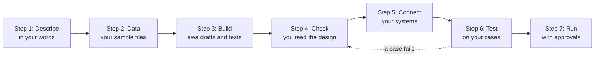
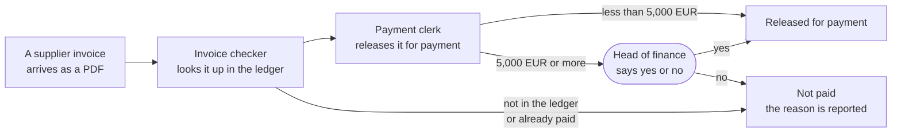

# awa

**awa helps you automate business processes with AI agents that run inside hard limits enforced by code and wait
for a person's OK before the steps you choose. You describe the process in your own words, awa drafts and tests it,
and you decide.**

## Start here

1. **Install awa.** One command, or a double-click installer if you have no Python: [Install](start/install.md).
2. **Open the web app.** Type `awa ui`. It opens in your browser and asks for the key of your AI provider.
3. **Follow the guided tour.** [The guided tour](guide/tour.md) builds one complete process with sample files,
   screen by screen, in about 30 minutes.

You prefer a terminal to the web app? Take [First automation](start/first-automation.md) instead of the tour.

## How it works

You describe, awa drafts and tests, you check and decide. When the process runs, a person approves the steps that
matter.

An example, the invoice desk of the tour: two agents check each invoice, and from 5,000 EUR the head of finance
decides.

An **agent** is an AI model with one job, its tools and its rules. An **approval** is a person's yes or no before a
step runs. A **test case** is one example with what the process must do with it.

## What it looks like

**Your files:** awa reads the invoices you bring and shows what is in them.

**The design:** who does what, which step asks you first, before anything runs.

**The approval:** the run waits until a person says yes or no.

Every screen, step by step: [the guided tour](guide/tour.md).

## What awa is, and what it is not

| awa is | awa is not |
| --- | --- |
| A local web app and a command line on your computer | A hosted service or a one-click automation |
| A helper that drafts agents and test cases from your words and files | A system that knows your process: you check the design and decide what is right |
| Default limits per run ([run limits](reference/settings.md#run-limits-and-loop-protection)) and approvals for the steps you choose | A guarantee: AI models are not deterministic, so you test on your own cases first |

**Status:** beta (1.0.0b1), no production history yet. It suits a pilot of one to three real processes under
control. What is still missing: [Roadmap](about/roadmap.md).

## Where to go

-   **I want to automate a process**

    ---

    The web app screen by screen, from a description and sample files to a tested invoice desk that asks a
    person before a large payment. The **Guide** section of this site has a page for every step.

    [The guided tour](guide/tour.md)

-   **I write Python**

    ---

    Agents, teams and workflows in a few lines, the API, the architecture. The **Develop** and
    **Reference** sections of this site are for you.

    [Quickstart](develop/quickstart.md)

