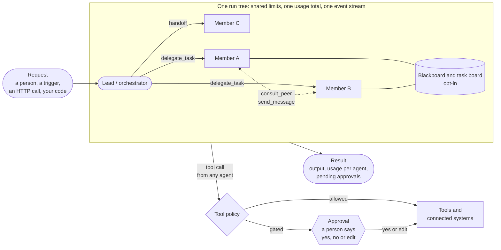
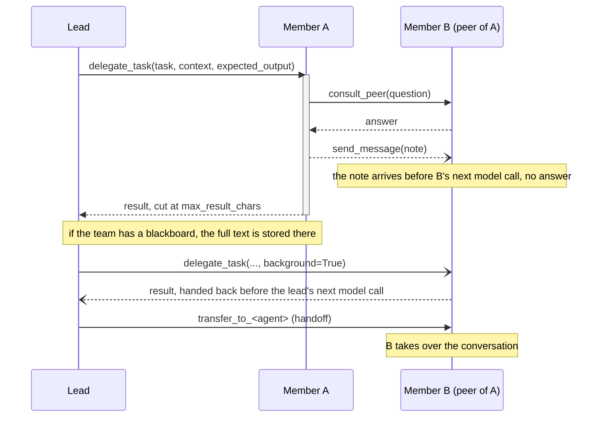
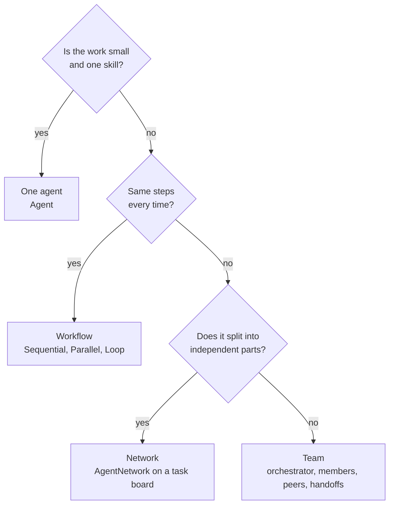
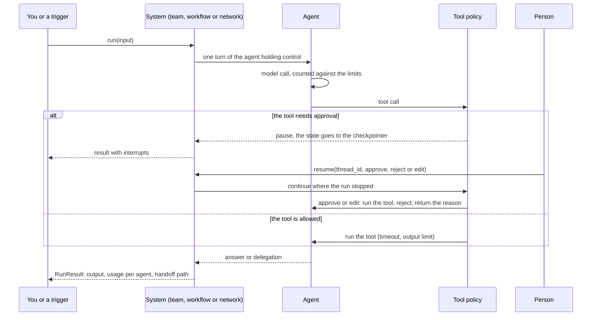
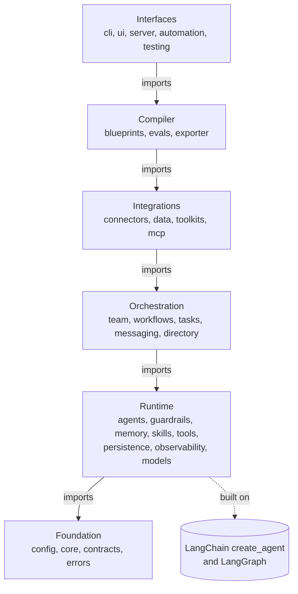

# How awa works

This page is the overview in pictures: how agents work together in awa, how they talk to each
other, where the limits sit, and why the library is built the way it is. Every diagram shows what
the code does today; the linked pages have the details and the tested examples.

## The idea: a hybrid multi-agent system under control

awa combines two ways of working together. A **lead** (the orchestrator of a team, or the lead of a
network) plans and delegates, and the **members** also work with each other directly: they consult
a colleague, leave a note, share state on a blackboard or claim work from a task board. Models
decide *what* to do; Python code decides *how much* they may do and *which* tool calls wait for a
person.

- **Hierarchical:** the lead delegates a self-contained brief; the member never sees the caller's
  conversation, and its result comes back to the lead.
- **Peer to peer:** members connected as peers ask each other (`consult_peer`) or send notes
  (`send_message`) without going through the lead.
- **Shared state:** a versioned blackboard (`blackboard=True`) and a task board (`task_board=True`)
  with owners, dependencies and atomic claims; both are opt-in for a team, and a network has a task
  board by default.
- **Under control:** every edge is declared; an agent gets exactly the tools its edges allow, and the
  whole run tree shares one set of limits. Any agent in the run can call a tool; a gated tool waits
  for a person.

Details: [Teams and networks](../develop/teams.md), [Agents and teams](../guide/agents-and-teams.md).

## How agents talk to each other

Every way of reaching another agent is a tool that the team gives to an agent only when an edge
allows it:

| Edge | Declared with | Tool | What happens |
| --- | --- | --- | --- |
| Delegation | `delegates` (default: the orchestrator to every member) | `delegate_task` | The member runs on a brief and returns a result |
| Consultation | `peers` | `consult_peer` | A question to a colleague; the answer comes back |
| Note | `peers` with messaging (default) | `send_message` | Delivered into the recipient's context, no answer |
| Handoff | `handoffs` | `transfer_to_<agent>` | The target takes over the conversation |

Whatever another agent wrote (results, notes, task text, board entries) reaches a model as labeled
data, never as instructions.

## Four ways to work together

- **Agent:** one model with tools, skills, memory and typed output.
- **Workflow:** fixed steps in code; a step can be an agent, a team or another workflow.
- **Team:** an orchestrator delegates to members; members consult each other and hand over the
  conversation.
- **Network:** a lead plans the goal as tasks on a board; teammates work concurrently and claim the
  next ready task they can do.

All four are `AgentLike` (`name`, `card`, `run`), so each one can be a team member, a workflow step,
a served system or an evaluation target.

## One run, step by step

A run-tree limit that is reached (model calls, tool calls, tokens, cost, time) stops the run with an
error you can handle (`UsageLimitExceededError`, `RunTimeoutError`). A team limit (delegation depth,
parallel delegations, calls per member) refuses that one delegation in code, and the model gets the
refusal as a tool result. No limit is ever a request in the prompt. Details:
[Safety](../develop/safety.md), [Approvals](../guide/approvals.md).

## The architecture in layers

awa has six layers; each may import only the layers below it (`lint-imports` checks this on every
change). The boxes name the main packages of each layer:

A blueprint (`blueprint.yaml`) describes a whole process as data: agents, tools, how they work
together, approvals and limits. `awa validate` checks it, `awa show` explains it, `awa eval` tests it
on eval cases, and `awa export` turns a one-agent blueprint into plain LangChain and LangGraph code
that runs without awa. Details: [Architecture](../develop/architecture.md),
[Blueprints](../develop/blueprints.md), [Export](../develop/export.md).

## The decisions behind it

| Decision | Why |
| --- | --- |
| Limits are counters in code, not words in a prompt | A model cannot talk its way past a limit on steps, tokens, cost, delegation depth, parallelism or time |
| Every edge between agents is declared | An agent can only reach the agents its edges allow; the topology is checked when the team is built |
| Content from other agents is data | A result, note or task written by an agent cannot give another agent instructions |
| One run tree | Delegations, consultations and handoffs share one usage total, one set of limits and one event stream, so a whole run is traced and stopped as one |
| Failures inside collaboration are results | A failing member returns an error result its caller can act on; only run-tree limits, cancellation and approvals cross run boundaries |
| Approvals pause, they do not block | A gated tool call saves the run in a checkpointer; the run continues after the decision, also in another process |
| Built on LangChain and LangGraph | Models, tools and graphs come from the ecosystem; a one-agent project can leave awa with `awa export` |
| Offline first | Every system runs with scripted models in tests, without a key or a network |

## Where to go next

| You want to | Read |
| --- | --- |
| Install awa | [Install](install.md) |
| Build and test a first team in ten minutes | [First automation](first-automation.md) |
| Write agents, teams and networks in Python | [Quickstart](../develop/quickstart.md), [Teams and networks](../develop/teams.md) |
| Understand the code base | [Architecture](../develop/architecture.md) |
