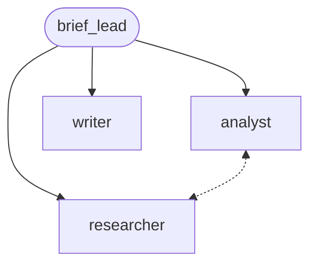

# Scenario 1: market brief from the open web

**Process.** A lead asks a researcher to find and read public pages about a short list of items,
reads the findings (an item whose quote lacks the year or does not say when the item first
appeared goes back to the researcher once, within `max_calls_per_member`), asks an analyst to check
them (the analyst consults the researcher about the item it trusts least), and has a writer draft the
executive summary. The answer is a structured brief: for every
item the year, the page it comes from and a verbatim quote of that page.

**Capabilities.** Keyless `web_search` and `fetch_url`, delegation, peer consult between members,
structured output.



| Case | Question | Expected |
| --- | --- | --- |
| `linux-distributions` | Debian, Ubuntu, Fedora: year of the first release | 1993, 2004, 2003 |
| `programming-languages` | Python, Java, Go: year each first appeared | 1991, 1995, 2009 |

**Scorers.** Deterministic first: `json_fields` (names and years in the order asked), delegation to
the researcher, analyst and writer, `web_search` and `fetch_url` were used, the answer holds URLs,
`quotes_grounded` (every quote occurs on a page the run fetched, footnote markers like `[30]` aside, and contains the item's year), `peer_consulted`. Judge last: the
summary mentions every item and claims nothing the quotes do not support.

**Endpoints and limits.** The built-in search reads DuckDuckGo's result pages (no key; it sends at most
one request per second and pauses for a minute when DuckDuckGo refuses automated searches, then
`web_search` says so and the run records the failure honestly). Pages come from Wikipedia. A run uses
about 3 searches and 3 page reads, so a full benchmark stays far below any rate limit.

```console
awa validate examples/benchmarks/core/01_market_brief/blueprint.yaml
python examples/benchmarks/core/run.py --live --only 1 --runs 3
```
