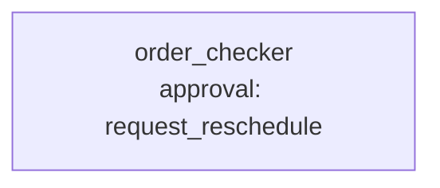

# Scenario 2: supplier orders against a REST API

**Process.** The buyer's open orders (`data/orders.csv`, a German CSV in Windows-1252: `;` separated,
amounts like `4.250,00`, dates like `11.11.2024`) each have a requested delivery date. The check asks
a public REST API for the public holidays of the supplier's country, flags every order whose date is
a weekend or a nationwide holiday there, and asks the buyer to approve a reschedule to the next
business day (`request_reschedule` waits for approval).

**Capabilities.** The generic `rest` connector with a keyless public API, CSV in cp1252, exact
numbers, an approval-gated action decided inside a case.



| Case | Request | Decision | Expected |
| --- | --- | --- | --- |
| `all-open-orders` | all open orders | approve every reschedule | 7 checked; B-1001, B-1002, B-1004, B-1005 flagged, 34,511.25 EUR |
| `one-supplier-rejected` | orders of Kowalski Stahl | reject every reschedule | B-1001, B-1004 flagged, 27,650.00 EUR, none rescheduled |
| `regional-holiday-is-no-problem` | order B-1006 | none needed | not flagged: 31.10. is a holiday only in some German states |

B-1001 and B-1005 fall on 11.11.2024 (a holiday in Poland and France), B-1002 on 3.10.2024 (German
Unity Day), B-1004 on a Saturday. The cancelled order B-1008 is ignored.

**Scorers.** `json_fields` on the exact numbers and order lists, `read_csv`, the holidays call and
`check_delivery_date` were used, `approval_granted` / `approval_rejected` / `no_approval` on
`request_reschedule`; the judge checks that each flag has a reason and a proposed day (the answer's `flags` list carries both).

**Endpoint and limits.** [Nager.Date](https://date.nager.at) public holidays,
`GET /api/v3/PublicHolidays/{year}/{country}`: no key and no stated rate limit, asked to be used with
consideration. A run makes two or three requests (one per country and year); past years do not change.

```console
awa validate examples/benchmarks/core/02_supplier_orders/blueprint.yaml
python examples/benchmarks/core/run.py --live --only 2 --runs 3
```
