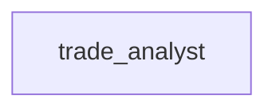

# Scenario 3: GraphQL lookup joined with a JSON file

**Process.** `data/suppliers.json` lists eight suppliers with their country code and annual spend.
The analyst reads the countries (currency, continent, capital) from a public GraphQL API and answers
questions that need both sources, with exact ids, counts and totals.

**Capabilities.** The generic `graphql` connector with a keyless public API, `json_query` on a file,
a join across two sources, structured output.



| Case | Question | Expected |
| --- | --- | --- |
| `euro-suppliers` | suppliers in euro countries and their annual spend | S-02, S-03, S-07; 3; 88,130 EUR |
| `suppliers-outside-europe` | suppliers outside Europe and their annual spend | S-04, S-06, S-08; 3; 117,350 EUR |
| `capital-and-currency` | capital of S-05's country; does it use the euro | Bern; no (its currency field is `CHE,CHF,CHW`) |

**Scorers.** `json_fields` on the exact answers, `json_query` and `countries_query` were used; the judge
checks that the summary names the three countries outside Europe.

**Endpoint and limits.** [Countries GraphQL API](https://countries.trevorblades.com) (a public API
for country data): no key, no stated rate limit; it refuses queries nested deeper than 8 levels, which
the connector's schema queries respect. A run sends one or two queries.

```console
awa validate examples/benchmarks/core/03_graphql_lookup/blueprint.yaml
python examples/benchmarks/core/run.py --live --only 3 --runs 3
```
