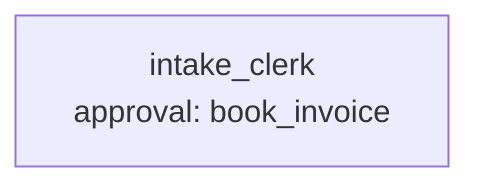

# Scenario 4: document intake

**Process.** Supplier invoices arrive as files in `data/inbox/`: a text PDF, a Word document with a
table, an Excel workbook with dates and formulas, and a scanned PDF. The clerk extracts the fields,
validates them against the vendor master (`data/vendors.csv`, German CSV in Windows-1252) and the
purchase orders (`data/purchase_orders.json`) with rules V1 to V6 (`tools.py`), books clean invoices
and puts everything else on hold with the reasons. A booking above 10,000 EUR waits for a manager's
approval (a conditional approval on the amount); the manager approves or rejects inside the case.

**Capabilities.** `extract_pdf_text`, `extract_docx_text`, `read_excel` (formula results saved in the
workbook), German number and date formats, validation rules as a tested tool, conditional approval with
both decisions, a scan that has no text layer.



| Case | Document | Decision | Expected |
| --- | --- | --- | --- |
| `clean-pdf-booked` | `2024-0412_mueller.pdf`, 1,428.00 EUR | none | booked, no approval asked |
| `large-word-invoice-approved` | `88231_zuercher.docx`, 21,420.00 EUR | approve | approval asked and granted, booked |
| `large-word-invoice-rejected` | the same | reject with a note | approval rejected, on hold with the note |
| `excel-wrong-vat-held` | `ln-2024-17_meyer.xlsx`, 5,568.00 EUR | none | on hold: V4, the VAT line uses 16 % |
| `scan-held-for-manual-entry` | `scan_0001.pdf` | none | on hold, nothing validated or booked |

**Scorers.** `json_fields` on decision, invoice number, vendor and gross amount; the reader tool of
the format was used; `validate_invoice`, `book_invoice` and `hold_invoice` were (or were not) called;
`approval_requested` / `approval_granted` / `approval_rejected`; `contains:V4`; judges on the
reviewer's note and on the scan reasons.

**Data.** `python examples/benchmarks/core/data_gen.py` recreates `data/` byte for byte
(`--check` compares).

```console
awa validate examples/benchmarks/core/04_document_intake/blueprint.yaml
python examples/benchmarks/core/run.py --live --only 4 --runs 3
```
