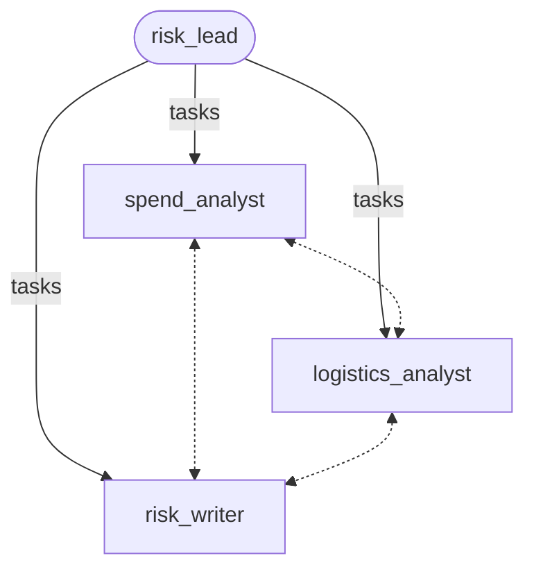

# Scenario 5: agent network

**Process.** A lead plans a supplier risk memo on a shared task board: the spend analysis (from
`data/spend.csv`) and the delivery analysis (from `data/deliveries.json`) run at the same time, the
memo depends on both. Three teammates claim the tasks that match their capability, share their key
finding on the blackboard, and hand their results back to the lead, who writes the final answer once
every handback is in.

**Capabilities.** `AgentNetwork` with a task board and dependent tasks, capability routing, the
blackboard, handbacks, a final synthesis.



| Case | Request | Expected in the memo |
| --- | --- | --- |
| `q3-supplier-risk-memo` | supplier risk memo for Q3 | highest spend: Nordwind GmbH, 48,230.50 EUR; slowest: Alpha Logistik, 6.33 days late on average |

**Scorers.** Deterministic: `tasks_completed` (all tasks completed, none failed or open, a handback for
each, normal stop), `dependency_order` (the memo was handed back after both analyses),
`blackboard_used`, and regular expressions for the two suppliers and their figures. Judge last: the
memo combines both findings, names the risk and one next step, using only the analyses' figures.

**Data.** `python examples/benchmarks/core/data_gen.py` recreates `data/`.

```console
awa validate examples/benchmarks/core/05_agent_network/blueprint.yaml
python examples/benchmarks/core/run.py --live --only 5 --runs 3
```
