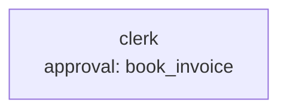

# Scenario 6: automation end to end

**Process.** A clerk books supplier invoices that arrive over a webhook (shared token in the
`X-Awa-Token` header) or as files dropped into `inbox/`; a weekly schedule summarizes the ledger
(`ledger.csv`). Bookings from 1,000 EUR on wait for a person: the run pauses, and after an
orderly restart of the server it resumes from its saved state (checked in this scenario).

**What a run plays.** The benchmark serves the blueprint in process (`awa serve`: the app runs the
worker, with the runs kept in a local `.awa/` folder, no database):

1. a small invoice (200 EUR) and a large one (1,250 EUR) arrive over the webhook; the small run
   succeeds, the large run waits for approval;
2. the server stops, `awa runs decide` approves (or rejects) the large run;
3. the server restarts and the decided run resumes from its saved state and succeeds;
4. a file dropped into `inbox/` starts a run that books it;
5. `awa trigger run` fires the weekly schedule once.



| Case | Decision | Ledger afterwards |
| --- | --- | --- |
| `large-invoice-approved` | approve | RE-20, RE-17, RE-31 |
| `large-invoice-rejected` | reject | RE-20, RE-31 (RE-17 is not booked) |

**Checks** (`scorers` of the cases, evaluated by `harness.py`): `webhook_run_succeeded`,
`large_run_waits_for_approval`, `decision_resumes_after_restart`, `file_drop_run_succeeded`,
`ledger_matches` (exact ledger lines), `schedule_run_succeeded` (the summary names the count).

```console
cd examples/benchmarks/core/06_automation
awa serve blueprint.yaml                         # the real thing: webhook + inbox + approvals
python ../run.py --live --only 6 --runs 3          # plays the benchmark day in process
```

Needs the `server` extra (`pip install -e ".[server]"`).
