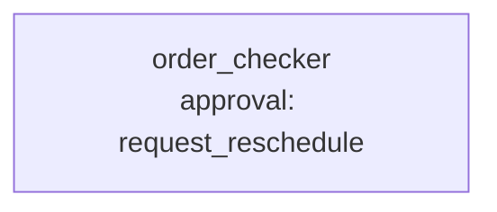

# Scenario 8: an MCP client calls the supplier-order blueprint

**Process.** The supplier-order check of [scenario 2](../02_supplier_orders/README.md) is offered to
other AI applications as an MCP server. The benchmark starts `awa mcp serve` as a separate process
and calls it the way a desktop assistant or an IDE would: with the official `mcp` client, over a real
transport. The client lists the tools, calls `run_order_checker` with a request, and answers the
reschedule approvals that the blueprint asks for.

**Capabilities.** `awa mcp serve` over stdio and over streamable HTTP (with a bearer key); the
protocol revision the server negotiates; approvals answered inside the tool call through
**elicitation**, and by a client without elicitation through `resume_order_checker`.



| Case | Transport | Approvals answered | Expected |
| --- | --- | --- | --- |
| `stdio-approved-by-elicitation` | stdio | elicitation, approve | B-1001, B-1004 rescheduled |
| `http-rejected-by-elicitation` | HTTP | elicitation, reject | none rescheduled, both rejected |
| `http-approved-with-resume-tool` | HTTP | `resume_order_checker`, approve | B-1001, B-1004 rescheduled |
| `stdio-rejected-with-resume-tool` | stdio | `resume_order_checker`, reject | none rescheduled, both rejected |

All cases ask for the orders of Kowalski Stahl (2 of the 7 open orders); both are flagged: B-1001 (11.11., a holiday in Poland) and B-1004 (a Saturday), 27,650.00 EUR.

**Checks** (`scorers` of the cases, evaluated by `mcp_client.py`): `tools_listed` (`run_order_checker`
and `resume_order_checker`), `protocol_revision` (the client and the server negotiated 2025-11-25, the
revision the [MCP guide](../../../../docs/develop/mcp.md#the-protocol-revision) pins), `approvals_answered`
(one answer per flagged order), `completed` (the run ended after the answers) and `output_matches` (the
exact fields of scenario 2 in the structured content). Model calls and tokens are those the server
reports for the whole call, which is what the ledger counts.

**How the server is started.** Offline, `mcp_launcher.py` starts the real `awa mcp serve` with the
scripted model of scenario 2 and the fake network (nothing else differs); live, the benchmark starts
`python -m awa mcp serve` with the model of the settings. Either way the server is a child process in a
temporary copy of scenario 2, and it is stopped after the run.

```console
python examples/benchmarks/core/run.py --offline --only 8 --runs 1     # the four cases, scripted
python examples/benchmarks/core/run.py --live --only 8 --runs 1        # the model of the settings
```

Needs the `mcp` and `server` extras (`pip install -e ".[mcp,server,files]"`).
