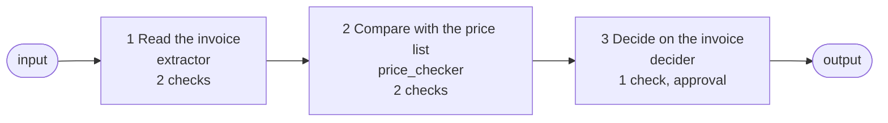

# Process: invoice check (three steps, each checked before the next starts)

**Process.** One supplier invoice is checked in three steps, each done by one agent. The next
step starts only after the checks of the step before it have passed.

1. **Read the invoice** (`extractor`): returns supplier, invoice number, total and lines.
   Checks: the output has the right fields; a rule stops the process when the supplier or the
   invoice number is missing or the total is zero or less.
2. **Compare with the price list** (`price_checker`): looks every line up in the price list,
   which is a document of this step (`data/files/price_list.csv`, declared in `data:`).
   Checks: the output has the right fields; a rule stops the process when a line is more than
   25 percent away from the list price. Before the agent runs, awa checks that the price list is
   there and still has the columns the step relies on.
3. **Decide on the invoice** (`decider`): prepares a recommendation. Check: a person decides
   when the total is 5,000 or more, or a line deviates more than 2 percent.



## Run it

```bash
# from the awa folder
P=examples/processes/invoice-check
awa validate $P
awa show $P
awa run $P "Check the invoice invoice_1041.txt"     # needs a model; awa run asks for the approval in the terminal
awa eval $P/blueprint.yaml $P/cases.yaml
```

The folder holds four sample invoices: `invoice_1041.txt` (matches the list, 165.00),
`invoice_1042.txt` (6,930.00, a person decides), `invoice_1043.txt` (a toner price 38 percent
above the list: the process stops at step 2) and `invoice_1044.txt` (no supplier: it stops at
step 1).

## What is proven, and what is not

- **Offline, scripted models** ([`tests/examples/test_process_invoice_check.py`](../../../tests/examples/test_process_invoice_check.py)):
  the order of the steps, that the next agent is never called after a failed check, that a
  missing or changed price list stops step 2 before its model is called, the pause for the
  approval and its resume without running step 1 again, a rejection, and running step 2 again on
  its own. This proves the flow, not how well a real model reads an invoice.
- **Not proven here:** answer quality with a real model, scanned or PDF invoices, an invoice
  with several pages. "Checked" means the checks above passed; it does not mean the extracted
  values are right. Review results that matter.
- The step approval only waits for a person; the library does not check who answers. Naming a role
  with `by:` records it and shows it on the approval card.

## Adapt it

Replace the sample files in `data/files`, keep the declared columns of the price list (or change
`expect:` in `data:`), and put the rules you need in `process.steps[].checks`. A rule reads the
output fields of its step (and `text`); it says when the step has failed.
