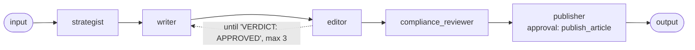

# Recipe: content production

**Process.** Marketing files a content request (blog post, social post, newsletter item).
The strategist turns it into a brief: audience, key message, keywords, length, call to
action. The writer drafts from the brief and the approved product facts only; the editor
checks the draft against the brief and the brand guidelines and sends it back with numbered
feedback until it is approved (at most three rounds). The compliance reviewer then checks
the approved text against the marketing rules (no guarantees, figures with their basis,
closing disclaimer, customer names only with consent), adds the mandatory disclaimer, and
saves compliant content to the CMS as "ready for publication". The publisher publishes it
once the content owner approves.

**One workflow** (`blueprint.yaml`) with an editing loop and an approval-gated last step:



| Agent | Does | Tools |
| --- | --- | --- |
| `strategist` | Brief from the request and the brand rules. | `get_content_request`, `get_brand_guidelines` |
| `writer` | Draft and revisions; claims only approved product facts. | `get_product_facts` |
| `editor` | `VERDICT: APPROVED` or `REVISE` with numbered feedback; carries brief and draft forward. | `get_brand_guidelines`, `get_product_facts` |
| `compliance_reviewer` | Rules CR-1 to CR-4, consent check, disclaimer; saves cleared drafts to the CMS. | `get_compliance_rules`, `get_product_facts`, `check_reference_consent`, `save_cms_draft` |
| `publisher` | Publishes the cleared draft after the content owner approves; reports the issues otherwise. | `get_cms_draft`, `publish_article` (approval) |

The compliance result (`compliance_reviewer`'s `output_schema`) has the request id,
`status` (`cleared` / `changes_required`), the title, the CMS draft id and every issue
with the rule, the passage and a compliant rewording; the publisher receives it as JSON.

**Pausing for the content owner.** When the publisher calls `publish_article`, the whole
workflow pauses: the result lists the pending approval (with `agent: publisher`) and a
thread id. `resume(thread_id, decision)` continues at the publisher only; the brief, the
drafts and the compliance check are not run again. With a durable checkpointer (for
example PostgreSQL) the pause survives restarts and the decision can come hours later
from another process.

## Run it

```bash
# from the awa folder; the tools.py beside a blueprint loads by itself
R=examples/recipes/content-production
awa validate $R/blueprint.yaml
awa run $R/blueprint.yaml "Produce content request REQ-201."   # asks for approval
awa eval $R/blueprint.yaml $R/cases.yaml
```

Sample requests: `REQ-201` (blog post, one revision), `REQ-202` (social post with a
guarantee), `REQ-203` (customer story without consent).

## Adapt it

1. **Replace the tools** in `tools.py`: `get_content_request` (content calendar or
   marketing work queue), `get_brand_guidelines` and `get_product_facts` (brand guide and
   approved claims), `get_compliance_rules` and `check_reference_consent` (rulebook and
   CRM consent records), `save_cms_draft`, `get_cms_draft` and `publish_article` (your CMS).
   A CMS with an MCP server can be declared under `mcp_servers` and listed as `mcp:cms`;
   keep the approval on its publish tool (`tool: mcp:cms/<publish tool>`).
2. **Put your rules in**: brand voice and banned words, approved product facts, compliance
   rules per channel. The writer may only claim what `get_product_facts` returns.
3. **Tune the loop.** `max_iterations: 3` bounds the editing rounds; the loop stops as soon
   as the editor writes `VERDICT: APPROVED`. Content that is still not approved reaches
   compliance as `changes_required` and is neither saved nor published.
4. **Keep the publication approval.** Serve the blueprint (`awa serve`) with a durable
   checkpointer so pending approvals survive restarts; the content owner answers them
   through the approvals API.

## Known limits

- Content that needs changes after compliance is not rewritten automatically; the issues
  (with suggested rewordings) go back to the requester.
- Images, layout and scheduling are left to your CMS.
