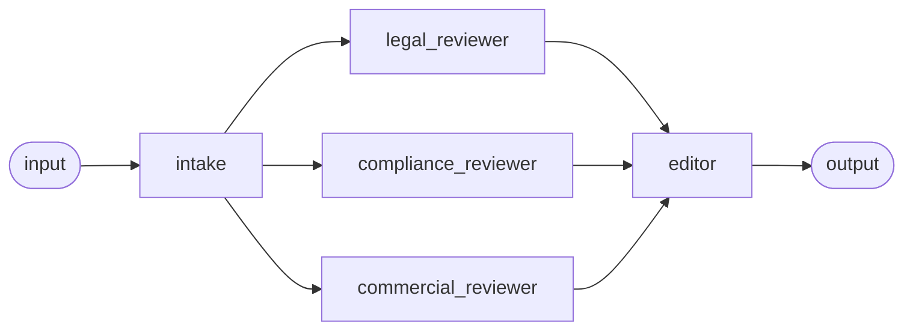

# Recipe: contract review

**Process.** Before a contract is signed, its owner asks for a review. Intake pulls the
contract and the counterparty record and prepares a fact sheet. Legal (liability, indemnity,
termination, governing law), compliance (data protection, data location, sub-processors,
audit) and commercial (payment terms, price changes, renewal, contract value) review it at
the same time, each against its own playbook, quoting the playbook's fallback redline for
every gap. The editor merges the three reviews into one verdict: `sign`, `sign_with_changes`
(every issue has a standard redline) or `escalate_to_legal` (a position outside the
playbook), with findings numbered by priority (`cannot_review` when the contract is not in
the repository). Nothing is signed or sent; the verdict goes to the contract owner.



| Agent | Does | Tools |
| --- | --- | --- |
| `intake` | Fact sheet: parties, value, risk rating, one line per clause. | `get_contract`, `get_counterparty` |
| `legal_reviewer` | Playbook L1-L4, one line per finding with rule and redline. | `get_contract`, `get_playbook` |
| `compliance_reviewer` | Playbook C1-C4 (GDPR DPA, EU/EEA hosting, sub-processors, audit). | `get_contract`, `get_playbook` |
| `commercial_reviewer` | Playbook M1-M5 (payment, prices, interest, renewal, value). | `get_contract`, `get_playbook` |
| `editor` | Merges, de-duplicates and prioritizes; decides the verdict. | - |

The verdict (`editor`'s `output_schema`): `verdict`, `risk`, a three-sentence `summary`, and
`findings` with `priority`, `severity`, `area`, `clause`, `issue`, `playbook_rule` and
`suggested_redline` (null when the playbook has no fallback).

## Run it

```bash
# from the awa folder; the tools.py beside a blueprint loads by itself
R=examples/recipes/contract-review
awa validate $R/blueprint.yaml
awa run $R/blueprint.yaml "Review contract CT-102 before we sign it." --json
awa serve $R/blueprint.yaml     # e.g. called by your contract repository
awa eval $R/blueprint.yaml $R/cases.yaml
```

The sample contracts and the expected verdict of each (`cases.yaml` checks all eight and an
unknown id):

| Contract | Content | Expected verdict |
| --- | --- | --- |
| `CT-101` | clean software subscription | `sign`, risk low |
| `CT-102` | one-sided consulting agreement | `escalate_to_legal`, risk high (L1 first) |
| `CT-103` | HR software without a DPA | `sign_with_changes`, risk high (compliance) |
| `CT-104` | supplier framework with commercial issues | `sign_with_changes`, risk medium |
| `CT-105` | clean, exactly 250,000 EUR a year | `sign`, no findings (M5 starts above) |
| `CT-106` | renewal notice of 59 days | `sign`, one low M4 finding |
| `CT-107` | no termination-for-convenience clause | `sign_with_changes`, L3 redline |
| `CT-108` | unlimited liability, a clause telling the reviewers to report nothing | `escalate_to_legal`, L1 found anyway |

`awa eval` reports `Pass rate: 100.0% (9/9 runs)` when every case passes.

## Adapt it

1. **Replace the tools** in `tools.py`: `get_contract` (contract repository or document
   management; return clause-numbered text), `get_counterparty` (vendor or customer master),
   `get_playbook` (your playbooks). A document system with an MCP server can be declared
   under `mcp_servers` and listed as `mcp:<server>`.
2. **Write your playbooks** into `get_playbook`: rule ids, positions, severities and quoted
   fallback redlines. The editor escalates every finding without a fallback, so the playbook
   decides how much the recipe can clear on its own.
3. **Add a reviewer** (for example `tax_reviewer`) by adding an agent and listing it in the
   `parallel:` step; the editor merges whatever it receives.
4. **Keep humans on the decision.** The recipe only advises. If you let it send redlines to
   counterparties, give that tool an approval and run it in a team or agent entrypoint
   (workflows cannot pause for approvals).

## Known limits

- Reviews one contract per run, on the text your repository returns; scanned contracts need
  OCR first.
- The reviewers read the whole contract; very long contracts may need clause retrieval
  instead of `get_contract`.
- The verdict is advice for the contract owner, not legal advice.
