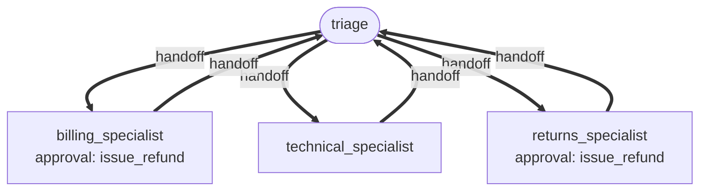

# Recipe: customer support desk

**Process.** Every customer message reaches triage first. Triage identifies the customer,
recalls what the desk already knows about them, and answers how-to questions straight from
the knowledge base. Billing, technical and order/returns conversations are handed to a
specialist who owns the conversation until the topic changes, then hands it back. Duplicate
charges and damaged items are refunded on the spot; refunds above 50.00 wait for a support
lead. Customers who ask for a person, mention legal steps or keep coming back about the same
problem are escalated to the human queue with a summary. Lasting facts (preferences, refunds,
promises) are remembered for the next conversation.



| Agent | Does | Tools |
| --- | --- | --- |
| `triage` | Identifies the customer, answers from the knowledge base, routes, escalates. | `lookup_customer`, `search_knowledge_base`, `escalate_to_human` |
| `billing_specialist` | Checks payments, refunds duplicate or wrong charges. | `lookup_invoices`, `issue_refund` (approval above 50.00), `escalate_to_human` |
| `technical_specialist` | Checks the status page first, then troubleshoots from the knowledge base. | `get_service_status`, `search_knowledge_base`, `escalate_to_human` |
| `returns_specialist` | Checks the order, refunds damaged items, creates return labels. | `lookup_order`, `create_return_label`, `issue_refund` (approval above 50.00), `escalate_to_human` |

All four share one team memory (`remember` / `recall`, three memories recalled
automatically per turn) and compact long conversations beyond 12,000 tokens.

## Run it

```bash
# from the awa folder; the tools.py beside a blueprint loads by itself
R=examples/recipes/customer-support-desk
awa validate $R/blueprint.yaml
awa chat $R/blueprint.yaml          # a multi-turn conversation
awa run $R/blueprint.yaml "C-1002 here. I was charged twice for September!"
awa serve $R/blueprint.yaml         # one thread per customer conversation
awa eval $R/blueprint.yaml $R/cases.yaml
```

Sample customers are `C-1001` to `C-1003`, orders `O-5001` / `O-5002`; the `sync` component
has a live incident.

## Adapt it

1. **Replace the tools** in `tools.py`: `lookup_customer` (CRM), `lookup_invoices` and
   `issue_refund` (billing / payment provider), `lookup_order` and `create_return_label`
   (order management), `search_knowledge_base` (help center), `get_service_status` (status
   page), `escalate_to_human` (ticketing queue). A CRM or help center with an MCP server can
   be declared under `mcp_servers` and listed as `mcp:crm`; keep the approval on refunds.
2. **Set the refund limit** in `REFUND_APPROVAL_THRESHOLD` (`refund_needs_approval`). Keep
   the gate; lower the limit for new or high-risk markets. `when: tools:refund_needs_approval`
   names the tools module; update it if you rename `tools.py`.
3. **Memory per customer.** The sample uses `scope: team` and prefixes every memory with the
   customer number, which works from every entry point. When customers are authenticated,
   switch to `scope: user` and pass the customer id as `deps={"user_id": ...}` when you run
   the team (for example with `ServedSystem(deps_factory=...)` in `awa.server`), so memories
   can never cross customers.
4. **Serve with a durable checkpointer**, so a paused refund survives restarts and the
   support lead can approve it from your back office.

## Known limits

- The desk answers in text; channel formatting (email signature, chat widgets) belongs in
  your integration.
- Specialists hand back to triage rather than to each other, which keeps routing simple;
  add `handoffs` edges between specialists if your conversations often switch topics.
- `awa run`, `awa chat` and `awa eval` do not pass `deps`, so `scope: user` memory only
  works where your code or server passes a user id.
