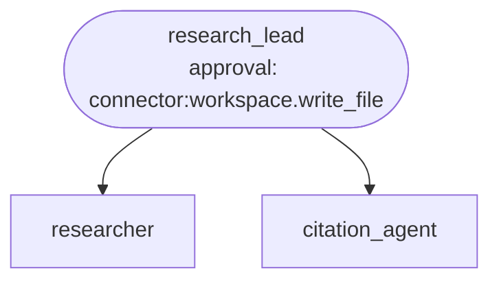
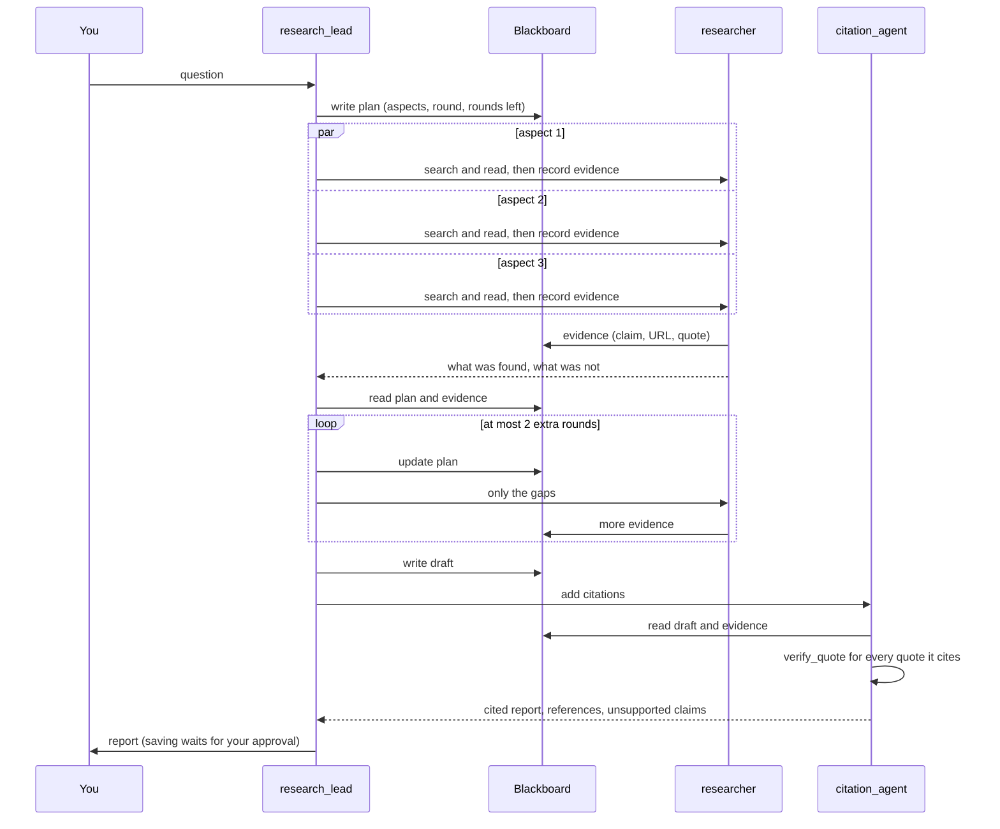

# Recipe: deep research

**Process.** Someone asks a research question that has several parts ("Python, Java and Go: the year
each first appeared and who designed it"). The orchestrator `research_lead` splits it into up to
four aspects and saves its plan on the shared blackboard, so the plan survives even when the
orchestrator's conversation is shortened. One researcher per aspect then searches the open web and
reads pages, all at the same time, and writes what it found to the blackboard: every finding is a
claim with the page URL and a word-for-word quote. The lead reads the plan and the evidence again,
writes a draft from the evidence only, and decides whether more research is needed: for a missing or
thin aspect it sends researchers out again, at most two extra rounds. A separate citation agent then
adds numbered citations: it cites a claim only when a quote states it and the quote was checked
against the page; a claim without verified evidence is removed and listed as unsupported. A person
approves saving the report, which is written to the `reports/` folder. The answer is structured:
report, references, unsupported claims, open questions, rounds used and where it was saved.



The same process in time (the orchestrator starts one `researcher` run per aspect in one step):



| Agent | Does | Tools |
| --- | --- | --- |
| `research_lead` | Plans, delegates in parallel, synthesizes from the evidence, decides on more rounds, saves and answers. | `workspace_write_file`, shared workspace (`write_shared`, `read_shared`, `list_shared`) |
| `researcher` | One aspect: at most two searches and three pages; records claim, URL and quote per finding. | `web_search`, `fetch_url`, shared workspace |
| `citation_agent` | Cites claim by claim from the evidence; removes what it cannot verify. | `verify_quote`, shared workspace |

## What is bounded, and by what

| Bound | Set by | Enforced |
| --- | --- | --- |
| At most 4 researchers at the same time | `team.limits.max_parallel_delegations: 4` | in code |
| At most 8 researcher runs per question (4 aspects plus 2 extra rounds of 2 gaps) | `team.limits.max_calls_per_member: 8` | in code: further requests are refused and the orchestrator is told |
| At most 2 extra rounds | the plan's `extra_rounds_left` on the blackboard, read back before every decision | by the orchestrator's instructions, with the limit above as the fence |
| Lead steps | `max_steps: 24` on the orchestrator | in code |
| A citation exists only for a verified quote | `verify_quote` fetches the page and compares the words | in code |
| Nothing is saved without a person | `approvals: connector:workspace.write_file` | in code |

## Run it

The recipe uses the built-in web tools only, so there is no `tools.py` and it needs no key
besides the model's. Search works without any API key.

```bash
# from the awa folder
R=examples/recipes/deep-research
awa validate $R/blueprint.yaml
awa run $R/blueprint.yaml --stream \
    "Python, Java and Go: the year each first appeared and who designed it."
awa eval $R/blueprint.yaml $R/cases.yaml
```

`awa run` stops when the orchestrator wants to save the report and asks you to approve or reject.
Reports land in `examples/recipes/deep-research/reports/`.

## Adapt it

1. **Change the folder** in `connectors.workspace.root` to where reports should go. For
   unattended runs (an `awa serve` trigger) set `requires_approval: false` there and remove
   the `approvals:` entry; `awa validate` then warns that the save needs no approval.
2. **Search elsewhere.** `web_search` uses a keyless search by default. Set
   `toolkits.web.search` (or restrict `fetch_url` with `allowed_hosts`, which also lets you
   drop the `tool_risks` entries) to search your own API or only trusted sites.
3. **Change the limits.** Fewer aspects and rounds make a cheaper run: lower
   `max_calls_per_member`, `max_parallel_delegations` and the "two extra rounds" in the
   orchestrator's instructions together. Each round costs roughly one run of every gap researcher
   plus three orchestrator steps.
4. **Change the output.** Edit `output_schema` of the orchestrator (and of `citation_agent`, whose
   fields the orchestrator copies).

## Known limits

- The report is only as good as the pages the search finds; the recipe checks that quotes are
  on the pages, not that the pages are right. `verify_quote` compares words, so a page that
  needs JavaScript or sits behind a login cannot be verified, and its claims are removed.
- Whether a claim is *supported by* its quote is the citation agent's judgment; that the quote's
  words *exist* on the page (in order, each piece inside one sentence, line or list item) is
  checked in code.
- Keyless search is often refused when several researchers search at the same moment (seen in
  live runs); the tool then says so and the researchers fetch the encyclopedia
  article of the subject instead. For dependable runs configure a search API (see "Adapt it").
- The extra-round limit of two is held by the plan and the orchestrator's instructions; only the
  total number of researcher runs is a hard limit.

## Measured results

One run of the case `three-languages-cited` with a real model (an Azure OpenAI deployment) on
2026-10-05, against the open web: keyless search and real pages. To repeat it, with a model key:

```bash
awa eval examples/recipes/deep-research/blueprint.yaml examples/recipes/deep-research/cases.yaml --tag full
```

| Case | Result | Model calls | Tokens | Time |
| --- | --- | --- | --- | --- |
| `three-languages-cited` | every scorer passed; judge 1.00 | 30 (29 and 1 for the judge) | about 137,000 | 48.6 s |

The plan was written to the blackboard, three researchers ran in parallel and one round was
enough. The citation agent checked six quotes against the live pages; the report cites Python
1991 (Guido van Rossum), Java 1995 (James Gosling) and Go 2009 (Robert Griesemer, Rob Pike, Ken
Thompson). The save paused for approval and the case's decision approved it. This is one run, not
a statistic: a live model and a rate-limited keyless search vary from run to run.

The cases `nothing-found-nothing-cited`, `research-rounds-stop-at-the-bound` and
`rejected-save-is-reported` run offline in the test suite and were not run with a real model.
