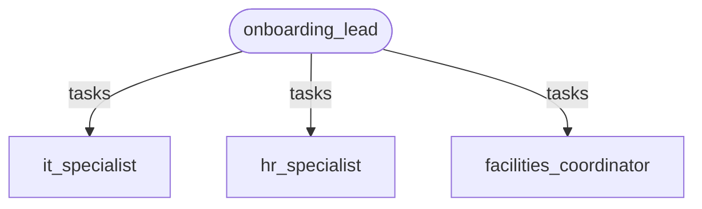
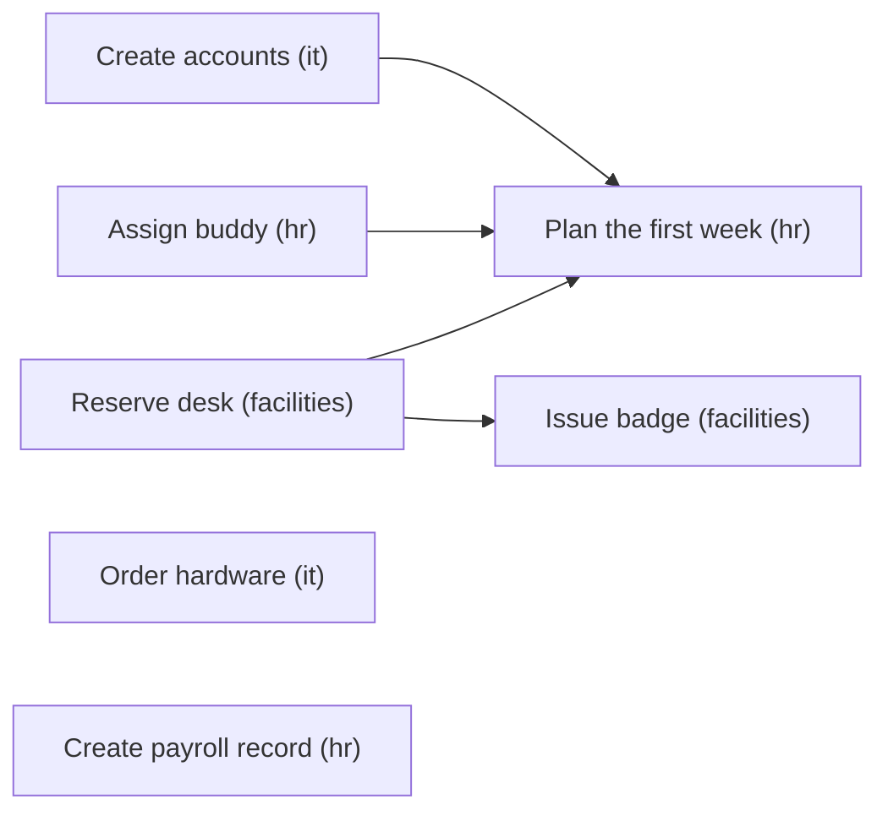

# Recipe: employee onboarding

**Process.** When HR marks a new hire as signed, the onboarding lead reads the hire's record
and puts the whole onboarding on a shared task board, in dependency order: IT creates the
accounts and raises the hardware purchase request; HR creates the payroll record (employees
only) and assigns a buddy; facilities reserves a desk and then issues the badge
(office-based hires only); and once accounts, buddy and desk exist, HR schedules the first
week. Teammates pick up the tasks that match their capability as soon as they are ready and
report the references back. The lead then sends the hiring manager a status summary and
answers with a checklist that also lists what is still waiting for people (procurement's
approval of the hardware, the payroll administrator's approval).



The plan the lead puts on the board for an office-based employee:



| Agent | Capability | Does | Tools |
| --- | --- | --- | --- |
| `onboarding_lead` | coordination | Reads the hire, plans the tasks, informs the manager, writes the checklist. | `get_new_hire`, `send_manager_summary` |
| `it_specialist` | it | Accounts and groups; hardware purchase request (office or home delivery). | `get_new_hire`, `create_accounts`, `order_hardware` |
| `hr_specialist` | hr | Payroll draft, buddy, first-week calendar. | `get_new_hire`, `create_payroll_record`, `assign_buddy`, `schedule_first_week` |
| `facilities_coordinator` | facilities | Desk near the team, access badge for its floor. | `get_new_hire`, `assign_desk`, `issue_badge` |

## Run it

The blueprint's entrypoint is an **agent network** (`network:`): IT, HR and facilities work
at the same time, each claiming the next ready task that matches its capability.

```bash
# from the awa folder; the tools.py beside a blueprint loads by itself
R=examples/recipes/employee-onboarding
awa validate $R/blueprint.yaml
awa run $R/blueprint.yaml "Onboard new hire H-2001." --stream
awa eval $R/blueprint.yaml $R/cases.yaml
awa serve $R/blueprint.yaml        # networks run one request at a time
```

Sample hires: `H-2001` (office employee), `H-2002` (remote employee), `H-2003` (office
contractor).

## Adapt it

1. **Replace the tools** in `tools.py`: `get_new_hire`, `create_payroll_record` and
   `assign_buddy` (HR information system), `create_accounts` (identity provider),
   `order_hardware` (procurement in the ERP), `assign_desk` and `issue_badge` (facilities and
   access control), `schedule_first_week` and `send_manager_summary` (calendar and email).
   An identity provider or HR system with an MCP server can be declared under `mcp_servers`
   and listed as `mcp:<server>`.
2. **Change the plan** in `onboarding_lead`'s instructions: add tasks (for example
   "Security training" for `it`), and a teammate with a new capability for a new department.
3. **Keep the human checkpoints in the systems of record.** Tools that commit money or
   personal data only create requests: the hardware purchase request is approved in the ERP
   and the payroll draft is signed off in the HR system. To gate a tool in the network
   itself, add it to `approvals:` and build with a checkpointer: the teammate's task is
   parked until the decision comes in while the other teammates keep working.
4. **Bound it.** `network.limits` caps tasks (10), lead turns (8), retries and time.

## Known limits

- One hire per run. Start it from your HR system's "contract signed" event.
- Hardware delivery and payroll approval happen after the run; the checklist lists them as
  waiting for people.
