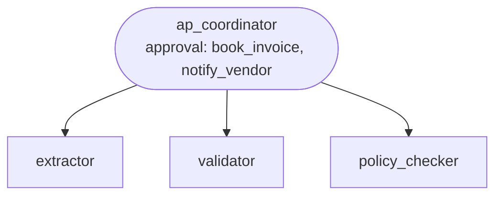

# Recipe: invoice processing

**Process.** A supplier invoice arrives in the accounts-payable (AP) inbox. Its fields are
extracted exactly as printed, then two checks run in parallel: a three-way match against the
purchase order, the goods receipt and the vendor master, and an AP policy check (duplicates,
changed bank details, approval limits). A clean invoice is booked in the ERP and the vendor
gets the pre-approved "booked" message; invoices above 10,000 EUR (or not in EUR) are booked
only after an AP manager approves. Anything else goes to the AP exception queue with every
reason, and the vendor is asked to act (for example, to issue a credit note) only after a
human has read the message. The result is a structured record for the ledger and the audit
trail.



| Agent | Does | Tools |
| --- | --- | --- |
| `ap_coordinator` | Runs the steps, decides book or hold, notifies the vendor, returns the outcome record. | `book_invoice` (approval above 10,000 EUR), `hold_invoice`, `notify_vendor` (approval for free text) |
| `extractor` | Reads the document and returns the invoice fields as structured data. | `fetch_invoice_document` |
| `validator` | Three-way match: vendor active, PO belongs to vendor, quantities received, prices within 2 %. | `get_vendor`, `get_purchase_order`, `get_goods_receipt` |
| `policy_checker` | AP policy AP-1 to AP-6: duplicates, IBAN against the vendor master, approval limit. | `get_ap_policy`, `get_vendor`, `find_booked_invoices` |

The outcome (`ap_coordinator`'s `output_schema`) has `decision` (`booked` / `on_hold`), the
booking reference or exception case, the amounts, every reason with its rule id, and whether
the vendor was notified.

## Run it

```bash
# from the awa folder; the tools.py beside a blueprint loads by itself
R=examples/recipes/invoice-processing
awa validate $R/blueprint.yaml
awa run $R/blueprint.yaml "Process invoice document DOC-1002." --stream
awa chat $R/blueprint.yaml              # one invoice per message
awa serve $R/blueprint.yaml
awa eval $R/blueprint.yaml $R/cases.yaml
```

`awa run` asks for approvals on the terminal; `awa serve` lists them under
`/v1/systems/invoice-processing/threads/{thread_id}/interrupts`. The sample inbox and the
expected outcome of each document (`cases.yaml` checks all nine):

| Document | Invoice | Expected result |
| --- | --- | --- |
| `DOC-1001` | clean, 1,428.00 EUR | booked, vendor gets the "booked" message |
| `DOC-1002` | 23,800.00 EUR | waits for the AP manager; booked on approval, held on rejection |
| `DOC-1003` | chairs 195.00 EUR against a PO price of 180.00 EUR | held (AP-1); credit-note request to the vendor after review |
| `DOC-1004` | invoice number already booked | held (AP-2), vendor not contacted |
| `DOC-1005` | IBAN differs from the vendor master | held (AP-3), vendor not contacted |
| `DOC-1006` | exactly 10,000.00 EUR | booked without approval |
| `DOC-1007` | 10,000.01 EUR | waits for the AP manager |
| `DOC-1008` | no purchase order on the invoice | held, the missing field named |
| `DOC-1009` | 14,280.00 EUR, text claims a pre-approval | waits for the AP manager all the same |

`awa eval` reports `Pass rate: 100.0% (9/9 runs)` when every case passes.

## Adapt it

1. **Replace the tools** in `tools.py`, keeping names and signatures: `fetch_invoice_document`
   (AP mailbox or document store plus OCR), `get_vendor` / `get_purchase_order` /
   `get_goods_receipt` / `find_booked_invoices` / `book_invoice` (ERP), `hold_invoice` (AP
   exception queue or ticketing system), `notify_vendor` (email gateway or supplier portal).
   If your ERP has an MCP server, declare it under `mcp_servers` and list `mcp:erp` instead of
   the ERP tools; keep the approval on the booking tool (`tool: mcp:erp/<booking tool>`).
2. **Put your policy in** `get_ap_policy` (or load it from your policy system); keep the rule
   ids, the agents cite them.
3. **Keep both approvals.** `booking_needs_approval` holds the threshold
   (`APPROVAL_THRESHOLD_EUR`); lower it rather than removing the gate. Free-text messages to
   vendors stay reviewed. The `when: tools:<function>` references name the tools module;
   update them if you rename `tools.py`.
4. **Use a durable checkpointer** in production so pending approvals survive restarts
   (`AWA_CHECKPOINTER_BACKEND=postgres`, see [Serving](../../../docs/develop/serving.md)).

## Known limits

- One invoice per run; batch the AP inbox in your scheduler and pass one document id each.
- Single-line purchase orders in the sample data; multi-line matching works the same but
  test it with your own documents in `cases.yaml`.
- Currency conversion is not handled: non-EUR invoices always go to a manager.
