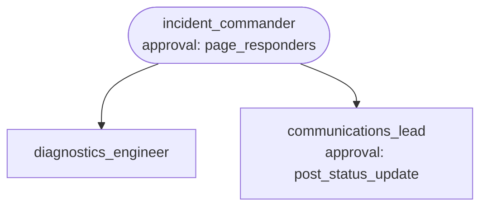

# Recipe: IT incident triage

**Process.** An alert from monitoring or a report from a colleague arrives. The incident
commander looks the service up in the service catalog and sets the severity with a fixed
matrix (SEV1: a tier-1 customer-facing service is down; SEV2: tier-1 degraded or tier-2
down; SEV3: internal or with a workaround). It opens the incident and, for SEV1 and SEV2,
pages the owning on-call rotation; a SEV1 page also wakes the major-incident rotation and
waits for the on-duty engineer to confirm. The diagnostics engineer checks metrics, logs
and recent deploys and names the runbook step to run. For customer-facing SEV1/SEV2
incidents the communications lead drafts a public status update, which is posted only after
approval. After resolution, the same desk writes the post-incident notes.



| Agent | Does | Tools |
| --- | --- | --- |
| `incident_commander` | Severity, incident record, paging, coordination; returns the incident record. | `get_service`, `open_incident`, `get_incident`, `page_responders` (approval for SEV1) |
| `diagnostics_engineer` | Impact, evidence, likely cause and the runbook step; changes nothing itself. | `get_service_health`, `query_logs`, `get_recent_deploys`, `lookup_runbook` |
| `communications_lead` | Public or internal status updates; post-incident notes with action items. | `get_incident`, `post_status_update` (approval for public updates), `save_post_incident_notes` |

The incident record (`incident_commander`'s `output_schema`) has the incident id, service,
severity, status, whether responders were paged, the likely cause, next steps and whether a
public update went out, ready for your ticketing system.

## Run it

```bash
# from the awa folder; the tools.py beside a blueprint loads by itself
R=examples/recipes/it-incident-triage
awa validate $R/blueprint.yaml
awa run $R/blueprint.yaml "ALERT checkout: error rate 38%, customers cannot pay." --stream
awa run $R/blueprint.yaml "INC-7001 is resolved. Please write the post-incident notes."
awa serve $R/blueprint.yaml     # point your alerting webhook here
awa eval $R/blueprint.yaml $R/cases.yaml
```

Sample services: `checkout` (down after a deploy), `payments-api` (slow upstream),
`reporting` (internal, slow query), `search`; `INC-7001` is a resolved incident.

## Adapt it

1. **Replace the tools** in `tools.py`: `get_service` (service catalog / CMDB),
   `get_service_health` and `query_logs` (monitoring and logs), `get_recent_deploys` (CI/CD),
   `lookup_runbook` (runbook wiki), `open_incident` / `get_incident` (incident management),
   `page_responders` (paging), `post_status_update` (status page and chat),
   `save_post_incident_notes` (wiki). Monitoring platforms with an MCP server can be declared
   under `mcp_servers` and given to `diagnostics_engineer` as `mcp:<server>`.
2. **Put your severity matrix** into `incident_commander`'s instructions and keep it
   deterministic; add response-time targets per severity if you have them.
3. **Keep both approvals.** A SEV1 page and a public statement are the two actions with
   consequences outside the team. If you add automatic mitigation (for example a rollback
   tool for `diagnostics_engineer`), gate it with an approval as well. The `when:
   tools:<function>` predicates name the tools module; update them if you rename `tools.py`.
4. **Serve with a durable checkpointer** so a pending approval survives restarts, and route
   the approval to the on-duty engineer's phone through your paging tool.

## Known limits

- One alert per run; de-duplicate alert storms in your alerting system before calling it.
- The recipe diagnoses and recommends; people run the mitigation.
- Status updates after the first one are not scheduled automatically; run the desk again
  with "Post the next update for INC-...".
