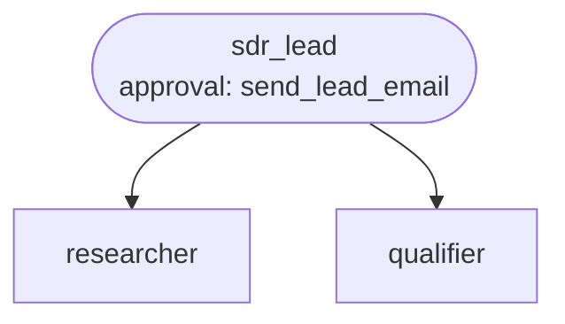

# Recipe: lead qualification

**Process.** An inbound lead lands in the CRM (demo request, webinar, newsletter). The SDR
lead reads it; existing customers are routed straight to their account manager. For
prospects, the company is researched (firmographics and news from the last six months) and
scored against the ideal customer profile (ICP) rubric, criterion by criterion, with
evidence. The score, tier and a summary are written back to the CRM, whose own rules then
start nurture campaigns or sales follow-up. A and B leads get a short, personal first email
that refers to something concrete about their company; a human reads and approves every
email before it is sent.



| Agent | Does | Tools |
| --- | --- | --- |
| `sdr_lead` | Reads the lead, coordinates research and scoring, updates the CRM, writes the email. | `get_lead`, `update_crm_lead`, `send_lead_email` (approval) |
| `researcher` | Firmographics and recent news, facts only, "unknown" when not found. | `get_company_profile`, `search_company_news` |
| `qualifier` | Scores the ICP rubric with evidence per criterion, applies disqualifiers, sets the tier. | `get_icp_rubric` |

`qualifier` returns a structured score (points and evidence per criterion, disqualifiers,
tier); `sdr_lead` returns the pipeline outcome (`tier`, `score`, `next_step`, `summary`).

## Run it

```bash
# from the awa folder; the tools.py beside a blueprint loads by itself
R=examples/recipes/lead-qualification
awa validate $R/blueprint.yaml
awa run $R/blueprint.yaml "Qualify inbound lead L-301." --stream
awa serve $R/blueprint.yaml     # call it from a CRM webhook
awa eval $R/blueprint.yaml $R/cases.yaml
```

Sample leads: `L-301` (strong fit), `L-302` (consumer business), `L-303` (unknown company),
`L-304` (existing customer).

## Adapt it

1. **Replace the tools** in `tools.py`: `get_lead` and `update_crm_lead` (your CRM; map
   tier and status to your lead fields), `get_company_profile` (company data provider),
   `search_company_news` (news or web search), `send_lead_email` (email gateway or sales
   engagement tool). A CRM with an MCP server can be declared under `mcp_servers` and used as
   `mcp:crm`.
2. **Put your ICP in** `get_icp_rubric`: criteria, points, disqualifiers and tier limits.
   Change the tier-to-status mapping in `sdr_lead`'s instructions if your funnel differs.
3. **Keep the email approval.** It is the only external action. Once the approval rate is
   consistently high, you can narrow it with a `when:` predicate (for example only tier B),
   never remove it for new campaigns.
4. **Tune the email rules** (length, tone, signature, languages) in `sdr_lead`'s
   instructions; add your brand voice as a custom skill if several recipes share it.

## Known limits

- One lead per run; trigger it from the CRM when a lead is created.
- The researcher only knows what your data provider and news search return; small or new
  companies end up in tier C by design.
- Rejected emails are not redrafted automatically; the rejection note is in the run for the
  sales rep.
