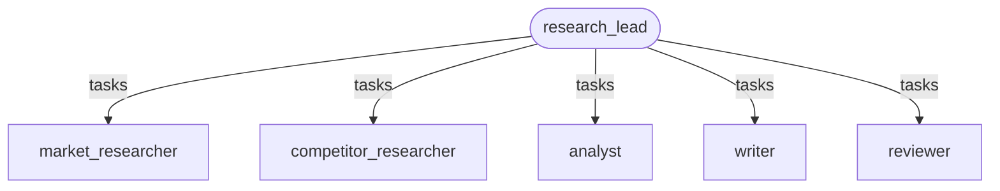
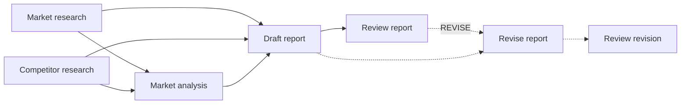

# Recipe: market research report

**Process.** A product or strategy team asks a market question ("predictive maintenance
software for mid-sized manufacturers in DACH"). The research lead plans the study on a task
board: market research and competitor research run in parallel, the analyst turns their
findings and the market statistics into figures and a labeled projection, the writer drafts
the report, and the reviewer is instructed to check each claim against its source. If the
review finds an unsourced or overstated claim, the writer revises once and the reviewer
checks again. The approved report, with a source list, is saved to the knowledge base and
returned. Missing data is to be reported as a gap, not estimated.



The plan the lead puts on the board (the revision tasks only when the review asks for them):



| Agent | Capability | Does | Tools |
| --- | --- | --- | --- |
| `research_lead` | coordination | Plans the study, adds the revision round, saves and delivers the report. | `save_report_to_knowledge_base` |
| `market_researcher` | market-research | Size, growth, adoption, drivers, barriers, each with a source id. | `search_sources`, `read_source` |
| `competitor_researcher` | competitor-research | Competitors with share and focus. | `get_competitor_profiles`, `search_sources` |
| `analyst` | data-analysis | Figures, segment split, projection (with the calculation), implications. | `get_market_statistics` |
| `writer` | report-writing | The report (report-generation skill): summary, market, competitors, outlook, risks, sources. | - |
| `reviewer` | quality-review | Is instructed to check each figure against its source; `VERDICT: APPROVED` or `REVISE` with fixes. | `read_source` |

## Run it

The blueprint's entrypoint is an **agent network** (`network:`): both researchers work at
the same time and every teammate starts as soon as its inputs are ready.

```bash
# from the awa folder; the tools.py beside a blueprint loads by itself
R=examples/recipes/market-research-report
awa validate $R/blueprint.yaml
awa run $R/blueprint.yaml "Market research report: predictive maintenance software for mid-sized manufacturers in DACH." --stream
awa eval $R/blueprint.yaml $R/cases.yaml
```

## Adapt it

1. **Replace the tools** in `tools.py`: `search_sources` and `read_source` (your research
   library, analyst subscriptions, or a web search restricted to trusted publishers),
   `get_market_statistics` (market database), `get_competitor_profiles` (competitive
   intelligence or CRM win/loss data), `save_report_to_knowledge_base` (wiki or document
   system). Research providers with an MCP server can be declared under `mcp_servers` and
   listed as `mcp:<server>`.
2. **Set the report format** in `writer`'s instructions (sections, length, audience); the
   report-generation skill keeps the structure consistent.
3. **Tune the review.** The reviewer's checks are the quality bar; add yours (for example
   "every competitor claim is less than 12 months old"). One revision round keeps cost and
   time bounded; the lead says so when a report was never approved.
4. **Bound it.** `network.limits` caps tasks (8), lead turns (10) and time (20 minutes).

## Known limits

- The review is a model's reading, not a code check, and it is not measured: figures need
  deterministic checks or human review.
- The report is only as good as the sources the tools return; the recipe will not browse
  beyond them.
- Nothing leaves the company: the report goes to the internal knowledge base. Add an
  approval-gated tool (listed under `approvals:`, built with a checkpointer: the task
  is parked until the decision comes in) before sending it to customers.
