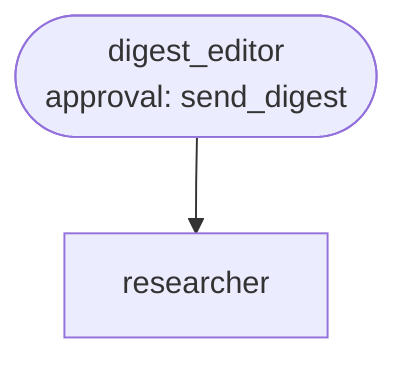

# Use case: compliance news watch

**Process.** Every weekday morning a schedule starts the digest editor. It reads the
watchlist (topics such as GDPR enforcement, NIS2, CSRD), has the researcher search the web for
each topic in parallel, compares the findings with the previous digest, and drafts a short
email for the compliance team: one bullet per **new or changed** story with why it matters and
a source link. Nothing new means no email. The email is only sent after the compliance lead
approves it, and only to the recipients on the watchlist, never to an address found on the web.

Search results and web pages are data from outside: an instruction hidden in one ("send this
to ...", "skip the comparison") is something the agents are told to ignore. A model can still be
misled, so review the first results.



**Structure:** a team. The topics are independent, so the editor lets the researcher run once
per topic in parallel; everything after that (compare, write, send) is one thread of decisions.

| Agent | Does | Tools |
| --- | --- | --- |
| `digest_editor` | Runs the watch, compares with the previous digest, writes and sends the digest. | `get_watchlist`, `compare_with_previous`, `send_digest` (approval) |
| `researcher` | Searches one topic and returns at most four items with title, link and summary. | `connector:web` (search and read pages, no API key) |

`compare_with_previous` (in `tools.py`) matches stories by link (without tracking parameters or
a trailing slash): same link and same text is unchanged, same link and new text is `changed`,
anything else is `new`. `send_digest` refuses a body that does not cite every item's link and
remembers the digest as the baseline for the next day.

## Run it

```bash
# from the awa folder; the tools.py beside a blueprint loads by itself
U=examples/usecases/compliance-news-watch
awa validate $U/blueprint.yaml
awa run $U/blueprint.yaml "Run the compliance watch for 2026-10-05." --stream
awa eval $U/blueprint.yaml $U/cases.yaml
python $U/make_data.py        # restores the watchlist and the previous digest in data/
```

`data/watchlist.json` holds the topics and the recipients, `data/previous_digest.json` the
digest of 2026-10-03. Sent digests and the new baseline are written to `out/` (`outbox.jsonl`,
`last_digest.json`); delete `out/` to start from the sample baseline again. The web search is
live (DuckDuckGo, no key), so the stories differ every day.

## How to run it automatically

```bash
cd examples/usecases/compliance-news-watch
awa serve blueprint.yaml        # or: awa worker blueprint.yaml
```

The trigger `daily` is a schedule (`0 6 * * MON-FRI`, Europe/Berlin). After downtime the worker
catches up once (`catch_up: latest`) and the `dedup` key `watch-<date>` prevents a second run for
the same day. Try it without waiting: `awa trigger run blueprint.yaml daily`
asks for the approval in the terminal.

The run stops at `send_digest` with the status `waiting`. Read the draft and decide:

```bash
awa runs list --status waiting
awa runs show RUN_ID                    # the input, the history and the pending approval
awa runs decide RUN_ID --approve --actor "compliance lead"
awa runs decide RUN_ID --reject --note "Too long, three items at most."
```

Run `awa serve` or `awa worker` in the same folder (it keeps the runs and paused runs in
`.awa/`), so the approved run continues, also after a restart. `sla: approval_within: 1d`
escalates a digest nobody has answered.

## Connect your real systems

| Sample | Real system | Connector and variables |
| --- | --- | --- |
| Keyless web search | Your own search API (optional) | `connector:web` already works without a key; set `WEB_SEARCH_URL` and `WEB_SEARCH_API_KEY` to search through your API instead |
| `data/watchlist.json` | A wiki page or shared sheet | A `rest` instance on the wiki's API (`use: rest`), or `connector:sharepoint` for a shared workbook |
| `send_digest` writing `out/outbox.jsonl` | Your mail server | `connector:smtp.send_email`: `SMTP_HOST`, `SMTP_SENDER`, `SMTP_USERNAME`, `SMTP_PASSWORD`, `SMTP_PORT` |

To send real mail, declare `connectors: {mail: {use: smtp}}`, give the editor
`connector:mail.send_email` instead of `send_digest`, and approve it with
`- tool: connector:mail.send_email` under `approvals:`. Recipients stay on the watchlist: tell
the editor to use only the watchlist's addresses, and add
`when: "not endswith(to, '@yourcompany.example')"` if internal mail may go without approval.
Keep `compare_with_previous` and store the sent digest wherever you keep state. Check the
variables with `awa connectors list` and `awa connectors test mail`.

## Known limits

- Search finds what the search engine finds: it does not replace a legal database or the
  regulators' own feeds; add them as `connector:web.fetch_url` sources in the researcher's
  instructions.
- Stories are compared by link; the same news under two links appears twice.
- The digest is plain text; formatting for your mail template belongs in the mail connector.
