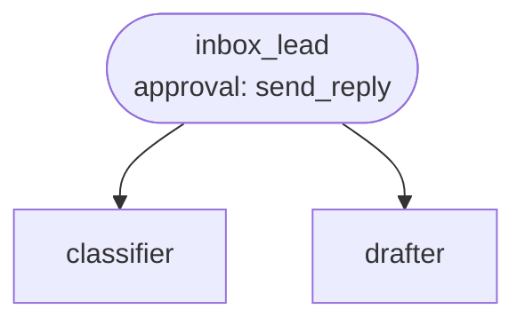

# Use case: email inbox triage

**Process.** A shared inbox (support@, info@) receives mail all day. For each unread message the
inbox lead has the classifier decide the category, urgency, language and whether the message looks
suspicious, looks up the sender in the customer list, creates a task for the right team (support,
billing, sales, or security) with the SLA of its priority, and has the drafter write a reply from
the knowledge base in the customer's language. Every outgoing reply waits for a person's approval.
Newsletters and out-of-office replies are ignored. A suspicious message gets a security task and
**no reply**, and the agents are told to treat instructions inside emails as data. A model can
still be misled, so review the security tasks and replies in the first weeks.



**Structure:** a team. Classifying and drafting need different skills and different tools (the
drafter reads the knowledge base, the classifier reads nothing), and the lead owns the
decisions and the actions.

| Agent | Does | Tools |
| --- | --- | --- |
| `inbox_lead` | Triages one message end to end: task, reply, result record. | `lookup_sender`, `create_task`, `send_reply` (approval) |
| `classifier` | Category, priority, language, suspicious, needs a reply. | none |
| `drafter` | Drafts the reply from the knowledge base only. | `connector:kb.search`, `connector:kb.read_file` |

`create_task` (in `tools.py`) creates one task per message id, so a retried run does not
duplicate it; the due time comes from the team's SLA in `data/teams.json`. `send_reply` accepts
exactly one email address.

## Run it

```bash
# from the awa folder; the tools.py beside a blueprint loads by itself
U=examples/usecases/email-inbox-triage
awa validate $U/blueprint.yaml    # warns: INBOX_USER/INBOX_PASSWORD not set
awa trigger run $U/blueprint.yaml inbox --payload "@$U/data/sample_mail.json"
awa eval $U/blueprint.yaml $U/cases.yaml
python $U/make_data.py        # restores customers, teams and the knowledge base in data/
```

`data/customers.csv` lists the known senders, `data/kb/` the answers the drafter may use. Tasks
and sent replies are written to `out/board.jsonl` and `out/outbox.jsonl`; both are file stubs
to replace by a connector (see below).

Expected result: each of the nine emails in `cases.yaml` gets the task of the right team and,
where a reply is due, a draft that waits for approval; the newsletter gets nothing, the fake IT
mail only a security task. `awa eval` reports `Pass rate: 100.0% (9/9 runs)` when every case
passes.

## How to run it automatically

```bash
cd examples/usecases/email-inbox-triage
export INBOX_USER=support@yourcompany.example INBOX_PASSWORD=<app password>
awa serve blueprint.yaml        # or: awa worker blueprint.yaml
```

The trigger `inbox` is a **mailbox**: every minute it reads the unread messages of `INBOX` on the
IMAP server named in `blueprint.yaml` (change `host`), starts one run per message and marks it
read once the run is queued; the email's `Message-ID` prevents a second run for the same
message. Runs for different messages run side by side (`concurrency: 3`).

A run that has drafted a reply stops at `send_reply` with the status `waiting`:

```bash
awa runs list --status waiting
awa runs show RUN_ID                   # the email, the task and the draft reply
awa runs decide RUN_ID --approve --actor "support lead"
awa runs decide RUN_ID --reject --note "Call the customer first."
```

Run `awa serve` or `awa worker` in the same folder so the approved run continues (also after a
restart). After four hours without an answer `sla: approval_within` escalates it.

## Connect your real systems

| Sample | Real system | Connector and variables |
| --- | --- | --- |
| The mailbox trigger | The shared inbox | Trigger `inbox`: `host` in the blueprint, `INBOX_USER`, `INBOX_PASSWORD` (names set by `username_env` and `password_env`) |
| `send_reply` writing `out/outbox.jsonl` | Your mail server | `connector:smtp.send_email`: `SMTP_HOST`, `SMTP_SENDER`, `SMTP_USERNAME`, `SMTP_PASSWORD` |
| `create_task` writing `out/board.jsonl` | Your task board | `connector:jira.create_issue`: `JIRA_URL`, `JIRA_EMAIL`, `JIRA_API_TOKEN` |
| `lookup_sender` and `data/customers.csv` | Your CRM | An `openapi` instance on the CRM's API description (`use: openapi`), or a `rest` instance |
| `data/kb/` | Your wiki | A `rest` instance on the wiki's API (`use: rest`; replace the `kb` connector, keep the name) |

Replace a tool by a connector in the lead's `tools:` and keep the approval on the outgoing mail:
`- tool: connector:mail.send_email` under `approvals:` (with `connectors: {mail: {use: smtp}}`).
Check the settings with `awa connectors list` and `awa doctor`.

## Known limits

- Attachments are saved to `attachments/` next to the blueprint by default; this use case
  turns that off (`attachments_dir: null`), so documents in attachments are not read.
- One reply per message; a customer's answer to your reply is a new message and a new run.
- The classifier is a model: review the first weeks of tasks and add the messages it got wrong
  to `cases.yaml`.
