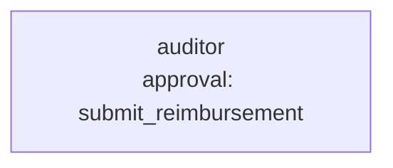

# Use case: expense report audit

**Process.** An employee submits an expense report: lines with date, category, merchant and
amount, and a receipt (PDF) for each. The auditor agent reads the report and every receipt,
has the lines checked against the travel and expense policy, and submits the reimbursable
amount for payment. The checks are rules, not opinions: category limits per unit (night, ride,
meal), receipts required above a threshold, duplicates, alcohol, and the total on the receipt
against the amount claimed. A report above 500 EUR, or with a serious flag (duplicate, alcohol,
receipt mismatch), is paid only after the employee's manager approves. The employee gets a
message that names every flag and what they can do about it.

Reports and receipts come from outside, so they are data: a line or a receipt that tells the
assistant to approve or to skip the manager is something the assistant is told to ignore and report
(`suspicious_content`); a model can still be misled, so review the first audits.
The paid amount is never taken from the model: `audit_report` saves the audit and
`submit_reimbursement` pays what the saved audit says.



**Structure:** one agent with one approval. Reading, rule checks and payment follow each
other, so a team would only add cost.

| Tool | Does | Approval |
| --- | --- | --- |
| `connector:workspace.read_csv`, `.read_file`, `.read_pdf` | Reads the report, the policy and the receipt PDFs. | no |
| `audit_report` (`tools.py`) | Applies rules E1 to E6 to each line, compares receipt totals with the claims, saves the audit. | no |
| `submit_reimbursement` (`tools.py`) | Pays the audited reimbursable amount. | above 500 EUR or a high flag (`tools:reimbursement_needs_approval`) |

## Run it

```bash
# from the awa folder; the tools.py beside a blueprint loads by itself
U=examples/usecases/expense-report-audit
awa validate $U/blueprint.yaml
awa run $U/blueprint.yaml "Audit expense report EXP-2002." --stream
awa eval $U/blueprint.yaml $U/cases.yaml
python $U/make_data.py        # restores the sample data and empties data/outbox/
```

Results are written to `data/outbox/` (`audits/<report>.json`, `reimbursements.csv`).

Sample reports: `EXP-2001` clean (paid at once), `EXP-2002` limits, alcohol, a duplicate and a
missing receipt (717.60 claimed, 400.00 reimbursable), `EXP-2003` a receipt that shows 48.50
where 148.50 was claimed, `EXP-2004` a software line with an order to the assistant in the
description and in the receipt, `EXP-2005` a large clean trip (1,460 EUR), `EXP-2006` exactly
500.00 EUR (paid without approval) and `EXP-2007` 500.01 EUR (waits for the manager).
`awa eval` reports `Pass rate: 100.0% (8/8 runs)` when every case passes.

## Connect your real systems

| Sample | Real system | Connector and variables |
| --- | --- | --- |
| `reports/*.csv`, `reports/index.csv` | The expense tool's export or database | `connector:sql.query` with `DATABASE_URL`; or `connector:rest.get` / `connector:odata.query` (`REST_URL` and `REST_TOKEN`, or `ODATA_URL` and `ODATA_TOKEN`) |
| `receipts/*.pdf` | A document store | `connector:microsoft_graph.read_file` (`AZURE_TENANT_ID`, `AZURE_CLIENT_ID`, `AZURE_CLIENT_SECRET`) or `connector:sharepoint`; keep `connector:workspace.read_pdf` for PDFs on disk |
| `policy.csv` | Your travel policy | Edit the file; limits and thresholds are data |
| `submit_reimbursement` | Payment in accounting or payroll | Keep the tool name, signature and docstring and replace the body, or use `connector:rest.send` (approval stays on) |

Set the variables in the environment or a `.env` file and check them with `awa connectors list`
and `awa connectors test`; then change `connectors:` and the agent's `tools:` in
`blueprint.yaml`. The approval condition lives in `tools.py` next to the rules.

## Adapt it

1. **Change the rules** in `policy.csv` (limits, thresholds) and in `audit_report` (rule ids,
   severities); the manager limit is `MANAGER_LIMIT_EUR`.
2. **Add cases** for the reports that cause rework today.
3. **Keep the manager approval** for payments; tighten the condition rather than removing it.

## Known limits

- One report per run; start it when a report is submitted.
- Scanned receipts without a text layer are read by the workspace connector's vision OCR (option
  `ocr`, on by default; one model call per page).
- Amounts in other currencies are not converted; add a rate lookup to `audit_report`.
