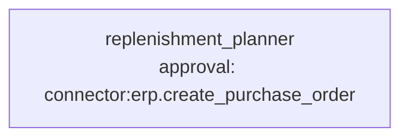

# Use case: inventory replenishment

**Process.** Every Monday the planner checks the warehouse: current stock (on hand and on
order) comes from the ERP over REST, the items and the last weeks of sales from the database.
`calculate_reorders` applies the rule: an item needs an order when on hand plus on order is at or
below its reorder point (average weekly sales times lead time plus one safety week); the
quantity restores four weeks of cover and is rounded up to the supplier's minimum order
quantity. The planner creates one purchase order in the ERP per proposal. **Orders worth more
than 5,000 EUR wait for a purchasing manager; smaller ones go out directly.** Negative stock
counts and unknown SKUs are reported as issues and never ordered.

The ERP can also call a webhook when a single SKU falls below its minimum; the planner then
checks and replenishes that SKU only.



**Structure:** one agent. Read stock, read demand, calculate, order are sequential steps and the
only decisions (what to order and how much) are code, so a team would only add cost. The
approval is conditional: `when: "quantity * unit_price > 5000"` on the ERP's purchase order
operation.

| Tool | Does | Approval |
| --- | --- | --- |
| `connector:erp.list_stock` | `GET /stock`: on hand and on order per SKU (generic `rest` connector). | no |
| `connector:inventory.query` | Read-only SQL: items, suppliers, weekly sales. | no |
| `calculate_reorders` (`tools.py`) | The reorder rule; returns proposals, sufficient SKUs and issues. | no |
| `connector:erp.create_purchase_order` | `POST /purchase-orders` for one SKU with one supplier. | above 5,000 EUR |

## Run it

The sample ERP is a small local server, so everything runs without a real system:

```bash
# from the awa folder; the tools.py beside a blueprint loads by itself
U=examples/usecases/inventory-replenishment
python $U/mock_erp.py &                   # GET /stock, POST /purchase-orders on 127.0.0.1:8099
export ERP_URL=http://127.0.0.1:8099 ERP_KEY=demo-key
awa validate $U/blueprint.yaml
awa run $U/blueprint.yaml "Run the weekly replenishment check for 2026-10-05, all SKUs." --stream
awa eval $U/blueprint.yaml $U/cases.yaml
python $U/make_data.py        # restores inventory.db and the ERP's stock list in data/
```

The sample asks for three orders: `MOT-AC-750` (30 units, 9,300 EUR, approval), `BRG-6204`
(800 units, 3,360 EUR) and `GSK-KIT-A` (60 units, 1,674 EUR); `HYD-HOSE-12` (negative count) and
`XTR-77` (unknown) are reported as issues, `FLT-OIL-3` has enough stock. The sample ERP
appends its purchase orders to `out/erp_purchase_orders.jsonl`. The blueprint's `erp` connector
allows plain `http` and a local address for it (`allow_http`, `allow_private_networks`): remove
both for a real ERP.

## How to run it automatically

```bash
cd examples/usecases/inventory-replenishment
export ERP_URL=... ERP_KEY=... ERP_HOOK_TOKEN=<shared secret>
awa serve blueprint.yaml        # or: awa worker blueprint.yaml
```

Two triggers fire:

- `weekly`, a schedule (`30 6 * * MON`, Europe/Berlin, missed ticks caught up once), starts the
  full check for all SKUs.
- `low-stock`, a webhook, starts the check for one SKU. The ERP posts
  `{"sku": "MOT-AC-750"}` to `/v1/automations/inventory-replenishment/webhooks/low-stock` with
  the header `X-Awa-Token: <ERP_HOOK_TOKEN>`; a wrong token gets 401, and the same SKU on the
  same day starts no second run.

Fire either trigger once without a server (approvals are asked in the terminal):
`awa trigger run blueprint.yaml low-stock --payload '{"sku": "MOT-AC-750"}'`.

In Windows PowerShell 5.1 the double quotes inside `'{...}'` are lost: save the JSON in a file and pass it as `--payload "@event.json"` (with the double quotes).

Small orders are placed immediately. A run with an order above the limit stops at that call with
the status `waiting` (the small orders of the same run are already placed and are not placed
twice):

```bash
awa runs list --status waiting
awa runs show RUN_ID                     # supplier, SKU, quantity, price and the reason
awa runs decide RUN_ID --approve --actor "purchasing manager"
awa runs decide RUN_ID --reject --note "Budget freeze this month."
```

Keep `awa serve` or `awa worker` running in the same folder so the approved run continues, also
after a restart.

## Connect your real systems

| Sample | Real system | Connector and variables |
| --- | --- | --- |
| `mock_erp.py` | Your ERP's REST API | The `erp` connector (`use: rest`): `ERP_URL` (base address) and `ERP_KEY`; adapt `path`, `items` (where the list sits in the answer) and the body parameters of the two operations to the API, or use `use: openapi` with the ERP's description (`spec:`), or `use: odata` for SAP and Dynamics (`ODATA_URL`, `ODATA_TOKEN`). Remove `allow_http` and `allow_private_networks` |
| `data/inventory.db` | The item and sales database | `inventory: {use: sql, env: {DATABASE_URL: INVENTORY_DATABASE_URL}}`: `INVENTORY_DATABASE_URL`; adapt the query in the planner's instructions to your tables |
| The webhook | The ERP's low-stock alert | `ERP_HOOK_TOKEN`; or a signed webhook (`scheme: body` or `timestamped`) if the ERP can sign |

Check the settings with `awa connectors list`, `awa connectors show erp --blueprint blueprint.yaml`
and `awa connectors test erp --blueprint blueprint.yaml`. Keep the approval condition: lower the
5,000 EUR in `approvals:` rather than removing it. Test both sides of the threshold (see
`cases.yaml`).

## Known limits

- One supplier per SKU; split orders or price breaks are not modeled.
- Demand is the plain average of the last four weeks: seasonality and promotions belong in the
  query that feeds `calculate_reorders`.
- Prices are in EUR; other currencies need a currency column and a converted value in the
  approval condition.
