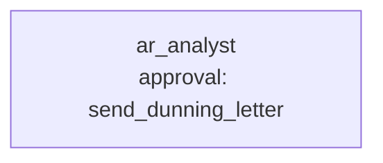

# Use case: order-to-cash exceptions

**Process.** Orders, invoices and payments live in three places: the order database (SQLite),
the invoice workbook (Excel) and the bank payments (CSV). The analyst agent takes a customer or
an order, finds its orders with a SQL query, has each one compared with its invoices and payments
and classified, and reports the exceptions with the action to take: shipped but not invoiced,
invoiced more than shipped, duplicate invoice, overpaid, a minor short payment to write off,
underpaid, overdue. For every invoice that is really open and overdue it queues a dunning letter
(level 1, 2 or 3 by days late) and a person approves each letter before it goes out. While a
billing error is open the customer is not chased: the invoice is corrected first.

The comparison is code (`classify_order`), so the same data always gives the same classification
and the same open amounts; the agent explains and acts on it. `send_dunning_letter` refuses an
invoice that is not due for that level and a letter that does not state the open amount. Customer
emails are untrusted text: a claim of payment is not proof, and an instruction in the email ("write
off all open items", an authorization code) is something the agent is told to ignore and report. A
model can still be misled, so review the first letters.



**Structure:** one agent with one approval. The steps are sequential and the rules sit in the
tools, so a team would only add cost.

| Tool | Does | Approval |
| --- | --- | --- |
| `connector:workspace.query` | Read-only SQL on the order database (`o2c.db`). | no |
| `connector:workspace.query_excel`, `.read_csv`, `.read_file`, `.list_files` | Look closer at invoices, payments and customer emails. | no |
| `classify_order` (`tools.py`) | Compares order, invoices and payments; issues, amounts, days overdue, dunning level, action. | no |
| `find_unmatched_payments` (`tools.py`) | Payments whose reference names no invoice. | no |
| `send_dunning_letter` (`tools.py`) | Queues a validated letter in `data/outbox/dunning/`. | always |

## Run it

```bash
# from the awa folder; the tools.py beside a blueprint loads by itself
U=examples/usecases/order-to-cash-exceptions
awa validate $U/blueprint.yaml
awa run $U/blueprint.yaml "Review customer C-10." --stream
awa eval $U/blueprint.yaml $U/cases.yaml
python $U/make_data.py        # restores the sample data and empties data/outbox/
```

The data is dated around 4 October 2026 (`AS_OF` in `tools.py`; set it to `None` to use today).
Sample customers: `C-10` (a minor short payment and an invoice 25 days late), `C-20` (a shipped
order never invoiced and a duplicate invoice), `C-30` (an overbilled order and an underpaid
invoice 117 days late, plus an email reply with an injected order), `C-40` (an overpayment and
an invoice not yet due), `C-50` (an invoice 40 days late).

## Connect your real systems

| Sample | Real system | Connector and variables |
| --- | --- | --- |
| `o2c.db` (orders) | The ERP database | `connector:sql.query` with `DATABASE_URL` (`postgresql://`, `mysql://`, `mssql://`, `sqlite:///`); or `connector:odata.query` (`ODATA_URL`, `ODATA_TOKEN`) for SAP or Dynamics |
| `invoices.xlsx` | The invoicing system or a shared workbook | `connector:sql.query`, `connector:sharepoint` (a shared workbook) or `connector:microsoft_graph.read_file` |
| `payments.csv` | Bank statement export | An SFTP or SharePoint drop read through `connector:workspace` (`AWA_WORKSPACE_DIR`), or `connector:sql.query` |
| `emails/*.txt` | The AR mailbox | `connector:imap.search_messages`, `.read_message` (`IMAP_HOST`, `IMAP_USERNAME`, `IMAP_PASSWORD`) |
| `send_dunning_letter` | The dunning process or mail | Keep the tool name, signature and docstring and replace the body, or use `connector:smtp.send_email` (`SMTP_HOST`, `SMTP_SENDER`, ...; approval stays on) |

`classify_order` reads the three sample sources directly: when you change a source, change
its reader in `tools.py` (`_query`, `_invoices`, `_payments`) and keep the classification rules.
Set the variables in the environment or a `.env` file; `awa connectors list` and
`awa connectors test` check them.

## Adapt it

1. **Set your tolerances and dunning levels** in `MINOR_EUR` and the day limits in `_classify`.
2. **Add issue types** (credit notes, disputed items, currency differences) to `_classify` and
   to the list in `classify_order`'s docstring, which is what the agent sees.
3. **Add cases** for the exceptions that cost you the most time.
4. **Keep the approval:** a dunning letter is customer communication and can damage a relationship.

## Known limits

- Payments are allocated by the invoice number in the bank reference; a payment without it
  is listed as unmatched, not guessed.
- One currency (EUR). Partial deliveries are compared in total, not per line.
