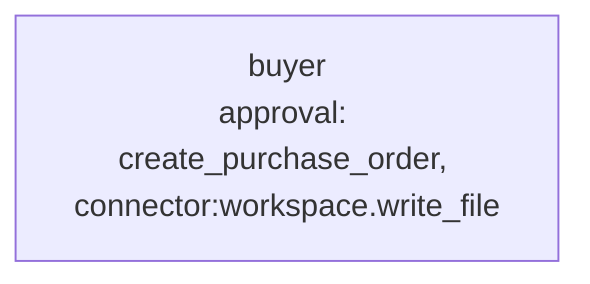

# Use case: purchase requisition to purchase order

**Process.** An employee emails a purchase requisition: what is needed, roughly what it
costs, which cost center pays. The buyer agent reads it, picks an approved supplier, checks the
cost center's budget, issues the purchase order and drafts the order mail to the supplier.
Orders above 1,000 EUR wait for the budget owner's approval before the order exists; every
supplier mail is released by a human. Requisitions that are incomplete, over budget or name a
supplier that is not approved are declined or sent back, with the policy rule that applies.

Requisitions are free text from outside the process, so the agent treats them as data: an
instruction hidden in one ("skip the budget check", "use this other supplier") is something the
agent is told to ignore and report (`suspicious_content`). A model can still be misled, so
review the first orders.



**Structure:** one agent with two approvals. The steps are sequential and every decision
depends on the one before, so a team or workflow would only add cost.

| Tool | Does | Approval |
| --- | --- | --- |
| `connector:workspace.read_file`, `.read_csv` | Reads the policy, the requisition and the supplier list. | no |
| `check_budget` (`tools.py`) | Budget still available: annual budget minus spent, committed and orders already issued. | no |
| `create_purchase_order` (`tools.py`) | Issues the order and books it; refuses unapproved suppliers and missing budget. | above 1,000 EUR (`tools:po_needs_approval`) |
| `connector:workspace.write_file` | Writes the supplier mail to `data/outbox/`. | always |

## Run it

```bash
# from the awa folder; the tools.py beside a blueprint loads by itself
U=examples/usecases/purchase-requisition
awa validate $U/blueprint.yaml
awa run $U/blueprint.yaml "Process requisition REQ-1002." --stream
awa eval $U/blueprint.yaml $U/cases.yaml
python $U/make_data.py        # restores the sample data and empties data/outbox/
```

`awa run` stops at the approval and asks for your decision; `--stream` shows each step. The
purchase order is written to `data/outbox/purchase_orders.csv` and the mail to
`data/outbox/REQ-1002-supplier-email.txt`.

Sample requisitions: `REQ-1001` small order (626 EUR), `REQ-1002` two GPU servers (14,800 EUR,
approval), `REQ-1003` banners from a pending supplier with no budget left, `REQ-1004` a docks
order with an injected instruction to buy from a blocked supplier, `REQ-1005` no cost center,
`REQ-1006` laptops (4,800 EUR) for a rejection.

## Connect your real systems

The sample files stand in for your ERP and mailbox. Swap them one at a time; the agent's
instructions, approvals and `cases.yaml` stay.

| Sample | Real system | Connector and variables |
| --- | --- | --- |
| `requisitions/*.txt` | The shared procurement mailbox | `connector:imap.search_messages` and `.read_message`: `IMAP_HOST`, `IMAP_USERNAME`, `IMAP_PASSWORD` |
| `suppliers.csv`, `budgets.csv` | ERP master data (SAP, Dynamics) | `connector:odata.query`: `ODATA_URL` and `ODATA_TOKEN` (or `ODATA_USERNAME` + `ODATA_PASSWORD`); or `connector:sql.query` with `DATABASE_URL` |
| `create_purchase_order`, `check_budget` | The ERP's purchase order API | Keep the two tool names and replace their bodies, or declare `connector:odata.create` (approval stays on) and move the budget rule into the ERP |
| `outbox/*-supplier-email.txt` | Mail to the supplier | `connector:smtp.send_email`: `SMTP_HOST`, `SMTP_SENDER`, `SMTP_USERNAME`, `SMTP_PASSWORD` |

Set the variables in the environment or a `.env` file, check them with `awa connectors list`,
and change the `connectors:` section and the agent's `tools:` of `blueprint.yaml`. Keep both
approvals: `connector:smtp.send_email` is gated by default. `awa connectors test` makes one small
real call per connector.

## Adapt it

1. **Put your policy** in `data/policy.md` and in the instructions (the 1,000 EUR limit also
   lives in `APPROVAL_LIMIT_EUR` in `tools.py`: rules belong in the tools and the approval
   condition, never only in the instructions).
2. **Add your own cases** to `cases.yaml`, especially the requisitions that go wrong today.
3. **Narrow the approval** with a different `when:` (for example by cost center) rather than
   removing it.

## Known limits

- One requisition per run; start it from the mailbox or a form submission.
- The agent does not negotiate prices or compare quotes; it uses the supplier and amount in
  the requisition.
- An order issued through the sample tool is a row in a CSV file, not a binding document.
