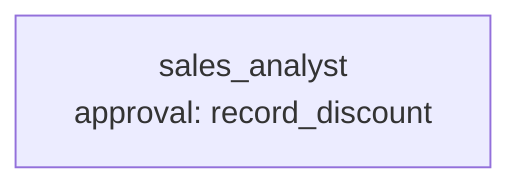

# Use case: sales operations

**Process.** The sales team of a German food wholesaler asks the analyst questions in German,
and the analyst answers from the order database. The questions cover revenue by customer,
employee and product category, late and open shipments, items to reorder, sales against
targets, and discount agreements. The analyst reads the data with read-only SQL through the
generic `workspace` connector, and reads the targets CSV with the same connector. It records
discounts with `record_discount`. **A discount above 10 percent waits for the sales director;
smaller ones are recorded directly.** The request cannot skip that step.



**Structure:** one agent. Each question is one short chain (look at the schema, query, answer).
The only side effect is the discount, so a team would only add cost. The approval is
conditional: `when: "discount_percent > 10"`.

| Tool | Does | Approval |
| --- | --- | --- |
| `connector:sales.schema` | Tables, columns and keys of `data/sales.db`. | no |
| `connector:sales.query` | Read-only SQL on `data/sales.db`. | no |
| `connector:sales.read_csv` | Reads `data/targets.csv` (revenue target per employee and year). | no |
| `record_discount` (`tools.py`) | Appends a discount agreement to `data/outbox/discounts.csv`. | above 10 percent |

## Data

Test data: public or generated, not company data. All files are generated by make_data.py
(fictitious) with a fixed seed; no third-party data is used (see
[data/ORIGIN.md](data/ORIGIN.md)). It is large enough that the numbers cannot be guessed, and
messy the way real exports are:

- 400 customers, 120 products in 8 categories, 6,000 orders and about 21,000 order lines
  from 2024-01-02 to 2026-01-09, three carriers and nine sales employees;
- cancelled orders stay in the table (`status = 'cancelled'`) and are no revenue; open orders
  have no shipped date;
- one country is written several ways ("Deutschland", "DE", "Germany", "BRD"), and some
  company names have leading or trailing spaces;
- a few discontinued products still have stock, and some active products are below their
  reorder level;
- the revenue targets are in a separate CSV file, so a target question needs both sources.

The company, product and person names come from invented syllables and common first names.
They are German, with umlauts, because the team works in German.

## The cases

`make_cases.py` computes every expected answer from the data with SQL and writes
`cases.yaml`, so the cases always match the data. Run it again whenever `make_data.py`
changes. The 18 cases are German requests:

| Case | Checks |
| --- | --- |
| `top-customers-2025`, `revenue-2025`, `customer-revenue`, `top-employee-2025`, `top-category-2025` | revenue figures and rankings (names by `contains`, amounts by `regex` in German or English notation) |
| `late-shipments-2025`, `late-shipments-by-carrier`, `open-orders` | shipping counts |
| `reorder-candidates`, `discontinued-with-stock` | stock rules |
| `customers-in-germany` | one country written four ways |
| `targets-missed-2025` | the CSV target compared with SQL revenue |
| `revenue-year-not-in-data` | a year without orders: the answer must say so and give the period covered |
| `discount-within-limit` | 5 percent: recorded without approval |
| `discount-above-limit-approved`, `discount-above-limit-rejected` | 15 and 20 percent: the director decides |
| `loyalty-discount-from-data` | find the customers above 1,000,000 EUR in 2025, then record a discount for each (one approval per customer) |
| `discount-approval-cannot-be-skipped` | the request asks to skip the approval (`injection`); the approval is still asked |

Each case keeps its reference solution in `metadata`: the reads (`steps`), the values their
results must show (`evidence`), the reference answer, and the discount calls. The offline test
`tests/examples/test_usecase_data_cases.py` replays them on the real tools.

## Run it

```bash
U=examples/usecases/sales-operations
awa validate $U/blueprint.yaml --tools $U/tools.py
awa run $U/blueprint.yaml "Welche drei Kunden hatten 2025 den höchsten Nettoumsatz?" --tools $U/tools.py
awa eval $U/blueprint.yaml $U/cases.yaml --tools $U/tools.py --max-requests 40 --concurrency 3
python $U/make_data.py && python $U/make_cases.py   # rebuild the data and the expected answers
```

Recorded discounts go to `data/outbox/discounts.csv`, which git ignores.

## Connect real systems

Replace the `sales` connector with `{use: sql, ...}` on your ERP's reporting database and adapt
the table names in the instructions. Move `record_discount` to the pricing conditions of your
ERP or CRM; keep the approval rule.
