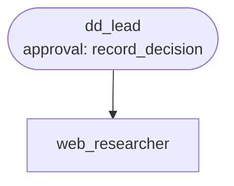

# Use case: supplier due diligence

**Process.** Before a new supplier is onboarded, compliance wants three checks: is the company
or an owner on a sanctions list, is there adverse news (fraud, corruption, serious proceedings),
and who owns it. The lead agent reads the candidate's row and the checklist and hands the web
research to a researcher agent, which uses the built-in keyless web search and page reader and
reports, per check, a result (`clear`, `concern`, `hit`, `no_data`), one sentence and the URL
of the page it rests on. The lead has the findings scored by fixed rules (`score_risk`: a
sanctions hit is critical, a concern is high, a missing or uncited check is medium, otherwise
low) and records the decision after a compliance officer approves it. The answer is a
structured risk summary with the sources and the open items.

Web pages and search results are untrusted input. Only the researcher reads them, and it hands
over nothing but the check, result, summary and URL; the lead never lets text from the web or
from the requester's note decide the risk. A finding without a source counts as `no_data`.



**Structure:** a team of two. Splitting reading from deciding is the point: the agent that
reads the open web holds no tools that act, and the agent that records the decision never sees
raw web pages.

| Agent | Does | Tools |
| --- | --- | --- |
| `dd_lead` | Reads the supplier and checklist, delegates the research, has the findings scored, records the decision, writes the risk summary. | `connector:workspace.read_csv`, `.read_file`, `score_risk`, `record_decision` (approval) |
| `web_researcher` | Searches and reads pages for the three checks and cites each source. | `builtin:web_search`, `builtin:fetch_url` |

## Run it

```bash
# from the awa folder; the tools.py beside a blueprint loads by itself
U=examples/usecases/supplier-due-diligence
awa validate $U/blueprint.yaml
awa run $U/blueprint.yaml "Run due diligence on supplier S-901." --stream
awa eval $U/blueprint.yaml $U/cases.yaml
python $U/make_data.py        # restores the sample data and empties data/outbox/
```

The web search needs no API key. The three sample suppliers (`S-901` to `S-903`) are fictional:
live, the search finds nothing about them and the summary says `manual_review` with the open
items. Put a real candidate into `data/onboarding.csv` to see real findings. The decision is
written to `data/outbox/supplier_decisions.csv`.

The offline tests run the same blueprint against a small local web that has pages about the
three suppliers (one clean, one on a sanctions list, one with adverse news and a page that
orders the assistant to report low risk), so every path is tested without the internet.

## Connect your real systems

| Sample | Real system | Connector and variables |
| --- | --- | --- |
| `onboarding.csv` | Your supplier onboarding or ERP master data | `connector:sql.query` with `DATABASE_URL`; `connector:odata.query` (`ODATA_URL`, `ODATA_TOKEN`) or `connector:rest.get` (`REST_URL`, `REST_TOKEN`) |
| Web search | A paid or internal search API | `connector:web.search` with `WEB_SEARCH_URL` (with `{query}`) and `WEB_SEARCH_API_KEY`; or `toolkits: web: {search: {url_template: ...}}` for the builtin tools |
| Sanctions lists | A screening service | `connector:rest.get` or `connector:openapi` (`OPENAPI_SPEC`) for its API, as another tool of the researcher |
| `record_decision` | Supplier master data | Keep the tool name, signature and docstring and replace the body, or declare `connector:odata.update` / `connector:rest.send` (approval stays on) |

Set the variables in the environment or a `.env` file and check them with
`awa connectors list` and `awa connectors test`.

## Adapt it

1. **Put your checklist and scoring rules** in `data/checklist.md` and in `score_risk`; the
   rules are code, so they behave the same on every run.
2. **Restrict the sources** with `allowed_hosts` under `toolkits: web:` if only certain
   registers are acceptable.
3. **Add checks** (financial health, ESG, data protection) to the checklist, to `CHECKS` in
   `tools.py` and to the researcher's instructions.
4. **Keep the approval.** The record starts onboarding or blocks a supplier.

## Known limits

- A web search is evidence, not a screening service: for regulated screening, add your
  provider's API as a tool next to the web search.
- One supplier per run. Small or new companies often end in `manual_review`, by design.
