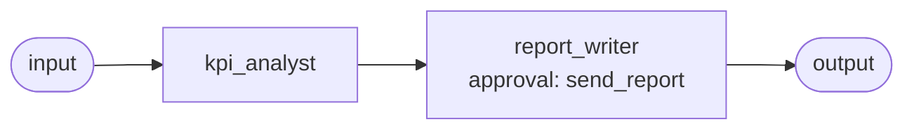

# Use case: weekly management report

**Process.** Every Monday morning a schedule starts a two-step workflow. The analyst finds the
reporting week (the last complete Monday-to-Sunday week), queries revenue, number of orders,
gross margin and new customers for it and for the week before, compares them with the budget,
and explains every flagged variance from the data: breakdowns by region and product with their
amounts, and "the data does not explain it" when it does not. It also reports data problems it
notices (here: orders without a region). The writer turns that into a short mail for
management with a headline, a KPI table and one paragraph per variance. **The mail is sent only
after a person approves it.**

In the sample week the total revenue is flat while South collapsed (supplier outage for the
pump) and East jumped (one large key-account order): a flat total that hides big shifts is
exactly what the report must explain.



**Structure:** a workflow of two steps. Analyzing and writing are strictly sequential and
need different tools: the analyst reads the database and does arithmetic, the writer may only
send mail, so it has no query tool of its own. It receives the figures as text, so a person
should still check them before approval.

| Agent | Does | Tools |
| --- | --- | --- |
| `kpi_analyst` | Reporting weeks, SQL for the KPIs, variance table, drivers, data issues. | `reporting_weeks`, `connector:finance.query`, `variance_table` |
| `report_writer` | Writes the management mail from the analysis and sends it after approval. | `send_report` (approval) |

`variance_table` (in `tools.py`) computes the percentages against the prior week and the budget
and flags a KPI `alert` from 10 % off either reference and `watch` from 5 %; the thresholds are
`ALERT_PCT` and `WATCH_PCT`. `reporting_weeks` removes date arithmetic from the model.

## Run it

```bash
# from the awa folder; the tools.py beside a blueprint loads by itself
U=examples/usecases/weekly-management-report
awa validate $U/blueprint.yaml
awa trigger run $U/blueprint.yaml weekly --payload '{"date": "2026-10-05"}'
awa eval $U/blueprint.yaml $U/cases.yaml
python $U/make_data.py             # the sample data (eight weeks ending with 2026-09-28)
python $U/make_data.py --current   # eight weeks ending with the week before today
```

In Windows PowerShell 5.1 the double quotes inside `'{...}'` are lost: save the JSON in a file and pass it as `--payload "@event.json"` (with the double quotes).

`data/sales.db` holds `orders`, `customers` and `budget`; `data/report_config.json` the
recipients. The sent mail is written to `out/outbox.jsonl`. The sample data ends in September
2026, so a run on another date finds an empty week and sends nothing: use `--current` or the
payload date above.

## How to run it automatically

```bash
cd examples/usecases/weekly-management-report
awa serve blueprint.yaml        # or: awa worker blueprint.yaml
```

The trigger `weekly` is a schedule (`0 7 * * MON`, Europe/Berlin). A Monday missed because the
worker was down is caught up once (`catch_up: latest`); the `dedup` key `weekly-report-<date>`
prevents a second report for the same Monday. The input carries the run date, which is all the
analyst needs.

The run stops at `send_report` with the status `waiting`, so the controller can read the mail
before it goes out:

```bash
awa runs list --status waiting
awa runs show RUN_ID                    # the analysis and the drafted mail
awa runs decide RUN_ID --approve --actor "controller"
awa runs decide RUN_ID --reject --note "Wait for the corrected South figures."
```

Keep `awa serve` or `awa worker` running in the same folder so the approved run continues, also
after a restart. `sla: approval_within: 1d` escalates a report nobody has answered.

## Connect your real systems

| Sample | Real system | Connector and variables |
| --- | --- | --- |
| `data/sales.db` | Your sales or finance database | `finance: {use: sql, env: {DATABASE_URL: FINANCE_DATABASE_URL}}`: `FINANCE_DATABASE_URL` (`postgresql://`, `mysql://`, `mssql://`); read-only rights are enough. Keep the tool name `connector:finance.query`, adapt the table description in the analyst's instructions |
| `send_report` writing `out/outbox.jsonl` | Your mail server | `connector:smtp.send_email`: `SMTP_HOST`, `SMTP_SENDER`, `SMTP_USERNAME`, `SMTP_PASSWORD` |
| `data/report_config.json` | Your distribution list | Keep it in the file, or read it from a wiki page with a `rest` instance on the wiki's API |

To send real mail declare `connectors: {mail: {use: smtp}}`, give the writer
`connector:mail.send_email` instead of `send_report`, and keep an approval on it
(`- tool: connector:mail.send_email`). Check the settings with `awa connectors list` and
`awa connectors test finance`.

## Known limits

- The budget is one value per week and metric in the `budget` table; a different budget logic
  belongs in a view that has the same columns.
- The report covers one week; month-end or quarterly reports need their own blueprint (copy
  this one and change `reporting_weeks`).
- The writer uses only the numbers of the analysis; the quality of the explanations depends on
  what the breakdown queries can show.
